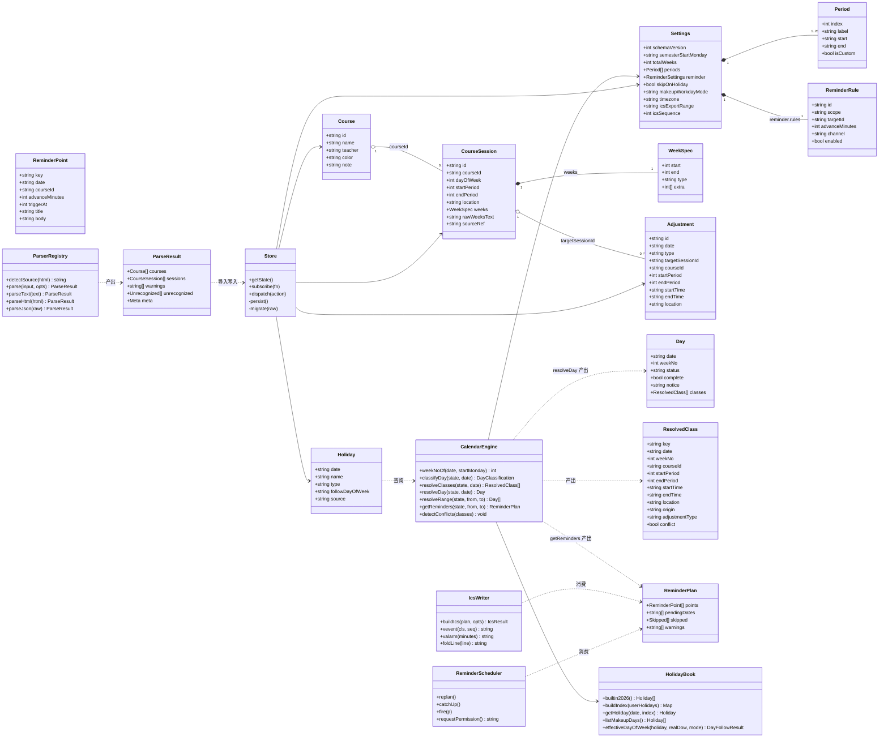
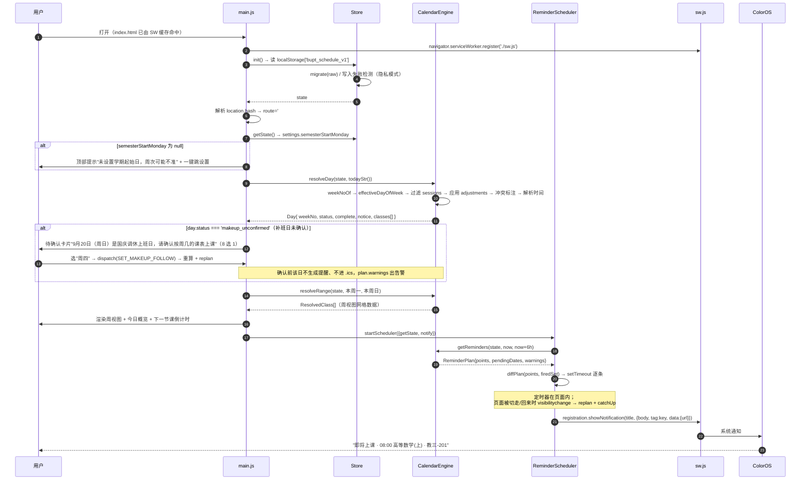
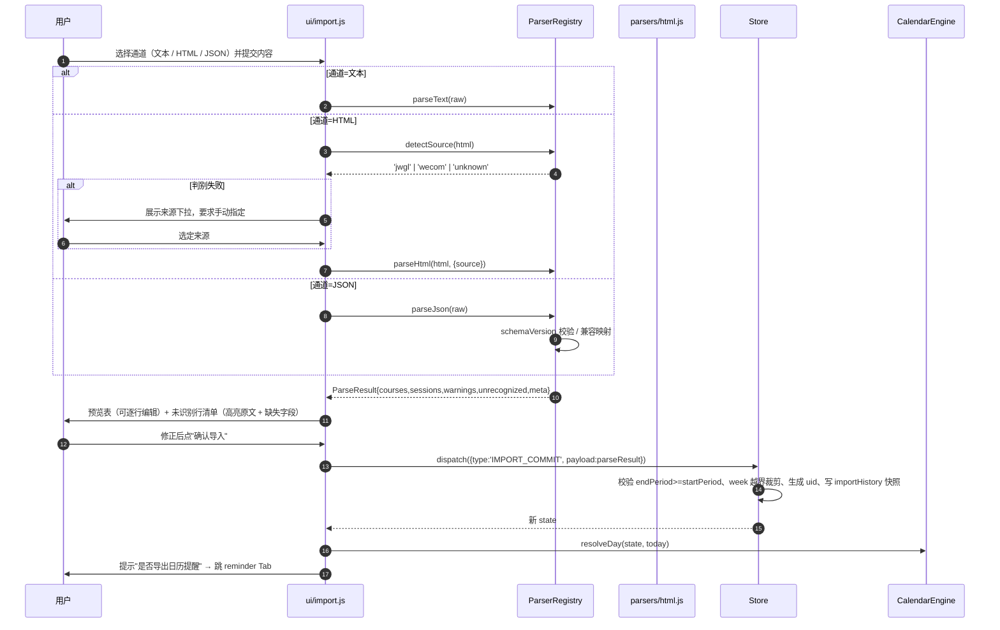
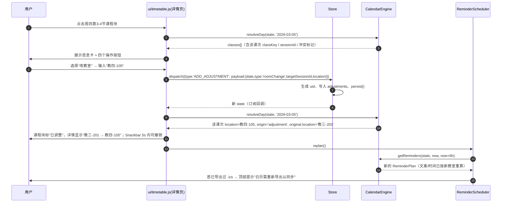

# 北邮课程表 · 系统架构设计（ARCHITECTURE）

> 输入：`docs/PRD.md` v1.0 ｜ 输出：可执行的实现设计（不含视觉稿）
> 技术栈已由交付总监锁定：**零构建原生前端**（HTML5 + CSS + 原生 ES Module JS），无 npm 运行时依赖、无 CDN 外链、无后端、数据全量 localStorage。

---

## 0. 已锁定决策与对 PRD 的三处修正

| # | 决策 | 来源 | 落实方式 |
|---|---|---|---|
| L1 | 零构建原生 ES Module，禁用 Vite/React/MUI/Tailwind | 交付总监 | 原生 `<script type="module">`；图标/字体/CSS 全部本地文件，`index.html` 里 **0 个外链** |
| L2 | 无后端，localStorage 单键持久化 | 交付总监 | 根键 `bupt_schedule_v1`，全量读写 |
| L3 | 提醒双通道：应用内定时器 + Notification API，`.ics` 为可靠主通道 | 交付总监 / PRD §附1 | `reminder.js` 出提醒点；`ics.js` 出日历文件；两者共用同一份 `ReminderPlan` |
| L4 | 单一真相函数 `resolveDay()` / `getReminders()` | 交付总监 / PRD §附2 | 全系统仅 `calendar.js` 允许出现日期/周次/节假日判断逻辑 |
| L5 | 纯逻辑模块不依赖 DOM，可 `node --test` 直测 | 交付总监 | `model / holidays / calendar / reminder / ics / parsers/*` 零 DOM 引用 |

### 0.1 对 PRD 的修正（必须落地，否则功能失真）

**修正 1（重要）：`setTimeout` 不能放在 Service Worker 里。**
PRD §6.2 时序图写 `APP->>SW: 下发当日提醒计划` + `SW->>SW: setTimeout`。这与实现事实冲突：**Service Worker 会在约 30 秒空闲后被浏览器终止**，其中的 `setTimeout` 大概率不会执行，`setInterval` 同理。
→ 落地方案：**定时器留在页面**（页面存活期间可靠），到点后调用 `registration.showNotification()` 让通知**以 SW 身份**弹出（这样通知能显示应用图标与名字，且不随页面被切后台而消失）。SW 只负责三件事：缓存壳、`showNotification`、`notificationclick` 回跳。详见 §C.3。

**修正 2：`weeks` 落地为结构化对象 `WeekSpec`，但只允许一个展开点。**
PRD §7.4 用 `weeks: number[]`（显式数组），交付总监锁定为 `{start,end,type,extra}`。采纳对象形态，PRD 担心的"下游到处分支展开"通过**唯一展开函数 `expandWeeks(spec) → number[]`** 解决：除 `calendar.js` 内部外，任何模块**不得**直接读 `weeks.start/type`。
配套硬规则：`1,3,5-9周` 这类不连续周次，**`start/end` 取最长连续包含段，其余离散周次落入 `extra`**（本例 `{start:5,end:9,type:'all',extra:[1,3]}`）。解析器必须按此规则归一，否则离散周次丢失。

**修正 3：必须静态托管（http/https），不能 `file://` 双击打开。**
`<script type="module">` 与 `navigator.serviceWorker.register()` 在 `file://` 协议下被 CORS/安全上下文拦截，模块加载直接报错；"添加到主屏幕"也要求安全上下文。
→ 交付形态定为：**静态文件 + 任意静态托管（GitHub Pages / 内网静态服务器 / `npx serve .`）**。部署属于交付流程的一部分，需在 README 写明。若真机验收场景必须本地打开，降级方案 B 见 §E.5（单文件内联，牺牲可测试性，不推荐）。

**修正 4（数据契约，PM 已确认 + 本文件已核实）：`followDayOfWeek` 是三态，"补班日待确认"绝不允许静默变成"今日无课"。**

事实依据：国务院办公厅《关于 2026 年部分节假日安排的通知》（2025-11-04）**只规定"哪天要上班"，从不规定"这一天补哪一天的课"**（原文对国庆仅写"9月20日（周日）、10月10日（周六）上班"）。哪个补班日对应哪天的课表由**各校教务处单独发文**，各校做法不同（按被冲掉的法定日配对 / 按时间顺序配对 / 干脆不上课）。因此**不存在可由公开数据推导的正确答案**，任何"看起来合理"的配对都是把猜测写进数据契约。

落地规则（含类型变更）。**最终口径（team-lead 拍板 + PM 终版），后续不再变**：

| 项 | 规定 |
|---|---|
| 字段类型 | `Holiday.followDayOfWeek: number(1-7) \| 'none' \| null` |
| 内置值 | **`2026-01-04 → 5`（周五，唯一 1:1 可解），其余 5 天（02-14 / 02-28 / 05-09 / 09-20 / 10-10）为 `null`**；`null` 禁止任何启发式填充 |
| `null` | **未确认** → `resolveDay()` 返回 `status:'makeup_unconfirmed'`、`complete:false`；UI 渲染**确认占位卡**（周一…周日 / 不上课），用户点选后写回 `'none'` 或 `1..7` 并重算。**`null` 无条件优先：与 `makeupWorkdayMode` 完全无关**（`skip` 只作用于已指定 `1..7` 的补班日，绝不掩掉"未知"） |
| `'none'` | 用户**显式确认**当日无课 → `status:'makeup_skipped'`、`complete:true`，**允许**渲染"今日无课"、不生成提醒、不进 .ics |
| `1..7` + `mode:'followWeekday'` | 按周 X 课表上课 → `status:'makeup_follow'` |
| `1..7` + `mode:'skip'` | 用户全局选择"补班日一律不排课" → `status:'makeup_skipped'`（不是 `normal`，提示条仍显示"已按设置不排课，如需上课请切换"） |
| 批量出口 | 用户不想被反复打扰时，确认卡提供「**这天确实没课**」+「**全部未确认日都不上课**」一键批量；**底层仍逐日写入 `'none'`**，不设全局静默开关（否则又会把"未知"批量伪装成"已知"） |
| `'none'` 与 `null` | **严禁合并处理**：两者 UI 文案、导出行为、是否产出提醒全都不同 |
| 提醒 / ICS | `makeup_unconfirmed` 日**不生成提醒点、不生成 VEVENT**，并**强制告警**（见 §C.2 `getReminders` 返回的 `pendingDates` / `skipped`、§C.4 `buildIcs` 返回的 `warnings`），**不得假装那天没课** |
| 产品意义 | PRD 已把 US-11 / 原 P1-1 升级为 **P0-17**、新增 **E15**：静默的"今日无课"会直接导致学生缺课，且他不会怀疑是 App 错了——这是本产品体感最强的错误类型，而修复成本只是一次点选 |

**已知残留风险（已向 lead 报备，不再展开）**：若用户从不打开 App，"确认卡"不会被看见。缓解手段是 §E.2 要求该卡片**占位在主区域**（不可折叠成小字）+ 提醒 Tab / 导出前双重告警；彻底消除需要推送能力，本产品无后端，做不到。

> 本条经交叉核实：33 个放假日与 6 个补班日的**星期分布已用 `dayOfWeekOf` 纯算术逐条复算**，与通知原文标注完全一致（元旦 01-01 周四…01-03 周六、春节 02-15 周日至 02-23 周一共 9 天、清明 04-04 至 04-06、劳动 05-01 至 05-05、端午 06-19 至 06-21、中秋 09-25 至 09-27、国庆 10-01 至 10-07；补班 01-04 周日 / 02-14 周六 / 02-28 周六 / 05-09 周六 / 09-20 周日 / 10-10 周六）。
>
> `01-04 → 5` 的**推定依据**（非通知内容，故在数据里标 `inferred:true` 供 UI 提示"推定值，请核对"）：元旦假期中 01-01 是法定假日本身（不产生"被借用的工作日"），真正被借用的只有 `01-02`（周五）一天，而补班日也只有 `01-04` 一天 → 1:1 唯一解，故补周五课。反观春节（借用 02-16/02-20/02-23 三天 vs 补班 2 天）、劳动节、国庆（均借用 > 补班数），映射不唯一，必须留 `null`。

---

## 1. 实现方案

### 1.1 核心技术难点

| 难点 | 本质 | 对策 |
|---|---|---|
| D1 四类判定叠加（Holiday / 调休 / 周次 / Adjustment） | 顺序错了必然出现"提醒了没课"或"有课没提醒"；更坏的是把"不知道"输出成"没课" | 单一纯函数 `resolveDay()`，判定顺序硬编码在同一条流水线里，UI 不得二次判断 |
| D2 双源页面结构不可知（教务表格 / 企微卡片 / 内联 JSON） | 解析器面临的选择器不确定性 | 特征串嗅探 + 多策略顺序降级 + 文本行正则兜底 + 解析失败进 `unrecognized` 不静默丢 |
| D3 Android 后台定时不可靠 | 浏览器能力边界，不是 bug | `.ics + VALARM` 主通道；页面内 6h 滚动窗口 + `visibilitychange` 重排 + catch-up；产品文案诚实标注局限 |
| D4 `.ics` 时区与 UID 稳定性 | 裸 UTC 偏移 8 小时；UID 漂移导致日历堆重复 | `TZID=Asia/Shanghai` + `VTIMEZONE` 块 + 墙钟字面量；UID = `courseId-date-P{start}-{end}@bupt_schedule` |
| D5 纯逻辑可测 | 无构建、无测试框架 | 逻辑层零 DOM，`node --test` 直接 `import`；DOM 访问全部压在 `src/ui/*` |
| D6 节次↔时间↔日期三套坐标 | 课表用"星期+节次"，提醒用"日期+时刻" | 以**节次**为内部权威单位（PRD Q2），时间只在出提醒/出 ICS 时由 `Period` 解析 |

### 1.2 框架与库选择

| 能力 | 选择 | 理由 |
|---|---|---|
| 视图 | 原生 DOM + 模板字符串 + `innerHTML` 局部替换 | 4 Tab + 1 二级页，规模不需要框架；避免框架运行时体积与构建 |
| 状态 | 手写 `store.js`（发布订阅 + 全量持久化） | 单用户单文档，状态量 <100KB |
| 路由 | `location.hash`（`#/timetable` `#/import` `#/reminder` `#/settings` `#/detail/:courseId/:date`） | 零依赖、可回退、二级页刷新可恢复 |
| 图标 | 内联 SVG 字符串（`components.js` 中 `ICONS` 常量） | 免外链、免 emoji 字体差异 |
| PWA | `manifest.webmanifest` + 手写 `sw.js`（CacheStorage 预缓存 + 导航请求 fallback） | 离线壳 |
| 提醒 | `Notification` + `registration.showNotification` | 系统级通知 |
| 日历 | 手写 ICS 文本生成器（无库） | 只需生成单一格式，库体积不划算且多数库处理 TZID 反而绕 |
| 测试 | `node --test` + `node:assert/strict` | Node 18+ 内置，零依赖 |

### 1.3 架构分层（严格三层，依赖单向）

```
┌──────────────────────── UI 层（唯一接触 DOM） ────────────────────────┐
│ index.html · main.js(路由) · ui/components.js · ui/timetable.js       │
│ ui/import.js · ui/reminderView.js · ui/settings.js                    │
└───────────────┬───────────────────────────────┬───────────────────────┘
                │ store.getState / store.dispatch │ 只调用纯函数取数据
┌───────────────▼──────────────┐  ┌──────────────▼──────────────────────┐
│ store.js（状态 + 持久化 + 订阅）│  │ 纯逻辑层（**零 DOM**，可 node 测试）   │
│ 只做 CRUD 与序列化             │  │ calendar.js  resolveDay/getReminders │
└───────────────┬──────────────┘  │ holidays.js  isHoliday/effectiveDOW  │
                │                 │ ics.js       buildIcs              │
                └────────────────►│ reminder.js  计划/差异/触发         │
                                  │ parsers/*    解析 → ParseResult     │
                                  │ model.js     常量/校验/时间换算      │
                                  └────────────────────────────────────┘
```

**硬约束（工程纪律，Code Review 检查项）**
1. `src/calendar.js`、`src/holidays.js`、`src/parsers/**`、`src/ics.js`、`src/model.js` 内**不得出现** `document` / `window` / `localStorage` / `navigator`。
2. `src/ui/**` 内**不得出现** `new Date(...)` 做日期运算、不得出现 `weekNo` 计算、不得出现 `%2` 判单双周、不得出现节假日日期字面量。需要日期结论时，只能调 `resolveDay(date)`。
3. `src/store.js` 内不得出现业务判断（除字段校验），不得 import `calendar.js`（避免循环依赖）；UI 取派生数据时自己调 `calendar.js`。

---

## 2. 文件清单（25 个文件：22 交付文件 + 3 测试）

| # | 路径 | 职责（一行） |
|---|---|---|
| 1 | `index.html` | 应用外壳：`<meta viewport>`、底部 4 Tab 导航、`#view` 挂载点、唯一 `<script type="module" src="./src/main.js">`，**禁止任何 CDN 链接** |
| 2 | `package.json` | **零依赖**，仅 `{"type":"module"}`，让 Node 把 `src/*.js` 当 ESM（否则测试 `import` 报 CJS 错误） |
| 3 | `manifest.webmanifest` | PWA 清单：`name/short_name/start_url:"."/display:"standalone"/background_color/theme_color/icons(192+512, any maskable)` |
| 4 | `sw.js` | 缓存壳（`install` 预缓存清单 → `activate` 清旧版 → `fetch` 仅对同源 GET 走 cache-first，导航请求 fallback `index.html`）；`showNotification` 由页面调用；`notificationclick` 聚焦/打开 `data.url` |
| 5 | `assets/css/app.css` | 设计系统：CSS 变量、ColorOS 浅色风格、圆角 16px、≥44px 触控区、课表网格、底部导航、Snackbar、折叠面板、深色安全区适配 |
| 6-7 | `assets/icons/icon-192.png`、`icon-512.png` | 本地 PNG 图标（`purpose:"any maskable"`），供 manifest 与通知 `icon` |
| 8 | `src/model.js` | 纯：`SCHEMA_VERSION`、枚举常量、`uid()`、时间工具（`todayStr`/`wallToEpoch`/`epochToWall`/`addDays`/`dayOfWeekOf`/`diffDays`）、周次工具（`expandWeeks`/`parseWeeksText`/`weeksToText`）、`validateState`、默认 `Period[]` 预设、`emptyState()` |
| 9 | `src/holidays.js` | 纯：`BUILTIN_2026`（**33 个放假日 + 6 个补班日**；`2026-01-04 → followDayOfWeek:5`（`inferred:true`），其余 5 天 `null`；数据源国办 2025-11-04 通知，见 §0.1 修正 4）、可选 `BUILTIN_2027_TENTATIVE`（`tentative:true`）、`buildHolidayIndex()`、`getHoliday(date)`、`listMakeupDays()`、`effectiveDayOfWeek(holiday, realDow, mode) → {dow:number\|null, kind:'follow'\|'skip'\|'unconfirmed'}`（只做三态翻译，**不产出 status**，status 由 `calendar.classifyDay` 组装） |
| 10 | `src/calendar.js` | 纯：**唯一真相层**。`classifyDay`（唯一分类点，出 `status`）→ `resolveClasses`（内部投影，出 `ResolvedClass[]`）→ **`resolveDay(state,date) → Day`**（UI 唯一入口，带 `status/complete/notice/classes`）；另有 `resolveRange`、**`getReminders(...) → ReminderPlan`**（`{points, pendingDates, skipped}`）、`detectConflicts` |
| 11 | `src/reminder.js` | 混合：消费 `getReminders` 的 `plan.points`；`diffPlan`（新计划 vs 已触发集合）、调度器 `startScheduler/stopScheduler/replan`、`requestPermission`、`fireNotification`（调 SW）、`catchUp`。DOM 相关仅 `document.visibilityState` 监听，可用注入隔离。**不做日期判断** |
| 12 | `src/ics.js` | 纯：**`buildIcs(plan, {calendarName, sequence}) → {text, warnings, eventCount}`**，含 `VTIMEZONE`、`VEVENT`、`VALARM`、行折叠（75 octet）、CRLF；`makeup_unconfirmed` 日**不产生 VEVENT**，缺失的日期以 `warnings` 返回（不写进文件正文） |
| 13 | `src/parsers/index.js` | 纯：`parse(input, {source}) → ParseResult` 统一入口；`detectSource(html)` 特征串嗅探；**通用文本行适配器**（3 种正式支持的写法）；`normalize()` 输出归一 |
| 14 | `src/parsers/html.js` | 纯：HTML 适配器。`DOMParser` 不可用（Node）时用**内置轻量正则分词**兜底 → 因此本文件不 import DOM，改用 `parseHtmlLite()`（见 §D.2 说明）；多策略选择器降级链 |
| 15 | `src/parsers/json.js` | 纯：JSON 适配器。`schemaVersion` 校验 + 向后兼容映射 + 自身备份格式复用 |
| 16 | `src/store.js` | 状态容器：`getState/subscribe/dispatch`、全量持久化（debounce 200ms）、`migrate()`、写入失败检测（隐私模式）、`importHistory` 保留最近 3 次快照 |
| 17 | `src/main.js` | 启动：注册 SW、初始化 store、hash 路由表、全局事件委托（`data-action`）、跨零点检测（`setInterval` 60s 比较 `todayStr()`）、首启引导 |
| 18 | `src/ui/components.js` | 通用件：`ICONS`（内联 SVG）、`tabsBar`、`sheet`（底部弹层）、`snackbar`（含 undo 按钮）、`confirmDialog`、`segmented`、`timePicker`、`emptyState`、`escapeHtml` |
| 19 | `src/ui/timetable.js` | 课表 Tab：周/日视图、周次切换器、今日概览 + 下一节课倒计时、假期/补班横幅（文案取自 `resolveDay(...).notice`）、`makeup_unconfirmed` 的**待确认卡片 + 周几选择器**、现在进度线、课程块；**并含二级页 `renderDetail()`**（信息卡 + 四个调整操作 + 调整记录 + 撤销） |
| 20 | `src/ui/import.js` | 导入 Tab：四通道 Segment、文本域/文件选择、来源下拉、解析预览表（可编辑单元格）、未识别行清单、确认/取消、导入历史回滚、示例数据一键填充 |
| 21 | `src/ui/reminderView.js` | 提醒 Tab：权限状态卡 + 申请、全局提前量/通道、课程级覆盖列表、`.ics` 导出（范围选择 + 下载 + **待确认日告警弹窗** + 已导出提示）、ColorOS 指引、今日提醒时间轴、限制说明折叠 |
| 22 | `src/ui/settings.js` | 设置 Tab：学期配置、节次时间表编辑（增删/校验/恢复默认）、节假日管理（内置 33+6 列表 + **6 个补班日的"按周几上课"逐条快速选择** + 增删 + 跳过开关 + 补班模式）、数据备份/恢复/清空、关于 |
| 23 | `tests/calendar.test.mjs` | 单测：周次换算、单双周、离散周次、节假日、补班日、Adjustment 四类型、冲突检测、`getReminders` 提前量/去重/跨天 |
| 24 | `tests/parsers.test.mjs` | 单测：三通道解析、周次文案 6 种写法、未识别行、来源判别、schemaVersion 不兼容 |
| 25 | `tests/ics.test.mjs` | 单测：CRLF、`TZID` 存在且无裸 `DTSTART:...Z`、`VALARM` 数量、UID 复现性、行折叠 |

---

## 3. 数据模型（Part A-3）

### 3.1 持久化根结构

`localStorage['bupt_schedule_v1']` = 一个 JSON 对象：

```jsonc
{
  "schemaVersion": 1,
  "settings":  { /* §3.2 */ },
  "courses":   [ /* Course[] */ ],
  "sessions":  [ /* CourseSession[] */ ],
  "adjustments":[ /* Adjustment[] */ ],
  "holidays":  [ /* Holiday[] · 仅用户添加的存这里，内置的在代码里 */ ],
  "importHistory": [ { "at": "2026-02-23T10:00:00+08:00", "count": 12, "snapshot": { } } ]
}
```

> `holidays` 持久化只存 `source:'manual'`。内置 2026 数据放 `holidays.js` 常量，读取时 `builtin ∪ user`（用户同日期覆盖内置）。这样内置数据升级不需迁移用户数据。

### 3.2 JSON Schema 片段

```jsonc
// ---------- Settings（单例） ----------
{
  "type": "object",
  "required": ["schemaVersion","totalWeeks","periods","reminder","skipOnHoliday","makeupWorkdayMode","timezone"],
  "properties": {
    "schemaVersion":      { "type": "integer", "const": 1 },
    "semesterStartMonday":{ "type": ["string","null"], "format": "date",
                            "pattern": "^\\d{4}-\\d{2}-\\d{2}$", "default": null,
                            "description": "第1周周一；null=未配置（UI 必须提示周次不准）" },
    "totalWeeks":         { "type": "integer", "minimum": 1, "maximum": 30, "default": 20 },
    "hasOddEvenWeek":     { "type": "boolean", "default": false },
    "skipOnHoliday":      { "type": "boolean", "default": true },
    "makeupWorkdayMode":  { "type": "string", "enum": ["followWeekday","skip"], "default": "followWeekday",
                            "description": "只决定『补班日排不排课』，不决定『要不要提示用户』。null 的 followDayOfWeek 在任何 mode 下都返回 makeup_unconfirmed" },
    "timezone":           { "type": "string", "const": "Asia/Shanghai" },
    "icsExportRange":     { "type": "string", "enum": ["all","next4weeks"], "default": "all" },
    "icsSequence":        { "type": "integer", "minimum": 0, "default": 0,
                            "description": "每次导出 +1，写入 VEVENT 的 SEQUENCE" },
    "lastImportAt":       { "type": ["string","null"], "default": null },
    "lastBackupAt":       { "type": ["string","null"], "default": null },
    "reminder":           { "$ref": "#/definitions/ReminderSettings" },
    "periods":            { "type": "array", "minItems": 1, "maxItems": 20,
                            "items": { "$ref": "#/definitions/Period" } }
  }
}

// ---------- Period ----------
{ "type": "object", "required": ["index","label","start","end"],
  "properties": {
    "index":    { "type": "integer", "minimum": 1 },
    "label":    { "type": "string", "default": "第1节" },
    "start":    { "type": "string", "pattern": "^([01]\\d|2[0-3]):[0-5]\\d$" },
    "end":      { "type": "string", "pattern": "^([01]\\d|2[0-3]):[0-5]\\d$" },
    "isCustom": { "type": "boolean", "default": false }
  } }

// ---------- Course ----------
{ "type": "object", "required": ["id","name"],
  "properties": {
    "id":        { "type": "string", "minLength": 1 },
    "name":      { "type": "string", "minLength": 1, "maxLength": 60 },
    "teacher":   { "type": ["string","null"], "default": null },
    "color":     { "type": ["string","null"], "pattern": "^#[0-9a-fA-F]{6}$" },
    "note":      { "type": ["string","null"] },
    "credit":    { "type": ["number","null"] },
    "createdAt": { "type": "string" }, "updatedAt": { "type": "string" }
  } }

// ---------- CourseSession（只读！调课不改它） ----------
{ "type": "object",
  "required": ["id","courseId","dayOfWeek","startPeriod","endPeriod","weeks"],
  "properties": {
    "id":          { "type": "string" },
    "courseId":    { "type": "string" },
    "dayOfWeek":   { "type": "integer", "minimum": 1, "maximum": 7,
                     "description": "1=周一 … 7=周日（**不是** JS getDay() 的 0-6）" },
    "startPeriod": { "type": "integer", "minimum": 1 },
    "endPeriod":   { "type": "integer", "minimum": 1,
                     "description": "必须 >= startPeriod，否则拒绝导入该行" },
    "location":    { "type": "string", "default": "" },
    "weeks":       { "$ref": "#/definitions/WeekSpec" },
    "rawWeeksText":{ "type": ["string","null"], "default": null,
                     "description": "原文，如 '1-16周(单)'，仅用于展示/回溯" },
    "teacher":     { "type": ["string","null"], "default": null },
    "sourceRef":   { "type": ["string","null"], "default": null,
                     "description": "如 'jwgl:row42' / 'wecom:card7' / 'text:line3'" }
  } }

// ---------- WeekSpec ----------
{ "type": "object", "required": ["start","end","type"],
  "properties": {
    "start": { "type": "integer", "minimum": 1 },
    "end":   { "type": "integer", "minimum": 1 },
    "type":  { "type": "string", "enum": ["all","odd","even"], "default": "all" },
    "extra": { "type": "array", "items": { "type": "integer", "minimum": 1 },
               "default": [], "description": "离散周次，升序去重，不含 start..end 区间内已覆盖的" }
  },
  "description": "不连续周次的归一规则：start..end 取最长连续包含段，其余入 extra。例：'1,3,5-9周' → {start:5,end:9,type:'all',extra:[1,3]}" }

// ---------- Adjustment（单日覆盖，优先级最高） ----------
{ "type": "object", "required": ["id","date","type","createdAt"],
  "properties": {
    "id":   { "type": "string" },
    "date": { "type": "string", "pattern": "^\\d{4}-\\d{2}-\\d{2}$" },
    "type": { "type": "string", "enum": ["cancel","reschedule","roomChange","makeup"] },
    "targetSessionId": { "type": ["string","null"] },
    "courseId":        { "type": ["string","null"] },
    "startPeriod":     { "type": ["integer","null"] },
    "endPeriod":       { "type": ["integer","null"] },
    "startTime":       { "type": ["string","null"], "pattern": "^([01]\\d|2[0-3]):[0-5]\\d$",
                         "description": "自定义时间，优先于节次解析" },
    "endTime":         { "type": ["string","null"] },
    "location":        { "type": ["string","null"] },
    "note":            { "type": ["string","null"] },
    "createdAt":       { "type": "string" }
  },
  "allOf": [
    { "if": { "properties": { "type": { "const": "cancel" } } },
      "then": { "anyOf": [ { "required": ["targetSessionId"] }, { "required": ["courseId"] } ] } },
    { "if": { "properties": { "type": { "const": "makeup" } } },
      "then": { "required": ["courseId","startPeriod","endPeriod"] } }
  ],
  "description": "cancel 带 targetSessionId=停该课次；只带 courseId=停该课程当日全部课次。reschedule/roomChange 必须带 targetSessionId。" }

// ---------- ReminderSettings / ReminderRule ----------
{ "ReminderSettings": {
    "type": "object", "required": ["enabled","defaultAdvanceMinutes","channel"],
    "properties": {
      "enabled": { "type": "boolean", "default": true },
      "defaultAdvanceMinutes": { "type": "integer", "minimum": 0, "maximum": 1440, "default": 15 },
      "channel": { "type": "string", "enum": ["notification","ics","both"], "default": "both" },
      "rules": { "type": "array", "items": {
        "type": "object", "required": ["id","scope","targetId","advanceMinutes","enabled"],
        "properties": {
          "id": { "type": "string" },
          "scope": { "type": "string", "const": "course" },
          "targetId": { "type": "string", "description": "Course.id" },
          "advanceMinutes": { "type": "integer", "minimum": 0, "maximum": 1440 },
          "channel": { "type": "string", "enum": ["notification","ics","both"] },
          "enabled": { "type": "boolean", "default": true }
        } } }
    } } }

// ---------- Holiday ----------
{ "type": "object", "required": ["date","name","type","source"],
  "properties": {
    "date": { "type": "string", "pattern": "^\\d{4}-\\d{2}-\\d{2}$" },
    "name": { "type": "string" },
    "type": { "type": "string", "enum": ["holiday","makeupWorkday"] },
    "followDayOfWeek": {
      "oneOf": [ { "type": "integer", "minimum": 1, "maximum": 7 },
                 { "const": "none" },
                 { "const": null } ],
      "default": null,
      "description": "★三态：1-7=按该星期上课；'none'=用户显式确认当日无课；null=未确认（除 01-04 外内置值均为 null，禁止猜测）。仅 makeupWorkday 使用"
    },
    "source": { "type": "string", "enum": ["builtin2026","builtin2027","manual"] },
    "dataRevision": { "type": "string", "default": "gb-2025-11-04",
                      "description": "内置数据版本，用于提示'数据可能已过时'" },
    "inferred": { "type": "boolean", "default": false,
                  "description": "true = followDayOfWeek 为推定值（如 2026-01-04→5），UI 应显示『推定，请核对』并允许一键改" },
    "tentative": { "type": "boolean", "default": false,
                   "description": "true = 该年份安排尚未由国务院发布（如 2027 元旦），仅作预占，UI 显示『待官方确认』" },
    "updatedAt": { "type": ["string","null"], "default": null,
                   "description": "写回 followDayOfWeek 时刷新，用于判定 .ics 是否已过期" },
    "note": { "type": ["string","null"] }
  } }
```

### 3.3 派生模型（运行时，不持久化）

```jsonc
// ResolvedClass
{
  "key": "s:8f2a|2026-03-05|P1-2",   // 唯一键：origin 前缀 + 来源 id + 日期 + 节次
  "date": "2026-03-05",
  "weekNo": 2,
  "courseId": "c1", "courseName": "高等数学(上)", "teacher": "王老师",
  "startPeriod": 1, "endPeriod": 2,
  "startTime": "08:00", "endTime": "09:35",
  "crossMidnight": false,
  "location": "教三-201",
  "origin": "session",                // 'session' | 'adjustment'
  "adjustmentType": null,             // 'cancel'|'reschedule'|'roomChange'|'makeup'|null
  "original": { "location": null, "startTime": null, "endTime": null }, // 调整前值，用于"原值 → 新值"对照
  "sessionId": "s1", "adjustmentId": null,
  "conflict": false, "conflictWith": [],
  "forcedOnHoliday": false
}

// ReminderPoint
{
  "key": "c1|2026-03-05|P1-2|15",     // 去重键：courseId|date|periods|advance
  "date": "2026-03-05",
  "courseId": "c1", "courseName": "高等数学(上)",
  "startPeriod": 1, "endPeriod": 2,
  "classStart": "08:00", "classEnd": "09:35",
  "location": "教三-201",
  "advanceMinutes": 15,
  "triggerAt": 1772412300000,          // epoch ms（按 Asia/Shanghai 墙钟换算得出）
  "channel": "both",
  "title": "即将上课",
  "body": "08:00 高等数学(上) · 教三-201 · 第1-2节",
  "classKey": "s:8f2a|2026-03-05|P1-2"
}

// Day（★ UI 唯一入口 resolveDay(state,date) 的返回值；UI 只允许按 status 分支）
{
  "date": "2026-09-20",
  "weekNo": 30,
  "status": "makeup_unconfirmed",   // 7 值枚举，见 §C.1 状态表
  "complete": false,                // ★ false ⇒ classes 不代表"全部"，更不代表"无课"
  "holidayName": "国庆节调休上班",
  "followDayOfWeek": null,
  "effectiveDayOfWeek": null,       // ★ 未确认态恒为 null（不可用真实星期冒充）；要真实星期请读 realDow/自带展示
  "notice": "9月20日（周日）是国庆调休上班日，请确认按周几的课表上课",
  "classes": []
}

// ReminderPlan（★ getReminders 的返回值 —— 用对象而非裸数组，调用方无法"只看 points"而忽略告警）
{
  "points": [ /* ReminderPoint[]，真正要排程/通知的 */ ],
  "pendingDates": ["2026-09-20", "2026-10-10"],          // ★ 待确认补班日：绝不静默为空
  "skipped": [                                            // 所有"没生成提醒"的原因，可审计
    { "date": "2026-09-20", "reason": "UNCONFIRMED_MAKEUP", "detail": "国庆节调休上班，未确认按周几上课" },
    { "date": "2026-10-01", "reason": "HOLIDAY",            "detail": "国庆节" },
    { "date": "2026-10-05", "reason": "CANCELLED",          "detail": "本次停课（adjustment a3）" }
  ],
  "warnings": ["2 个调休上班日待确认，未生成提醒：2026-09-20、2026-10-10"]
}

// ParseResult
{
  "courses": [{ "id":"c1","name":"高等数学(上)","teacher":"王老师" }],
  "sessions": [{ "id":"s1","courseId":"c1","dayOfWeek":1,"startPeriod":1,"endPeriod":2,
                 "location":"教三-201","weeks":{"start":1,"end":16,"type":"all","extra":[]},
                 "rawWeeksText":"1-16周","sourceRef":"jwgl:row42" }],
  "warnings": ["第 18 周超出总周数 16，已裁剪"],
  "unrecognized": [{ "raw":"周一 体育 待定", "reason":"缺少节次", "index": 3 }],
  "meta": { "source":"jwgl", "detectedBy":"feature:jwgl-meta", "strategy":"table-grid" }
}
```

### 3.4 完整示例（1 门课 + 2 个 session + 1 个 adjustment + settings）

```json
{
  "schemaVersion": 1,
  "settings": {
    "schemaVersion": 1,
    "semesterStartMonday": "2026-02-23",
    "totalWeeks": 20,
    "hasOddEvenWeek": false,
    "skipOnHoliday": true,
    "makeupWorkdayMode": "followWeekday",
    "timezone": "Asia/Shanghai",
    "icsExportRange": "all",
    "icsSequence": 3,
    "lastImportAt": "2026-02-23T10:12:00+08:00",
    "lastBackupAt": null,
    "reminder": {
      "enabled": true,
      "defaultAdvanceMinutes": 15,
      "channel": "both",
      "rules": [
        { "id": "r1", "scope": "course", "targetId": "c1",
          "advanceMinutes": 30, "channel": "both", "enabled": true }
      ]
    },
    "periods": [
      { "index": 1, "label": "第1节", "start": "08:00", "end": "08:45", "isCustom": false },
      { "index": 2, "label": "第2节", "start": "08:50", "end": "09:35", "isCustom": false },
      { "index": 3, "label": "第3节", "start": "09:55", "end": "10:40", "isCustom": false },
      { "index": 4, "label": "第4节", "start": "10:45", "end": "11:30", "isCustom": false },
      { "index": 5, "label": "第5节", "start": "13:30", "end": "14:15", "isCustom": true }
    ]
  },
  "courses": [
    { "id": "c1", "name": "高等数学(上)", "teacher": "王老师", "color": "#0B6BCB",
      "note": "带计算器", "createdAt": "2026-02-23T10:12:00+08:00" }
  ],
  "sessions": [
    { "id": "s1", "courseId": "c1", "dayOfWeek": 1, "startPeriod": 1, "endPeriod": 2,
      "location": "教三-201",
      "weeks": { "start": 1, "end": 16, "type": "all", "extra": [] },
      "rawWeeksText": "1-16周", "sourceRef": "jwgl:row42" },
    { "id": "s2", "courseId": "c1", "dayOfWeek": 4, "startPeriod": 3, "endPeriod": 4,
      "location": "教三-201",
      "weeks": { "start": 1, "end": 16, "type": "odd", "extra": [6] },
      "rawWeeksText": "1-16周(单)", "sourceRef": "jwgl:row43" }
  ],
  "adjustments": [
    { "id": "a1", "date": "2026-03-05", "type": "roomChange",
      "targetSessionId": "s2", "location": "教四-105",
      "note": "教室设备检修", "createdAt": "2026-03-04T20:31:00+08:00" }
  ],
  "holidays": [
    { "date": "2026-04-18", "name": "校运动会", "type": "holiday",
      "source": "manual", "note": "全校停课" }
  ],
  "importHistory": []
}
```

---

## 4. 程序调用流程（Part A-4）

### 4.1 类/模块关系



### 4.2 关键流程：打开应用 → 渲染课表 → 生成提醒



### 4.3 关键流程：导入（三通道归一到 ParseResult）



### 4.4 关键流程：单次调课 → 重算



---

## C. 关键算法伪代码

### C.1 `classifyDay` → `resolveClasses` → `resolveDay` —— 全系统唯一真相

**三层，一条流水线**（team-lead 拍板的接口形态）：
1. `classifyDay(state, date)` → 分类结果（含 `status`）。**只有这里判断"今天是什么日子"。**
2. `resolveClasses(state, date)` → `ResolvedClass[]`。**内部投影**，只把分类结论翻译成课程列表，不再判断日期语义。
3. **`resolveDay(state, date)` → `Day`（对外唯一入口）**。`{date, weekNo, status, complete, holidayName, followDayOfWeek, effectiveDayOfWeek, notice, classes}`。

`resolveDay` 的返回值**带 `status`**，所以"真的没课"与"不知道有没有课"在类型上可区分（lead 的硬要求）；`resolveClasses` 保留数组形态供内部与测试复用，但**外部禁止裸调**（§7 G9 门禁）。

#### 状态枚举（下游唯一允许分支的字段）

**枚举全集（7 值，字符串逐字对齐，工程请照抄）**：
`normal` · `holiday_silent` · `makeup_unconfirmed` · `makeup_skipped` · `makeup_follow` · `out_of_semester` · `unconfigured`

| `status` | 含义 | `complete` | `classes` 语义 | 横幅文案（`notice`） | 提醒 / .ics |
|---|---|---|---|---|---|
| `unconfigured` | 未设置 `semesterStartMonday` | false | 空，且**无意义**（周次算不出来） | 黄条"未设置学期起始日，周次可能不准" | 不生成 |
| `out_of_semester` | 日期在学期外 | true | 空，且**确定无课**（权威） | 按方向取"本学期尚未开始 / 已结束" | 不生成 |
| **`holiday_silent`** | 法定放假日**且** `skipOnHoliday=true`（该态恒为静默；`skipOnHoliday=false` 时走 `normal`） | true | 空 = **确实无课** | "国庆假期 · 今日无课" | 不生成，ICS 不导 |
| `makeup_skipped` | 用户**显式确认**当日无课（`'none'`），或 `1..7` 但 `mode='skip'` | true | 空 = **确实无课** | `'none'`→"调休上班日 · 不排课"；`1..7`+skip→"已按设置不排课（本应按周X）" | 不生成 |
| `makeup_follow` | 补班日按周 X（`1..7` + `mode='followWeekday'`） | true | 完整 | "调休补班 · 按周五课表" | 正常生成 |
| **`makeup_unconfirmed`** | 补班日**未确认**（`followDayOfWeek===null`，**无条件优先、与 mode 无关**） | **false** | **空 ≠ 无课** | "调休上班日 · 请确认按周几的课表" + 选择器 | **不生成**，ICS 排除 + `warnings` 告警 |
| `normal` | 普通日（含 `skipOnHoliday=false` 时的法定假日） | true | 完整（可能 0 节，如周末） | 无 | 正常生成 |

> **铁律**：`complete` 的语义是"`classes` 列表是否权威"。`classes.length === 0` **只有在 `complete === true` 时才代表"确实没课"**；`complete === false` 时它只意味着"我不知道"。任何一行 `if (classes.length === 0) 显示无课` 都必须先判 `complete`，且 `unconfigured` / `makeup_unconfirmed` 两态必须各自有专属 UI。这是修正 4 要根治的雷。
>
> **为什么 `null` 优先于 `makeupWorkdayMode`（设计注释，防后人"顺手优化"）**：`makeupWorkdayMode` 表达的是"排课默认策略"，`null` 表达的是"不知道该上什么课"。后者无法被前者回答——用 `mode` 去掩掉 `null`，本质是把"我不知道"改写成"我确定没课"。用户若确想"以后别问我"，正确表达是在该日卡片上选「这天确实没课」（逐日写入 `'none'`），而不是靠一个全局开关把多天的未知一并掩掉。

#### `effectiveDayOfWeek` 在各状态下的取值（team-lead 验收项 2，已定死）

| status | `effectiveDayOfWeek` | 说明 |
|---|---|---|
| `normal` | 真实星期 `1..7` | 普通日按它取课 |
| `holiday_silent` | 真实星期 `1..7` | 仅展示，不取课 |
| `out_of_semester` | 真实星期 `1..7` | 仅展示 |
| `makeup_follow` | `1..7`（指定值） | 按周 X 上课 |
| `makeup_skipped`（`1..7` + `mode='skip'`） | `1..7`（指定值） | 用于 notice 提示"本应按周 X" |
| `makeup_skipped`（`'none'`） | **`null`** | 用户明确"不上课"，不存在"按哪天" |
| **`makeup_unconfirmed`** | **`null`** | **"按哪天"尚未确定，UI 只能出选择器** |
| `unconfigured` | **`null`** | 周次都算不出，星期无意义 |

> **fail-closed 原则**：凡"这一天按哪天的课表"未确定，该字段一律 `null`，**绝不用真实星期兜底**。否则 UI 写 `renderByWeekday(day.effectiveDayOfWeek)` 就会把周六的补班日渲染成"周六课表"——又一次静默把"未知"变成"看起来已知"。真实星期（如"周日"）由 `notice` 文案承载（`9月20日（周日）是国庆调休上班日…`），UI 不需要也不应该自己算。

> **与 team-lead 冻结表的对应关系**：其余 6 值逐字一致；额外多出的 `unconfigured` 不能并入 `out_of_semester`——学期起始日没填时"在不在学期内"本身无从判断，若合并会让 UI 说出"不在本学期范围"这种确定性断言（`complete` 必须是 false 而非 true）。

#### `classifyDay` 的判定顺序（**唯一顺序，不可调换**）

team-lead 2026-10 裁定，写死在这里；工程师与 QA 都以此为准，任何"顺手优化"的顺序调整都算缺陷：

| # | 条件 | status | complete | 为什么必须在这个位置 |
|---|---|---|---|---|
| 1 | `semesterStartMonday` 为空 **或** `totalWeeks` 非法（`!Number.isFinite(x) \|\| x <= 0`） | `unconfigured` | **false** | 学期都没配时"在不在学期内"**不可判**；此时说"不在本学期"就是把未知说成已知。`totalWeeks` 的校验同属此因：`33 > undefined` 得到 `false`（NaN 比较），会**静默越过**第 2 步，把学期外日期当成学期内 —— 与"`null` 被当成已知"是同一类病，只是换了字段 |
| 2 | `weekNo < 1` 或 `weekNo > totalWeeks` | `out_of_semester` | true | **学期外优先于补班三态** |
| 3 | `Holiday.type === 'holiday'` 且 `skipOnHoliday !== false` | `holiday_silent` | true | 法定假期先于其他判断 |
| 4 | `Holiday.type === 'makeupWorkday'` | 三态：`null`→`makeup_unconfirmed`(complete=false) / `'none'`→`makeup_skipped` / `1–7` + `mode` → `makeup_follow` 或 `makeup_skipped` | 见状态表 | 只在"学期内 + 非假期"时才谈补班 |
| 5 | 其余（含 `skipOnHoliday=false` 的法定假日） | `normal` | true | — |

**关键：`out_of_semester` 优先于补班三态。** 学期结束后的补班日不该弹"请确认 10 月 10 日按哪天课表上课"——那天根本没有课表可言；反过来则会让整个寒暑假持续弹确认卡，明显更糟。

**推论（写用例时必须注意）**：⚠️ 三个补班样本**不属于同一个学期，不能共用一份 state**，否则用例会以"状态不对"的形式失败、而根因是配置错：

| 样本 | `semesterStartMonday` | 周次 | 期望 |
|---|---|---|---|
| `2026-10-10`（周六补班） | `'2026-09-07'`（周一） | 第 5 周 | `makeup_unconfirmed` |
| `2026-09-20`（周日补班） | `'2026-09-07'` | 第 2 周 | `makeup_unconfirmed` |
| `2026-10-01`（国庆） | `'2026-09-07'` | 第 4 周 | `holiday_silent` |
| `2026-01-04`（推定 `5`） | **`'2025-09-01'`（周一）** | 第 18 周 | `makeup_follow`，按周五课表 |

> 上面四个周次已用 `dayOfWeekOf` / `weekNoOf` 实算核对；反例：`'2026-02-23'` 起点下 `10-10` 是第 **33** 周、`01-04` 是第 **-7** 周，都会先落 `out_of_semester`。

```js
// calendar.js —— 纯函数。★ 全系统"这一天是什么日子"的唯一判断点
// ⚠ 只允许 calendar.js 内部、resolveDay 与测试调用；UI 禁止直接调（见 §7 G9 门禁）
export function classifyDay(state, dateStr) {
  const { settings } = state;
  const holIndex = buildHolidayIndex(state.holidays);        // builtin ∪ user
  const hol = getHoliday(dateStr, holIndex);
  const realDow = dayOfWeekOf(dateStr);                      // 1..7，周一=1
  const weekNo = weekNoOf(dateStr, settings.semesterStartMonday);
  const base = {
    weekNo, realDow, effectiveDow: realDow, status: 'normal', skipAll: false,
    holidayName: hol?.name ?? null,
    followDayOfWeek: hol?.followDayOfWeek ?? null
  };

  // ① 学期配置是否可用（★ 顺序 1）：起点为空，或 totalWeeks 非法（备份恢复/手改 localStorage 可能出现）
  //    NaN 陷阱：weekNo > undefined → false，会静默越过第 2 步，把学期外日期当学期内
  const tw = Number(settings.totalWeeks);
  if (!settings.semesterStartMonday || !Number.isFinite(tw) || tw <= 0)
    return { ...base, status: 'unconfigured', skipAll: true };

  // ② 学期边界（★ 顺序 2）：out_of_semester 优先于补班三态
  if (weekNo < 1 || weekNo > tw)
    return { ...base, status: 'out_of_semester', skipAll: true };   // weekNo 已可判方向，notice 区分文案

  // ③ 法定放假日（★ 顺序 3）
  if (hol?.type === 'holiday') {
    const r = { ...base };
    return settings.skipOnHoliday
      ? { ...r, status: 'holiday_silent', skipAll: true }   // 法定放假 → 全静默；skipOnHoliday=false 走 normal
      : { ...r, status: 'normal' };
  }

  // ④ 调休补班日（★ 顺序 4）：三态翻译委托 holidays.effectiveDayOfWeek，status 在这里组装
  if (hol?.type === 'makeupWorkday') {
    const { dow, kind } = effectiveDayOfWeek(hol, realDow, settings.makeupWorkdayMode);
    if (kind === 'follow') return { ...base, status: 'makeup_follow', effectiveDow: dow };
    if (kind === 'skip' || kind === 'skipWithHint')
      // dow=null 表示用户显式'none'；dow=1..7 表示"本来该按周X，但用户设了不排课"
      return { ...base, status: 'makeup_skipped', skipAll: true, effectiveDow: dow };
    // ★ effectiveDow 显式置 null：未确认时"按哪天"不存在，UI 拿到 null 只能出选择器
    return { ...base, status: 'makeup_unconfirmed', effectiveDow: null, skipAll: true };
  }

  return base;                                                  // 普通日
}

// holidays.js —— 三态翻译的唯一实现（classifyDay 不得自己再写一遍 if）
export function effectiveDayOfWeek(hol, realDow, mode) {
  const f = hol.followDayOfWeek;
  if (f === 'none')          return { dow: null, kind: 'skip' };     // 用户显式确认当日无课
  if (typeof f === 'number') {
    // 用户全局选择了"补班日一律不排课" → 仍按 skip，但要能告诉用户"本应按周 X"
    return mode === 'skip' ? { dow: f, kind: 'skipWithHint' }        // notice 里带上 (按周X)
                           : { dow: f, kind: 'follow' };
  }
  // f === null → 未确认。★ 任何 mode 都不降级为 skip：skip 只决定排不排课，不豁免提示义务
  return { dow: null, kind: 'unconfirmed' };
}
```

```js
// calendar.js —— 纯函数，输入 state（不可变）+ dateStr，无副作用
// ★ 投影函数：只把 classifyDay 的结论翻译成 ResolvedClass[]，不得再自行判断日期语义
export function resolveClasses(state, dateStr) {
  const { settings, sessions, courses, adjustments } = state;
  const periods = indexPeriods(settings.periods);          // Map<index, Period>
  const courseMap = byId(courses);

  // ---------- 步骤 1+2：分类（周次 / 真实星期 / Holiday / 补班三态） ----------
  const { weekNo, effectiveDow, skipAll } = classifyDay(state, dateStr);
  // status 不需要：投影只关心"要不要排课、按周几排"

  // ---------- 步骤 3：周次过滤（含单双周 / 周段 / 离散） ----------
  let classes = [];
  const inSemester = weekNo >= 1 && weekNo <= settings.totalWeeks;
  if (!skipAll && inSemester) {
    for (const s of sessions) {
      if (s.dayOfWeek !== effectiveDow) continue;                // ★ 用 effectiveDow，不是 realDow
      const weeks = expandWeeks(s.weeks);                        // ★ 唯一展开点
      if (!weeks.includes(weekNo)) continue;
      const c = courseMap.get(s.courseId);
      if (!c) continue;                                          // 悬空外键 → 跳过（导入校验应已拦住）
      classes.push(toResolvedClass(s, c, dateStr, weekNo));
    }
  }

  // ---------- 步骤 4：Adjustment 覆盖（append-only 投影，绝不改 sessions） ----------
  const todays = adjustments.filter(a => a.date === dateStr);
  for (const a of todays) {
    switch (a.type) {
      case 'cancel':
        classes = classes.filter(c =>
          a.targetSessionId ? c.sessionId !== a.targetSessionId
                            : c.courseId !== a.courseId);        // 无 target 时按课程整体停
        break;
      case 'roomChange': {
        const t = classes.find(c => c.sessionId === a.targetSessionId);
        if (t) {
          t.original.location = t.location;
          t.location = a.location ?? t.location;
          t.origin = 'adjustment'; t.adjustmentType = 'roomChange'; t.adjustmentId = a.id;
          t.key = `a:${a.id}|${dateStr}`;
        }
        break;
      }
      case 'reschedule': {
        const t = classes.find(c => c.sessionId === a.targetSessionId);
        if (t) {
          t.original.startTime = null;                            // 步骤 5 才解析，占位
          t.startPeriod = a.startPeriod ?? t.startPeriod;
          t.endPeriod   = a.endPeriod   ?? t.endPeriod;
          t.startTime   = a.startTime ?? null;                    // 自定义时间优先
          t.endTime     = a.endTime   ?? null;
          t.location    = a.location  ?? t.location;
          t.origin = 'adjustment'; t.adjustmentType = 'reschedule'; t.adjustmentId = a.id;
          t.key = `a:${a.id}|${dateStr}`;
        }
        break;
      }
      case 'makeup': {
        const c = courseMap.get(a.courseId);
        if (!c) break;
        classes.push({
          key: `a:${a.id}|${dateStr}`, date: dateStr, weekNo,
          courseId: c.id, courseName: c.name, teacher: c.teacher ?? null,
          startPeriod: a.startPeriod, endPeriod: a.endPeriod,
          startTime: a.startTime ?? null, endTime: a.endTime ?? null,
          location: a.location ?? '', origin: 'adjustment', adjustmentType: 'makeup',
          adjustmentId: a.id, sessionId: null,
          original: { location: null, startTime: null, endTime: null },
          conflict: false, conflictWith: [],
          forcedOnHoliday: skipAll                     // ★ 用户在假期显式补课 → 展示并提醒
        });
        break;
      }
    }
  }
  // ★ 注意：skipAll 时上面 session 阶段被跳过，但 makeup 仍会追加；这是"假期优先 + 显式意图不丢"的折中。

  // ---------- 步骤 5：时间解析（节次 → 时刻） ----------
  for (const c of classes) {
    if (c.startTime && c.endTime) continue;                      // 自定义时间已就绪
    const p1 = periods.get(c.startPeriod), p2 = periods.get(c.endPeriod);
    if (!p1 || !p2) { c.invalidPeriod = true; continue; }        // 节次表被删/越界
    c.startTime = p1.start;
    c.endTime   = p2.end;
    c.crossMidnight = p2.end < p1.start;                         // E4：晚课跨零点
  }

  // ---------- 步骤 6：冲突检测（同节次重叠，只能标不能合） ----------
  for (let i = 0; i < classes.length; i++) {
    for (let j = i + 1; j < classes.length; j++) {
      const A = classes[i], B = classes[j];
      if (A.courseId === B.courseId) continue;                    // 同课重叠=重复排课，另由导入校验处理
      if (A.startPeriod <= B.endPeriod && B.startPeriod <= A.endPeriod) {
        A.conflict = B.conflict = true;
        A.conflictWith.push(B.key); B.conflictWith.push(A.key);
      }
    }
  }

  // ---------- 步骤 7：稳定排序 ----------
  return classes.sort((x, y) =>
    (x.startTime || '99:99').localeCompare(y.startTime || '99:99') ||
    x.startPeriod - y.startPeriod ||
    x.courseName.localeCompare(y.courseName));                    // 末位按名字，保证 UI 顺序稳定
}
```

**`NOTICE` 字段审计**（改文案前逐行核对；已用 7 个状态实跑验证文案无 `undefined`/`null`/`NaN`）

| status | 用到的 `Day` 字段 | 该字段在此状态下的取值 | 实跑得到的文案 |
|---|---|---|---|
| `unconfigured` | — | — | 未设置学期起始日，周次可能不准 |
| `out_of_semester` | `weekNo` | number；`<1` → 未开始，`>totalWeeks` → 已结束 | 本学期尚未开始 / 本学期已结束 |
| `holiday_silent` | `holidayName` | string（`?? '假期'` 兜底） | 国庆节调休上班 · 今日无课 |
| `makeup_skipped`（`'none'`） | `holidayName`、`effectiveDayOfWeek`（**null**） | null 走"今日无课"分支 | 调休上班日（国庆节调休上班）· 今日无课 |
| `makeup_skipped`（`1..7`+skip） | `effectiveDayOfWeek`（**1..7**） | 非 null 走"本应按周X"分支 | 调休上班日 · 已按设置不排课（本应按周五课表，如需上课请切换） |
| `makeup_follow` | `effectiveDayOfWeek` | 1..7 | 调休补班 · 按周五课表 |
| `makeup_unconfirmed` | `date`（星期由 `dayOfWeekOf(date)` 现算） | string；**`Day` 没有 `realDow`** | 09-20（周日）是国庆节调休上班，请确认按周几的课表上课 |
| `normal` | — | — | `null`（无横幅） |

> **两个必须守住的细节**：
> 1. `makeup_skipped` 一条文案承担两种来源，**只能靠 `effectiveDayOfWeek` 是否为 null 区分**。若误用已不存在的 `effectiveDow`，该字段恒为 `undefined` → 永远走"今日无课"分支，"本应按周X"永不出现（不抛错，静默错文案）。
> 2. `makeup_follow` / `makeup_unconfirmed` 若用错字段名，会输出 `按周undefined课表` 一类文案——同样不抛错。故加 `wd(n)` 越界兜底（`wd(9) → '?'`）：宁可显示 `?`，也不把 `undefined` 端给用户。

**`resolveDay`（★ 对外唯一入口，返回值带 `status`）**

> 类型名**全库统一为 `Day`**（文档正文、类图、JSDoc、`@returns`、类型别名一律同此名）。历史上曾用「`Resolved-` + `Day`」的同义名，已废弃，**不得在任何地方复现**（本文件与类图均已清零）——保留同义名会让下一个人以为是两个类型。`Day.classes` 仍是 `ResolvedClass[]`。

```js
const WD = '一二三四五六日';
const wd = n => (n >= 1 && n <= 7) ? WD[n - 1] : '?';      // ★ 兜底：绝不让 "undefined" 出现在用户文案里
// ★ NOTICE 的入参是**完整的 Day**（不是 classifyDay 的中间结果）——Day 才有 date。
//   下面每个函数只允许读 Day 的 9 个字段；用错字段名不会抛错，只会输出 "按周undefined课表" 这类文案 bug。
const NOTICE = {
  unconfigured:       () => '未设置学期起始日，周次可能不准',
  out_of_semester:    d => d.weekNo < 1 ? '本学期尚未开始' : '本学期已结束',
  holiday_silent:     d => `${d.holidayName ?? '假期'} · 今日无课`,
  makeup_skipped:     d => d.effectiveDayOfWeek                 // 'none' → null；1..7 + mode=skip → 1..7
                            ? `调休上班日 · 已按设置不排课（本应按周${wd(d.effectiveDayOfWeek)}课表，如需上课请切换）`
                            : `调休上班日（${d.holidayName}）· 今日无课`,
  makeup_follow:      d => `调休补班 · 按周${wd(d.effectiveDayOfWeek)}课表`,
  makeup_unconfirmed: d => `${d.date.slice(5)}（周${wd(dayOfWeekOf(d.date))}）是${d.holidayName}，`
                         + `请确认按周几的课表上课`,          // Day 没有 realDow，星期由 date 现算
  normal:             () => null                                // 普通日无横幅
};

/* ★ NOTICE 字段审计（改文案前必须逐行核对，见 §C.1 表）
   status              | 用到的 Day 字段                        | 取值
   --------------------+---------------------------------------+---------------------------
   unconfigured        | —                                     | —
   out_of_semester     | weekNo                                | number（<1 或 >totalWeeks）
   holiday_silent      | holidayName                           | string（?? '假期' 兜底）
   makeup_skipped      | effectiveDayOfWeek, holidayName        | null（'none'）/ 1..7（mode=skip）
   makeup_follow       | effectiveDayOfWeek                     | 1..7
   makeup_unconfirmed  | date（星期由 dayOfWeekOf(date) 现算）   | string
   normal              | —                                     | notice = null
   历史坑：早期伪代码用 c.effectiveDow / c.realDow（classifyDay 的中间字段名），
   改成传 Day 后这两个字段不存在 → 分别退化为"永远显示今日无课"和"按周undefined课表"。
   两个都不抛错，只出怪文案。*/

export function resolveDay(state, dateStr) {          // ★ 返回 Day（对象，带 status）
  const cls = classifyDay(state, dateStr);            // ① 分类（唯一判断点）
  const classes = resolveClasses(state, dateStr);      // ② 投影（不重复判断日期语义）
  const complete = cls.status !== 'makeup_unconfirmed' && cls.status !== 'unconfigured';

  // ★ 先组装 Day，再算 notice：NOTICE 需要完整上下文（date/weekNo/effectiveDayOfWeek）
  const day = {
    date: dateStr,                      // ★ classifyDay 不返回 date，必须在这里补上
    weekNo: cls.weekNo,
    status: cls.status,                 // ★ UI 只允许按 status 分支
    complete,                           // ★ false ⇒ classes 不代表"全部"，更不代表"无课"
    holidayName: cls.holidayName,
    followDayOfWeek: cls.followDayOfWeek,
    effectiveDayOfWeek: cls.effectiveDow,
    notice: null,                       // 占位，稍后填
    classes
  };
  day.notice = NOTICE[day.status](day);  // ★ 传 day（有 date），不传 cls（没有 date）
  return day;
}
```

> 命名说明（避免工程师写错）：`resolveDay` = **对外**（对象，带 `status`）；`resolveClasses` = **内部投影**（数组）；`classifyDay` = 分类器。旧的"`resolveDay` 返回数组"写法已作废。

**辅助纯函数（model.js）**

```js
export const dayOfWeekOf = (dateStr) => {            // 1=周一 … 7=周日
  const [y, m, d] = dateStr.split('-').map(Number);
  const dow = new Date(Date.UTC(y, m - 1, d)).getUTCDay(); // 0=周日
  return dow === 0 ? 7 : dow;
};
export const diffDays = (a, b) => {                   // b - a，整数天
  const t = s => { const [y,m,d] = s.split('-').map(Number); return Date.UTC(y,m-1,d); };
  return Math.round((t(b) - t(a)) / 86400000);        // ★ 必须 Math.round，防浮点
};
export const weekNoOf = (dateStr, startMonday) => {
  if (!startMonday) return null;
  return Math.floor(diffDays(startMonday, dateStr) / 7) + 1;
};
export const expandWeeks = (spec) => {
  const out = [];
  for (let w = spec.start; w <= spec.end; w++) {
    if (spec.type === 'all') out.push(w);
    else if (spec.type === 'odd' && w % 2 === 1) out.push(w);
    else if (spec.type === 'even' && w % 2 === 0) out.push(w);
  }
  for (const w of spec.extra || []) if (!out.includes(w)) out.push(w);
  return out.sort((a, b) => a - b);
};
// ★ 时区：墙钟字面量 → epoch，禁止 new Date('2026-03-05T08:00')
export const wallToEpoch = (dateStr, hhmm) => {
  const [y,m,d] = dateStr.split('-').map(Number);
  const [hh,mm] = hhmm.split(':').map(Number);
  return Date.UTC(y, m - 1, d, hh, mm) - 8 * 3600 * 1000;  // Asia/Shanghai = UTC+8，无 DST
};
export const todayStr = () => {                       // 上海时区的"今天"
  const t = new Date(Date.now() + 8 * 3600 * 1000);
  return `${t.getUTCFullYear()}-${pad(t.getUTCMonth()+1)}-${pad(t.getUTCDate())}`;
};
```

**判定顺序不可调换的证明（写进注释，防后人改）**
- 若把 `effectiveDayOfWeek` 提前到 holiday 之前：补班日按周四取课后，`followDayOfWeek` 又叠加一次 → 错。
- 若把 Adjustment 提前到周次过滤之前：`cancel` 会去过滤一个还不存在的列表 → 空操作。
- 若把冲突检测提前到时间解析之前：跨零点课程区间判定失真。
- 若 `classifyDay` 把 `makeupUnconfirmed` 当作 `holiday_silent` 处理（即"跳过 = 无课"）：学生当天直接缺课，且 UI 还会热情地展示"今日无课"。**这个分支必须独立成 status，不许与假期合并。**

### C.2 `getReminders` —— 提醒点的唯一生产者（返回 `ReminderPlan`，不让调用方"只看 points"）

```js
export function getReminders(state, fromDate, toDate) {
  const ruleByCourse = new Map((state.settings.reminder.rules || []).map(r => [r.targetId, r]));
  const { defaultAdvanceMinutes, channel: defChannel } = state.settings.reminder;
  const points = [], skipped = [], pendingDates = [];
  const seen = new Set();

  for (const date of eachDate(fromDate, toDate)) {          // 闭区间，逐日
    const day = resolveDay(state, date);                   // ★ 只走对外入口，才拿得到 status/complete

    // ---- ★ 不产点的原因必须显式记账，绝不允许"静默少一天" ----
    if (day.status === 'unconfigured') {
      if (date === fromDate) skipped.push({ date, reason: 'SEMESTER_UNCONFIGURED',
                                            detail: '未设置学期起始日' });
      continue;
    }
    if (day.status === 'makeup_unconfirmed') {
      pendingDates.push(date);                             // ★ 独立字段：调用方无法忽略
      skipped.push({ date, reason: 'UNCONFIRMED_MAKEUP',
                     detail: `${day.holidayName} 未确认按周几上课` });
      continue;                                            // 该日不产任何提醒点
    }
    if (!day.complete) continue;                           // 学期外等

    if (day.status === 'holiday_silent') {                 // 法定假期（skipOnHoliday=true）
      if (day.classes.length) { /* forcedOnHoliday 的显式补课：照常产点，见下 */ }
      else { skipped.push({ date, reason: 'HOLIDAY', detail: day.holidayName }); continue; }
    }

    for (const c of day.classes) {
      if (c.invalidPeriod) { skipped.push({ date, reason: 'PERIOD_MISSING', detail: c.courseName }); continue; }
      if (c.crossMidnight) { /* 按开始日归属，提醒仍按开始时间算（E4） */ }

      const rule = ruleByCourse.get(c.courseId);
      if (rule && rule.enabled === false) { skipped.push({ date, reason: 'RULE_DISABLED', detail: c.courseId }); continue; }
      const advance = rule?.advanceMinutes ?? defaultAdvanceMinutes;
      const ch = rule?.channel ?? defChannel;
      if (ch === 'ics') continue;                          // 只要日历通道 → 不产生应用内提醒点

      const triggerAt = wallToEpoch(date, c.startTime) - advance * 60000;
      const key = `${c.courseId}|${date}|P${c.startPeriod}-${c.endPeriod}|${advance}`;
      if (seen.has(key)) continue;                         // 去重：同课同日同节次同提前量只留一条
      seen.add(key);

      points.push({
        key, date, classKey: c.key,
        courseId: c.courseId, courseName: c.courseName,
        startPeriod: c.startPeriod, endPeriod: c.endPeriod,
        classStart: c.startTime, classEnd: c.endTime,
        location: c.location, advanceMinutes: advance, channel: ch, triggerAt,
        title: '即将上课',
        body: `${c.startTime} ${c.courseName} · ${c.location || '地点待定'} · 第${c.startPeriod}${
                c.endPeriod > c.startPeriod ? '-' + c.endPeriod : ''}节`
      });
    }
  }

  return {
    points: points.sort((a, b) => a.triggerAt - b.triggerAt),
    pendingDates,                                          // ★ 待确认补班日
    skipped,                                               // ★ 全部"没生成"的原因，可审计
    warnings: pendingDates.length
      ? [`${pendingDates.length} 个调休上班日待确认，未生成提醒：${pendingDates.join('、')}`]
      : []
  };
}
```

关键规则：
1. **提前量为 0** 合法（`triggerAt = 上课时刻`），`wallToEpoch` 不减。
2. **提前量跨天**：`advanceMinutes=1440` 时 `triggerAt` 落到前一天，仍合法（不裁剪），因为 `wallToEpoch` 已是 epoch，天然支持。
3. **`ch === 'ics'` 的应用内提醒点**：不生成（该课程用户只要日历），但 `.ics` 导出仍包含它。→ `getReminders` 产出 `points` 服务应用内通道；`buildIcs` 消费同一个 `plan` 出日历。两者共用一份计算。
4. **假期**：`status==='holiday_silent'` 且无 `forcedOnHoliday` 课次 → `skipped(HOLIDAY)`；假期里的显式补课 `makeup` adjustment 仍有课 → 有提醒（用户显式意图）。
5. **去重键含 `advance`**：允许同一课程同时有 30/5 分钟两条提醒；当前 UI 每课只允许一条 rule，键留扩展余地。
6. **`makeup_unconfirmed` 一律不产点**：即使该日存在 `makeup` adjustment 也不产——因为"到底上不上课"本身未定，提醒会误导。必须同时进 `pendingDates` + `skipped` + `warnings` 三处。
7. **返回对象而非裸数组**：这是 lead 的硬要求——`getReminders(...).points` 之外还有 `pendingDates`/`warnings`，调用方**无法只消费 `points` 而声称"没有课"**。

**消费方约定**

| 消费方 | 调什么 | 拿到什么 | 必须处理 |
|---|---|---|---|
| 今日提醒时间轴 | `getReminders(today, today)` | `plan.points` | `plan.pendingDates.length > 0` → 显示"今日有 N 个待确认上课日" |
| 前台调度器 | `getReminders(from, from+6h)` | `plan.points` | 只排 `points`；`pendingDates` 不影响排程但需回传 UI |
| `.ics` 导出 | `getReminders(from, to)` → `buildIcs(plan, …)` | `{text, warnings}` | `warnings.length > 0` → **导出前弹窗**（去确认 / 仍然导出） |

### C.3 前台调度器：为什么只能调度未来 6 小时

```js
const HORIZON_MS  = 6 * 3600 * 1000;   // 滚动窗口
const CATCHUP_MS  = 5 * 60 * 1000;     // 回前台补发窗口（PRD US-8 AC4）
const TICK_MS     = 60 * 1000;         // 每分钟做一次"窗口滑移 + 跨零点探测"

let timers = [], ticking = null;
let fired = new Set();                 // 内存去重；同时持久化最后触发日期

export function replan(ctx) {
  clearAllTimers();
  const now = Date.now();
  const from = todayStr();
  const to   = epochToDateStr(now + HORIZON_MS);        // 窗口右端可能跨到明天
  const plan   = getReminders(ctx.getState(), from, to);
  const points = plan.points;                          // ★ 只排 points；plan.pendingDates 交给 UI 挂提示条

  for (const p of points) {
    const dt = p.triggerAt - Date.now();
    if (dt < -CATCHUP_MS) continue;                     // 过期太久，丢弃
    if (dt <= 0) { fire(ctx, p); continue; }             // catch-up：5 分钟内错过的立即补发
    if (dt > HORIZON_MS) continue;                       // 超出窗口，等下次 replan
    timers.push(setTimeout(() => fire(ctx, p), dt));
  }
}

export function startScheduler(ctx) {
  replan(ctx);
  document.addEventListener('visibilitychange', () => {
    if (document.visibilityState === 'visible') replan(ctx);  // 回到前台立刻重排+补发
  });
  window.addEventListener('focus', () => replan(ctx));
  ticking = setInterval(() => {
    // ① 跨零点：日期变了 → 全量重排（今日概览/横幅也要换）
    if (ctx.lastDate !== todayStr()) { ctx.lastDate = todayStr(); ctx.onDayChange(); replan(ctx); }
    // ② 窗口滑移：每分钟把窗口右端往后推 1 分钟
    else replan(ctx);
  }, TICK_MS);
}

async function fire(ctx, p) {
  if (fired.has(p.key)) return;
  fired.add(p.key);
  if (Notification?.permission !== 'granted') { ctx.notify({type:'REMINDER_BLOCKED', p}); return; }
  const reg = await navigator.serviceWorker.getRegistration();
  const opts = { body: p.body, tag: p.key, renotify: false, icon: './assets/icons/icon-192.png',
                 badge: './assets/icons/icon-192.png', data: { url: `#/detail/${p.courseId}/${p.date}` } };
  if (reg?.showNotification) await reg.showNotification(p.title, opts);  // ★ 走 SW，页面切后台也在
  else new Notification(p.title, opts);                                    // 降级（桌面/老内核）
  ctx.notify({ type: 'REMINDER_FIRED', p });                               // 时间轴打勾
}
```

**为什么是 6 小时，不是 24 小时 / 整学期：**

| 原因 | 说明 |
|---|---|
| 数据易变 | 用户在 12:00 调了下午的课，若上午就排了 24h 的定时器，下午那条按旧数据响 → 必须短窗口 + 高频重排 |
| 后台节流 | Android 对后台页面 `setTimeout` 有节流/冻结；定时器越长越可能被跳过。6h 窗口内用户大概率会再打开一次（早八、午休、晚饭），每次打开都 `replan` |
| 跨零点 | 每天课程是独立的，窗口过长会混入明天的课；6h 且从"今天"起算，天然只在当日+次日边界处过渡 |
| `setTimeout` 精度损失 | 长定时在设备休眠时不保证准点；短定时 + 每分钟 `TICK` 校验，误差可控在 60s 内 |

**页面被关闭后如何降级（三条腿）：**
1. **`.ics` 主通道**：导出到 ColorOS 系统日历，事件与 `VALARM` 由系统守护进程触发，与浏览器生命周期无关 → 这是唯一"必响"的通道，UI 文案不得弱化它。
2. **catch-up**：下次打开时，`replan` 会把 `now - 5min` 内错过的提醒立即补发（`dt <= 0 && dt >= -CATCHUP_MS`），避免"早上被杀，全天静默"。
3. **诚实告知**：提醒 Tab 常驻限制说明（PRD US-8 AC5），不得承诺"一定送达"。

### C.4 `.ics` 格式规范

**完整样例（1 个 VEVENT + VALARM，含 VTIMEZONE）**——`\r\n` 为真实换行：

```ics
BEGIN:VCALENDAR
VERSION:2.0
PRODID:-//bupt_schedule//BUPT Timetable//CN
CALSCALE:GREGORIAN
METHOD:PUBLISH
X-WR-CALNAME:北邮课程表
X-WR-TIMEZONE:Asia/Shanghai
BEGIN:VTIMEZONE
TZID:Asia/Shanghai
X-LIC-LOCATION:Asia/Shanghai
BEGIN:STANDARD
TZOFFSETFROM:+0800
TZOFFSETTO:+0800
TZNAME:CST
DTSTART:19700101T000000
END:STANDARD
END:VTIMEZONE
BEGIN:VEVENT
UID:c1-20260305-P1-2@bupt_schedule
DTSTAMP:20260220T120000Z
DTSTART;TZID=Asia/Shanghai:20260305T080000
DTEND;TZID=Asia/Shanghai:20260305T093500
SUMMARY:高等数学(上)
LOCATION:教三-201
DESCRIPTION:第1-2节 08:00-09:35\n教师：王老师\n备注：带计算器
STATUS:CONFIRMED
TRANSP:OPAQUE
SEQUENCE:3
CATEGORIES:bupt_schedule
BEGIN:VALARM
ACTION:DISPLAY
TRIGGER:-PT15M
DESCRIPTION:即将上课：高等数学(上) @ 教三-201
END:VALARM
END:VEVENT
END:VCALENDAR
```

**逐条硬规范：**

| 项 | 规定 | 理由 |
|---|---|---|
| 换行 | 一律 `\r\n`（CRLF） | RFC 5545 要求；部分解析器对 LF 严格 |
| 行折叠 | 单行超过 **75 octet** 时，折行处在第 75 字节前插入 `CRLF + 空格`；折叠必须按 UTF-8 **字节**计数，不可按字符（中文 3 字节/字），且不得切断多字节字符 | 否则 ColorOS 日历可能解析失败或截断中文 |
| `DTSTAMP` | **UTC**，格式 `YYYYMMDDTHHMMSSZ`，取导出时刻 | 规范要求 |
| `DTSTART/DTEND` | 必须 `;TZID=Asia/Shanghai`，值不带 `Z`。**禁止** `DTSTART:20260305T000000Z` | 裸 UTC 会在导入后整体偏移 8 小时（PRD E6） |
| `VTIMEZONE` | 中国无 DST，只写一个 STANDARD（`TZOFFSETFROM/TO` 均 `+0800`） | 有些日历实现缺 VTIMEZONE 会拒绝 TZID |
| `UID` | `${courseId}-${YYYYMMDD}-P${startPeriod}-${endPeriod}@bupt_schedule`；`courseId` 使用已清洗字符（`[^A-Za-z0-9_-]` → `-`） | 稳定可复现（PRD US-9 AC4）；同一课次无论导出多少次 UID 不变 |
| `SEQUENCE` | 取 `settings.icsSequence`（每次导出 +1），同一次导出内所有事件相同 | 语义正确（整批更新）；支持的日历会据此更新已有事件 |
| `SUMMARY` | 课程名，**转义** `\ , ;` → `\\ \, \;`，`\n` → `\n` | 课程名含逗号（如"线性代数, 习题课"）会破坏结构 |
| `DESCRIPTION` | 节次 + 时间 + 教师 + 备注，段间用字面量 `\n` 转义 | PRD US-9 AC4 |
| `TRIGGER` | `-PT{n}M`（n=0 时用 `-PT0S`） | 相对开始时间，n=0 用 0 秒时长写法避免歧义 |
| 跨零点 | `DTEND` 允许落到次日（`DTEND;TZID=...:20260306T002000`） | PRD E4 |
| 导出范围 | `all` = 学期全部**实际发生课次**（展开 VEVENT，不用 RRULE）；`next4weeks` = 今天至 +28 天 | 规避日历 App 对 RRULE 支持差异；防上千事件导入慢 |
| 假期 | `status==='holiday_silent'`（无 `forcedOnHoliday` 课次）的日期不产生 VEVENT | PRD US-10 AC2 |
| **待确认补班日** | `plan.pendingDates` 中的日期**不产生 VEVENT**，并由 `buildIcs` 在返回值的 `warnings` 里给出"N 个调休上班日待确认，未导出：…"；UI 必须**导出前弹窗**（去确认 / 仍然导出），**禁止静默导出** | PRD E15 / §0.1 修正 4 |
| 返回形态 | `buildIcs(plan, {calendarName, sequence}) → { text, warnings, eventCount }`；`text` 直接进 Blob，**`warnings` 不得写进文件正文** | lead 要求"导出结果需带 warnings"；告警进正文会污染 ICS |
| 编码 | `new Blob([result.text], {type:'text/calendar;charset=utf-8'})` → `<a download="bupt-schedule-第N周.ics">` | 无需后端 |

**重复导出的真实行为与对策（必须写进 UI 指引，不要骗用户）：**
- 事实：**Android/ColorOS 的"导入 .ics 文件"路径通常是逐条追加**，多数实现**不做 UID 合并**（UID 去重是 CalDAV/订阅同步的语义）。所以同一份课表导 3 次，日历里可能出现 3 份副本。
- 因此产品侧策略（三选一，明确告知）：
  1. **首推**：导出时生成**独立日历名** `X-WR-CALNAME:北邮课程表`，并在指引里写"若之前导入过，请先删除日历中的「北邮课程表」旧事件再导入"。
  2. 保留稳定 `UID` + 递增 `SEQUENCE`：对支持 UID 覆盖的实现（少数第三方日历、Thunderbird、Google Calendar 网页导入）能正确更新，是"不亏的赌注"。
  3. 提供"仅导出未来 4 周"减小重复体积与清理成本。
- UI 里必须能查到"上次导出时间 + 课表是否在导出后被修改过"（`settings.lastIcsExportAt` vs `courses/sessions/adjustments` 的 `updatedAt` 最大值），若已失效则显示"课表已变更，建议重新导出"横幅。**确认/修改某个补班日的 `followDayOfWeek` 也计入"课表已变更"**（因为它会增删整天的课次）。

---

## D. 解析器契约

### D.1 统一输出与入口

```js
/**
 * @typedef {Object} ParseResult
 * @property {Course[]}        courses
 * @property {CourseSession[]} sessions
 * @property {string[]}        warnings       可继续导入的异常（周次越界、重复排课、总周数不足）
 * @property {Unrecognized[]}  unrecognized   解析失败条目：{ raw:string, reason:string, index:number }
 * @property {Meta}            meta           { source:'jwgl'|'wecom'|'text'|'json', detectedBy:string, strategy:string }
 */
```

```js
// parsers/index.js
export function parse(input, opts = {}) {
  const kind = opts.kind ?? guessKind(input);   // 'text' | 'html' | 'json'
  if (kind === 'json') return parseJson(input, opts);
  if (kind === 'html') {
    const source = opts.source && opts.source !== 'auto' ? opts.source : detectSource(input);
    if (source === 'unknown' && !opts.forceSource) {
      return { courses: [], sessions: [], warnings: [],
               unrecognized: [{ raw: '', reason: 'SOURCE_UNDETECTED', index: 0 }],
               meta: { source: 'unknown', detectedBy: 'none', strategy: 'none' } };
    }
    return parseHtml(input, { source, forceSource: opts.forceSource });
  }
  return parseText(input);
}
export function detectSource(html) {
  if (/jwglxt|教务|本科生院|xsd\/xsgrxx|kbcx|jwgl/.test(html) &&
      /<table/i.test(html)) return 'jwgl';
  if (/企业微信|wxwork|work\.weixin|qy\.weixin|课表|课程卡片/i.test(html)) return 'wecom';
  if (/<table/i.test(html)) return 'jwgl';           // 有表格无特征串 → 按教务兜底
  return 'unknown';
}
```

**三通道共同契约（所有适配器必须遵守）**
1. **绝不返回"0 课且 0 未识别"**。若什么都没解析到，必须把整段输入塞进 `unrecognized[0]` + `reason:'NO_COURSE_FOUND'`（PRD E14）。
2. **绝不自造 `Course`**：只能产出 `courseId` 与课程名，`id` 由 `normalize()` 统一分配（同名课程合并为同一 `Course`）。
3. **`dayOfWeek` 一律 1–7**；任何 `Sunday/周日` → 7。
4. `endPeriod < startPeriod` 的行 → 不进 `sessions`，进 `unrecognized` 且 `reason:'PERIOD_ORDER'`。
5. `weeks` 必须已经是 `WeekSpec`；原文保留到 `rawWeeksText`。
6. `sourceRef` 必须填（便于用户在预览页定位原文行）。

### D.2 企微 H5 课表适配器（`parsers/html.js` → `parseWecom`）

企微课表三种可能结构，**按顺序降级**，命中即停：

| 顺序 | 结构 | 策略标识 | 做法 |
|---|---|---|---|
| S1 | **内联 JSON**（`window.__INITIAL_STATE__` / `<script id="__NEXT_DATA__">` / 任意 `{"courseName":...}` 大对象） | `wecom:json` | 扫 `<script>` 内容，找含 `course` / `schedule` / `kcb` 键的 JSON 片段，`JSON.parse` 后按字段名模糊匹配（`courseName|kcmc|name`、`dayOfWeek|xq|xingqi`、`startPeriod|jc|section`、`weeks|zc|zcd`、`location|cdmc|classroom`） |
| S2 | **table 网格**（行列=节次×星期） | `wecom:table` | 复用 `parseTableGrid()`（与教务同一函数，见 D.3） |
| S3 | **卡片 / div 列表**（一课程一卡片，内部多行文本） | `wecom:card` | 找重复结构：取 `document` 中"同 class 且出现 ≥3 次"的容器；每个容器提取 `innerText` 按行拆分，用**邻近关系**抽字段（见下） |
| S4 | 兜底 | `wecom:text` | 把整页 `innerText` 交给 `parseText()` 通用行解析器 |

**S3 邻近关系抽取规则（企微卡片最常见的形态）：**
```
卡片文本行示例：
  高等数学(上)
  王老师
  周一 第1-2节
  教三-201
  1-16周
```
规则：在卡片内逐行扫描，标注每行的"类型标签"（`isWeekday`/`isPeriod`/`isWeeks`/`isLocation`/`isTeacher`/`isName`），然后：
- 课程名 = 第一个未被识别为其他类型的行；
- 星期 = 命中 `/(周|星期|礼拜)[一二三四五六日天]/` 的行；
- 节次 = 命中 `/(\d+)\s*[-~]\s*(\d+)\s*节|第\s*(\d+)\s*节/`；
- 周次 = 命中 `/\d+\s*[-~]\s*\d+\s*周|周次|\(\s*[单双]\s*\)/`；
- 地点 = 命中 `/教[一二三四五六七八九十]|楼|校区|沙河|西土城|[A-Z]\d{3}/`；
- 教师 = 剩余行中长度 ≤ 6 且不含数字的行。
- 若 `星期` 或 `节次` 缺失 → 整卡进 `unrecognized`（`reason:'MISSING_FIELD'`），不猜。

> **DOM 依赖说明**：`parsers/html.js` **不使用 `DOMParser`**（Node 测试环境没有）。改用自实现的 `parseHtmlLite(html)`：用正则把 `<tr>/<td>/<div>` 结构压平成 `{tag, text, depth}` 行数组 + 保留 `<br>` 为 `\n`。这样同一份代码在浏览器与 `node --test` 里行为一致 —— 这是"纯逻辑可测"的关键取舍，**代价**是选择器能力受限（够用，因为目标页面结构简单且我们本就多策略降级）。

### D.3 教务系统适配器（`parsers/html.js` → `parseJwgl`）

主策略 `jwgl:table`：找"节次×星期"网格表。

1. 用 `parseHtmlLite` 得到 `tables[]`；选**行数最多且含"星期一"或"周一"表头**的那张。
2. 读表头确定列 → 星期映射（`星期一/周一/一` → 1；`星期日/周日/日/天` → 7）。列偏移 = 表头列 index，允许前 1–2 列为"节次/时间"。
3. 读第 0/1 列确定行 → 节次映射（`第1节`/`1`/`1-2`/`第一大节`）。若无节次列，则第 i 行 = 第 i 节。
4. **单元格解析**：`<td>` 文本按 `<br>`/换行拆行，逐行用类型标签法（同 D.2 S3）。单元格内常有多门课（同行并列），用"连续出现课程名 → 断开"启发式切分：遇到第 2 个"看起来像课程名"且其后又跟星期/节次信息时切一条新记录。
5. 空单元格 / `-` / `无` → 跳过，不算失败。
6. 一行都解析不出来 → 整表进 `unrecognized`，并给"未找到课表表格，请改用文本粘贴或 JSON 通道"（PRD US-1 AC5）。

**周次文案归一（`parseWeeksText`，全适配器共用，必须覆盖全部写法）**

| 原文 | 解析结果 `WeekSpec` |
|---|---|
| `1-16周` / `第1-16周` / `1~16周` / `1—16周` | `{start:1,end:16,type:'all',extra:[]}` |
| `1-16周(单)` / `1-16周（单周）` / `1-16单周` | `{start:1,end:16,type:'odd',extra:[]}` |
| `1-16周(双)` | `{start:1,end:16,type:'even',extra:[]}` |
| `单周` / `双周` | `{start:1,end:20,type:'odd'/'even',extra:[]}`（end 用 `totalWeeks`） |
| `1,3,5-9周` | `{start:5,end:9,type:'all',extra:[1,3]}` ← **最长连续段规则** |
| `1-8,10-16周` | `{start:1,end:8,type:'all',extra:[10..16]}`（并列两段取更长的做 start/end，等长取靠前的） |
| `1-16周 单双周` | `{start:1,end:16,type:'all'}` + `warnings:['单双周标记歧义，已按全周处理']` |
| `3-15周(单),17周` | `{start:3,end:15,type:'odd',extra:[17]}` |

正则骨架（顺序匹配，先整体后局部）：
```js
const RE_WEEKS_RANGE = /(\d{1,2})\s*[-~—－至]\s*(\d{1,2})\s*周/;
const RE_WEEKS_ODD   = /[（(]\s*单\s*[)）]|单周/;
const RE_WEEKS_EVEN  = /[（(]\s*双\s*[)）]|双周/;
const RE_WEEKS_LIST  = /(\d{1,2})\s*周?\s*[,，、]\s*((?:\d{1,2}\s*周?\s*[,，、]?\s*)+)/;
```
`parseWeeksText` 需处理全角/半角括号、`~ - — － 至` 四种连字符、中文逗号顿号。

### D.4 通用文本适配器（`parsers/index.js` → `parseText`）

**正式支持的 3 种写法（写进 UI 的"格式示例"面板，只承诺这三种）：**

| # | 写法 | 示例 | 匹配要点 |
|---|---|---|---|
| F1 | `星期 + 节次 + 课程 + [地点] + [教师] + 周次` | `周一 1-2节 高等数学 教三-101 王老师 1-16周` | 最宽松，字段靠类型识别，不靠位置 |
| F2 | `分隔符表格`（Tab / `|` / 逗号） | `高等数学\|周一\|1-2\|教三-101\|王老师\|1-16周` | 按分隔符切 6 段，顺序固定 |
| F3 | `时间制`（只给起止时间） | `周一 08:00-09:35 高等数学 教三-101 1-16周` | 时间反查最近节次（PRD Q2），查不到则 `unrecognized` |

```js
const RE_DOW    = /(?:周|星期|礼拜)\s*([一二三四五六日天1-7])/;
const RE_PERIOD = /(\d{1,2})\s*(?:[-~—]\s*(\d{1,2}))?\s*节/;
const RE_TIME   = /(\d{1,2}:\d{2})\s*[-~—至]\s*(\d{1,2}:\d{2})/;
const RE_WEEKS  = /(?:第\s*)?\d{1,2}\s*[-~—－至]\s*\d{1,2}\s*周|单周|双周|\d{1,2}(?:\s*[,，、]\s*\d{1,2}(?:\s*[-~—－至]\s*\d{1,2})?)*\s*周/;
const RE_LOC    = /(?:教|楼|区|苑|馆|中心|沙河|西土城|宏福|主楼|实验楼)[^\s,，|]{0,12}|[A-Za-z]?\d{2,4}(?:-[A-Za-z0-9]{1,6})?/;
const RE_TEACHER= /([\u4e00-\u9fa5]{2,4})(?:老师|教授|讲师)?$/;
```
解析流程：① 用 `RE_DOW` 摘星期 → ② `RE_PERIOD` 或 `RE_TIME` 摘节次/时间 → ③ `RE_WEEKS` 摘周次 → ④ `RE_LOC` 摘地点 → ⑤ 剩余文本中最长片段=课程名，次长（≤6 字、无数字）=教师。任何一步缺失 → 该行进 `unrecognized` 并给出 `reason`（`MISSING_DOW` / `MISSING_PERIOD` / `MISSING_WEEKS` / `MISSING_NAME`），**不猜、不丢**。

---

## E. UI 结构（容器 / 状态 / action）

### E.1 壳与路由

```html
<body>
  <main id="view"></main>                     <!-- 视图挂载点，整块替换 -->
  <nav class="tabbar" id="tabbar">            <!-- 固定底部，4 项 -->
    <a data-route="#/timetable" data-action="nav">课表</a>
    <a data-route="#/import"    data-action="nav">导入</a>
    <a data-route="#/reminder"  data-action="nav">提醒</a>
    <a data-route="#/settings"  data-action="nav">设置</a>
  </nav>
  <div id="snackbar-host"></div>              <!-- Snackbar / undo 统一出口 -->
  <div id="sheet-host"></div>                 <!-- 底部弹层 / 表单 -->
  <div id="dialog-host"></div>                <!-- 二次确认 -->
</body>
```

| 路由 | 视图函数 | 数据来源 |
|---|---|---|
| `#/timetable`（默认） | `renderTimetable(container, state, uiState)` | `resolveRange(week)` + `resolveDay(today)` |
| `#/detail/:courseId/:date` | `renderDetail(...)` | `resolveDay(date).classes.find(courseId)` + 该课程全部发生日期 |
| `#/import` | `renderImport(...)` | `state.importHistory` + 临时 `parseDraft`（**UI 私有状态，不落库**） |
| `#/reminder` | `renderReminder(...)` | `getReminders(today, today)` + `Notification.permission` |
| `#/settings` | `renderSettings(...)` | `state.settings` + `buildHolidayIndex` |

**UI 局部状态（不回写 store，避免污染持久化）**：`uiState = { weekOffset, viewMode:'week'|'day', parseDraft, selectedChannel, expandedPanels:Set, detailAdjustForm }`。用模块级变量 + 局部重渲染，不做全局状态。

### E.2 课表 Tab 状态机

| 状态（由 `resolveDay(...).status` 驱动） | 视觉/文案 | 次要动作 | 提醒影响 |
|---|---|---|---|
| `empty`（`sessions.length===0`，与 status 正交，优先渲染） | 空态插画 + "去导入课表"主按钮 | → `#/import` | — |
| `unconfigured` | 顶部黄条"未设置学期起始日，周次可能不准" | 一键跳设置 | 不生成 |
| `out_of_semester` | 横幅"本学期尚未开始 / 已结束" | 归档按钮 | 不生成 |
| `holiday_silent` | 假期横幅"国庆节 · 今日无课" | 无 | 不生成 |
| `makeup_skipped` | 横幅：`'none'`→"调休上班日（国庆节）· 今日无课"；`1..7`+skip→"已按设置不排课（本应按周X）" | 可跳设置改回"按周上课" | 不生成 |
| `makeup_follow` | 横幅"调休补班 · 按周五课表" | 正常渲染当日课块 | 正常生成 |
| **`makeup_unconfirmed`** | **黄色"待确认"卡片**：`9月20日（周日）是国庆调休上班日，请确认按周几的课表上课` + 8 选 1 单选（周一…周日 / 不上课），**必须占位在主区域、不可折叠成一行小字** | 选定即 `SET_MAKEUP_FOLLOW` → 重渲染 + replan | 确认前：不生成 + 提醒页横幅告警 |
| `normal` | 今日概览条（今日 N 节课 / 下一节课倒计时） | — | 正常生成 |
| 「现在线」（与 status 正交） | 当前时刻落在某节次或日列内 → 横向进度线 + 今日列高亮 | 每分钟 `TICK` 更新 | — |

> 渲染纪律：横幅文案一律取 `resolveDay(...).notice`，**UI 不得自行拼文案**；`classes.length === 0` 必须先判 `.complete` 才能显示"今日无课"。另：**当周任意一天**为 `makeup_unconfirmed` 时，周视图顶部还要挂一条"本周有 N 个调休上班日待确认"的汇总提示，避免用户只看今天而漏掉周四那天。

### E.3 事件委托清单（全部走 `#app`/`document` 单监听 + `data-action`）

| `data-action` | 元素 | 携带数据 | 调用的 action |
|---|---|---|---|
| `nav` | tabbar 项 | `data-route` | 改 hash → 路由重渲染 |
| `week-prev` / `week-next` | 周次切换器 | — | `uiState.weekOffset ± 1` → 重渲染 |
| `week-today` | 回到本周 | — | `weekOffset = 0` |
| `toggle-view` | 周/日视图 | `data-mode` | `uiState.viewMode` |
| `makeup-follow` | 待确认卡片单选（周一…周日 / 不上课） | `data-date` `data-follow`（`"1".."7"` 或 `"none"`） | `SET_MAKEUP_FOLLOW{date,value}` → 重渲染 + `replan()` |
| `makeup-follow-all` | 确认卡「全部未确认日都不上课」 | — | `SET_MAKEUP_FOLLOW_BULK{none:true}`，逐日写入 `'none'` |
| `open-detail` | 课程块 | `data-course-id` `data-date` | 路由 → `#/detail/:id/:date` |
| `adj-open` | 详情页四个按钮 | `data-adj-type` | 打开 `sheet` 表单 |
| `adj-submit` | 表单提交 | 序列化 `form` | `ADD_ADJUSTMENT` |
| `adj-undo` | Snackbar 撤销 | `data-adj-id` | `DELETE_ADJUSTMENT`（5s 后隐藏） |
| `adj-delete` | 调整记录行 | `data-adj-id` | `DELETE_ADJUSTMENT`（二次确认） |
| `import-channel` | Segment | `data-channel` | `uiState.selectedChannel` |
| `import-submit` | 解析按钮 | — | `ParserRegistry.parse` → `uiState.parseDraft` |
| `import-cell-edit` | 预览表单元格 | `data-row` `data-field` | 改 `parseDraft` |
| `import-commit` | 确认导入 | — | `IMPORT_COMMIT` + `IMPORT_HISTORY_PUSH` |
| `import-rollback` | 历史项 | `data-import-id` | `IMPORT_ROLLBACK` |
| `import-sample` | 填充示例 | — | 写入示例文本（不落库） |
| `account-disabled` | 账号直连（灰显） | — | 打开说明 `dialog`，**不提交任何表单** |
| `perm-request` | 申请通知权限 | — | `requestPermission()` → 重渲染 |
| `reminder-advance` | 提前量选择 | `data-minutes` | `SET_REMINDER_DEFAULTS` |
| `rule-upsert` / `rule-delete` | 课程级覆盖 | `data-course-id` | `UPSERT_RULE` / `DELETE_RULE` |
| `ics-export` | 导出按钮 | `data-range` | `getReminders` → `plan.warnings` 非空先弹窗（去确认 / 仍然导出）→ `buildIcs(plan)` → 用 `result.text` 下载 → 展示 `result.warnings` → `MARK_ICS_EXPORTED` |
| `period-edit` | 节次表输入 | `data-index` `data-field` | `SET_PERIOD`（提交前校验时间递增） |
| `period-reset` / `period-add` / `period-del` | 节次区按钮 | — | `RESET_PERIODS` / `ADD_PERIOD` / `DELETE_PERIOD` |
| `semester-save` | 学期表单 | `form` | `SET_SEMESTER` |
| `holiday-toggle` | 跳过开关 | — | `TOGGLE_HOLIDAY_SKIP` |
| `makeup-mode` | 补班模式 | `data-mode` | `SET_MAKEUP_MODE` |
| `holiday-add` / `holiday-del` | 自定义节假日 | `data-date` | `UPSERT_HOLIDAY` / `DELETE_HOLIDAY` |
| `backup-export` / `backup-import` / `data-clear` | 数据区 | — | `EXPORT_BACKUP` / `RESTORE_BACKUP{mode}` / `CLEAR_ALL` |

### E.4 Store action 全清单（`store.js` 只做校验 + 写入 + notify）

```
SET_SEMESTER{semesterStartMonday,totalWeeks,hasOddEvenWeek}
SET_PERIOD{index,field,value} / RESET_PERIODS / ADD_PERIOD / DELETE_PERIOD{index}
SET_REMINDER_DEFAULTS{enabled,defaultAdvanceMinutes,channel}
UPSERT_RULE{rule} / DELETE_RULE{id}
TOGGLE_HOLIDAY_SKIP / SET_MAKEUP_MODE{mode}
UPSERT_HOLIDAY{holiday} / DELETE_HOLIDAY{date}
SET_MAKEUP_FOLLOW{date, follow}             // ★ follow: 1..7 | 'none' —— 把 null 落成明确值，并刷新 updatedAt
SET_MAKEUP_FOLLOW_BULK{dates?|none?}        // dates=按给定日期列表写值；none=true 时把全部 null 日逐日写成 'none'（不设全局静默开关）
IMPORT_COMMIT{parseResult} / IMPORT_ROLLBACK{historyId}
ADD_ADJUSTMENT{adjustment} / DELETE_ADJUSTMENT{id}
MARK_ICS_EXPORTED{at}                       // 写 lastIcsExportAt 并 icsSequence += 1
EXPORT_BACKUP                               // 纯读，返回 JSON 字符串
RESTORE_BACKUP{payload,mode:'overwrite'|'merge'}
CLEAR_ALL
```
校验失败 → `dispatch` 返回 `{ok:false, errors}`，UI 用 Snackbar 展示，**不写入**。

### E.5 降级方案 B（仅当必须 `file://` 打开时）

若交付环境无法静态托管：把 `src/**` 全部打包为单文件 `<script>`（非 module）内联进 `index.html`，放弃 SW 与 PWA 安装能力 → **提醒只剩 `.ics` 一条通道、离线能力消失**。因此不推荐；默认交付走静态托管（见 §0.1 修正 3）。

---

## 5. 共享知识 / 跨切面约定

| 约定 | 内容 |
|---|---|
| 时间 | 全部**墙钟字面量**（`YYYY-MM-DD` / `HH:mm`），时区固定 `Asia/Shanghai`；epoch 只在调度与 ICS `DTSTAMP` 使用 |
| `dayOfWeek` | **1=周一 … 7=周日**。禁止使用 `Date.getDay()/getUTCDay()` 的返回值直接比较 |
| ID | `uid()` = `Date.now().toString(36) + Math.random().toString(36).slice(2,7)`；★ 但 ICS `UID` 用 `courseId + date + periods`，**不用随机 id**，否则每次导出都变 |
| 持久化 | 单键全量写；`persist()` debounce 200ms；写入 `try/catch` → 失败即置 `storageBroken=true` 并顶部横幅（隐私模式） |
| 迁移 | `migrate(raw)` 按 `schemaVersion` 顺序升级；未知高版本 → 拒绝恢复并提示"数据版本 X，当前支持 Y" |
| 国际化 | 不做，全中文 |
| 无障碍 | 触控区 ≥44px；`aria-label` 在图标按钮上必填；纯 CSS 键盘可达 |
| 颜色 | 课程色若为空则按 `courseId` 哈希取调色板（10 色），保证稳定 |
| 空白/异常 | 用户可见文案不用技术术语（"未找到课表表格，请改用文本粘贴"），日志细节进折叠面板 |
| **日期语义** | 任何"这天有没有课/上什么课"的判断，只能来自 `resolveDay(...).status` 与 `.complete`；`classes.length===0` 单独使用**不构成"无课"的证据**。UI 禁止直接调 `resolveClasses` / `classifyDay`（§7 G9 门禁） |
| **补班日** | `followDayOfWeek` 三态（`1..7` / `'none'` / `null`）；内置只有 `01-04→5`（`inferred:true`），其余 5 天 `null`；`null` 必须在 UI 显式"待确认"，不得落成"无课"；`'none'` 与 `null` 严禁合并处理 |
| **status 字面量（已冻结）** | 7 值：`normal` / `holiday_silent` / `makeup_unconfirmed` / `makeup_skipped` / `makeup_follow` / `out_of_semester` / `unconfigured`。**禁止改名**。未来若需新语义（如"假日不静默但不排课"）只能**追加第 8 个值**，不得重命名或复用既有值——历史数据与 QA 断言会失去语义 |
| **同名不同层（易混）** | `Holiday.type` 的 `'holiday'` 是**数据字段取值**；status 的 `holiday_silent` 是**运行时状态**。两者不可互相替换：把 `Holiday.type` 改成 `holiday_silent` 会与 §3.2 schema 打架；把 status 写成 `holiday` 会丢掉"仅当 `skipOnHoliday` 才成立"的约束 |
| **"未开学 / 已结束"文案** | 方向判定在 `calendar.js` 的 `NOTICE.out_of_semester` 里用 `weekNo < 1` 完成，写进 `notice`；**UI 不得自行比 `date` 与 `semesterStartMonday/totalWeeks`**，也不得为此再拆 status |

---

## 6. 风险与待确认（架构侧）

| # | 风险/未决 | 影响 | 架构应对 | 需谁定 |
|---|---|---|---|---|
| R1 | **必须静态托管（https）**，`file://` 无法跑 module/SW | 交付形态 | 已在 §0.1 修正 3 明确；README 写部署步骤 | 需 team-lead 确认托管方式（GitHub Pages / 内网 / 打包时提供） |
| R2 | 企微 H5 源码可能不含课表数据（PRD Q3） | 通道②对企微可能失效 | 企微侧主推"文本粘贴"，HTML 为增强；`detectSource` 判别失败强制用户手选 | 需 1 次真机验证（QA 负责） |
| R3 | 2026 之后节假日内置数据 | 长期有效性 | `holidays.js` 单点常量；`source` 字段区分；设置页"数据待更新"提示条；节假日 JSON 导入复用通道③ | 产品已接受（PRD Q4） |
| R4 | ColorOS "导入 .ics" 是否按 UID 覆盖 | 重复事件堆积 | 见 §C.4 三选一策略 + 稳定 UID + 递增 SEQUENCE + 强提示"先删旧" | 需真机验证，QA 出结论后回写文档 |
| R5 | Node 版本需 ≥18 才有 `node --test` | 测试可跑 | `package.json` 只标 `type:module`；README 注明 Node ≥18 | 工程侧 |
| R6 | 教务系统表格存在 `<td rowspan>` 合并单元格（连堂课） | 网格错位 | `parseHtmlLite` 必须处理 `rowspan/colspan`（记账占位），否则第 3 行起整体左移 → 这是解析器最容易错的地方，必须写单测 | 工程侧（见 §F 易错点） |
| R7 | **补班日"补哪天的课"无公开数据可依** | 猜错 → 学生按错课表上课 → 直接缺课 | 内置 `followDayOfWeek` 全 `null` + `makeup_unconfirmed` 状态 + 用户点选（§0.1 修正 4）。**严禁任何启发式填充** | 产品已定（P0-17），需北邮教务处实际安排才能变成"已确认"，由用户在 App 内一次性点选 |
| R8 | 2026 节假日表数据准确性 | 假期/补班判错 | 已按国办 2025-11-04 通知录入 33+6 条，星期分布用纯算术逐条复算通过；`dataRevision` 字段留痕，跨年份显示"数据待更新" | 已闭环；每年需按新通知更新 |

---

## 7. 完成定义（DoD，架构视角）

1. `node --test tests/` 全绿，且测试文件不 import 任何 `src/ui/**`。
2. `grep -rn "document\|window\|localStorage" src/calendar.js src/holidays.js src/ics.js src/parsers/` 无命中（除注释）。
3. `grep -rn "getDay()\|getUTCDay()" src/ui/` 无命中。
4. `curl` 打开 `index.html`，DevTools Network 中**无任何非本源请求**（离线合规）。
5. 导出 `.ics` 用文本编辑器检查：含 `BEGIN:VTIMEZONE`、`TZID=Asia/Shanghai`，**不含** `DTSTART:` 后紧跟纯时间+`Z` 的裸 UTC。
6. 断网刷新首屏可用（SW 缓存命中）。
7. `grep -rn "resolveClasses(\|classifyDay(" src/ | grep -v "src/calendar.js"` **零命中**：外部只能调 `resolveDay`（对象）与 `getReminders`（计划）。
8. `grep -rn "classes.length === 0\|classes.length===0" src/ui/` 的每一处都在 `if (day.complete)` 分支内或有 `complete` 判据（人工 review + 示例数据验证）。
9. `getReminders` 的调用点**全部**解构 `{points, pendingDates, warnings}`，不存在 `const points = getReminders(...)` 这种直接把对象当数组用的写法。
10. `buildIcs` 的调用点全部读取 `result.text` 与 `result.warnings`；文件正文里搜不到任何告警文案。
11. 2026-09-20 与 2026-10-10（均为 `null`）在课表页出确认卡、在导出时进 `warnings` 并被排除、页面**不出现**"今日无课"；2026-01-04 显示"调休补班 · 按周五课表"。
