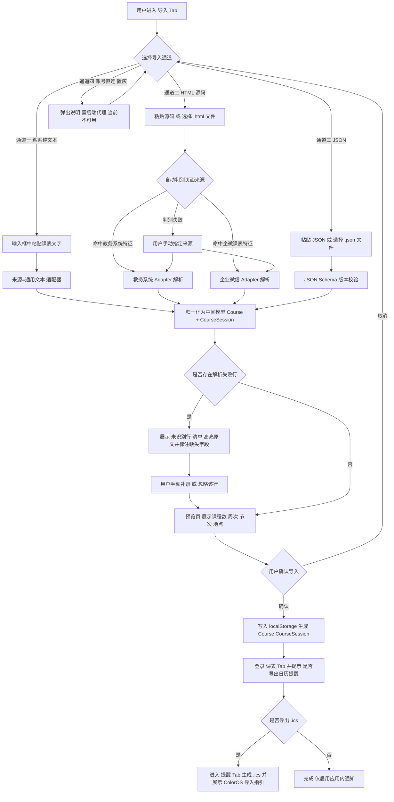
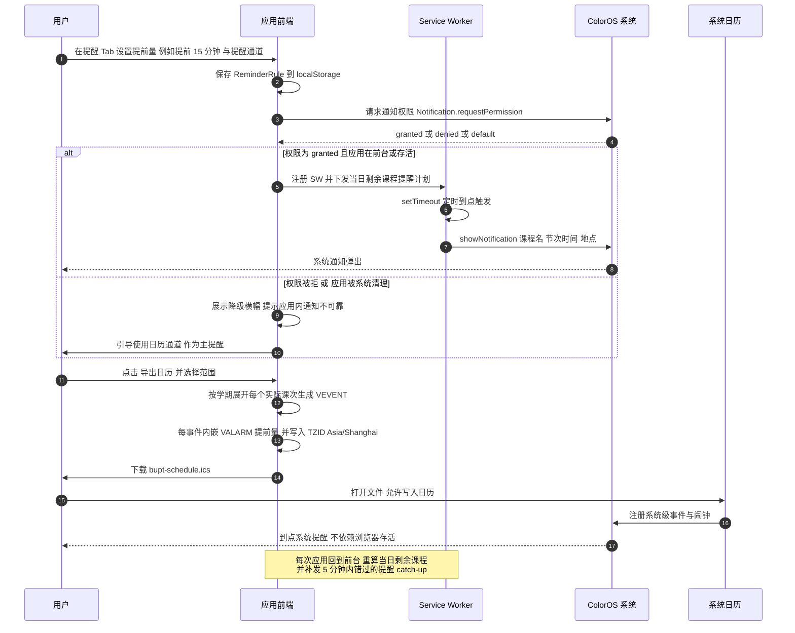
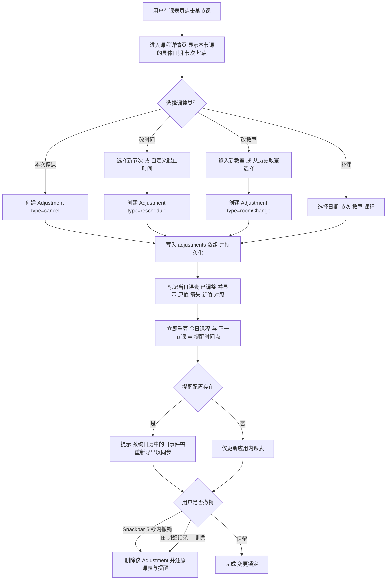
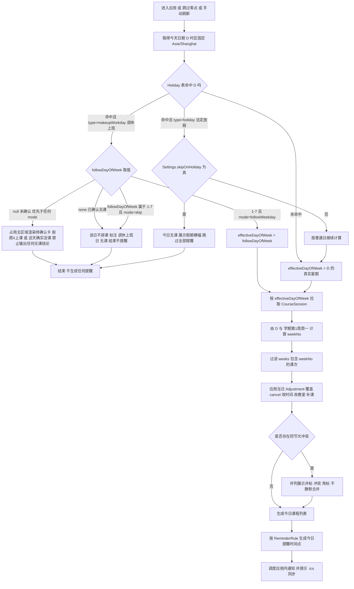

# 北邮课程表 · 产品需求文档（PRD）

## 0. 项目信息

| 项 | 内容 |
|---|---|
| 文档语言 | 中文 |
| 项目名称 | `bupt_schedule` |
| 技术栈 | Vite + React + MUI + Tailwind CSS；PWA（Manifest + Service Worker） |
| 目标平台 | OPPO 手机（Android + ColorOS），Chromium 内核浏览器 |
| 交付形态 | **可安装 PWA**：浏览器打开 → 添加到主屏幕；免应用商店、免打包 |
| 架构约束 | 纯前端、无后端、离线优先；全部数据存 `localStorage`；不做账号登录抓取 |
| 文档版本 | v1.0（初版，待架构评审） |

### 原始需求复述

北邮学生需要一款跑在自己 OPPO 手机上的课程表 App，满足五件事：

1. 从「企业微信北邮课程表」或「北邮本科教育系统（教务系统）」两种来源导入课程表，**两条路都要能用**；
2. 展示每节课的**上下课时间、课程名称、地点**等关键信息；
3. **上课提醒**，且提醒时间与提醒方式均可自定义；
4. 课表能随课程调整（调课、换教室、停课）**灵活更新**；
5. **自动识别节假日**，节假日当天跳过课程提醒、不发上课通知。

并要求说明整体功能结构与关键交互流程。

---

## 1. 产品目标与成功指标

### 1.1 产品目标

| # | 目标 | 说明 |
|---|---|---|
| G1 | **两条导入通道都能走通** | 企业微信课表页与教务系统课表页，用户用"复制文本 / 另存 HTML / 导出 JSON"任一方式，都能在 2 分钟内把课表落到本地，全程不需要账号密码、不依赖校内网 |
| G2 | **提醒不在 Android 后台丢** | 正面承认浏览器后台定时器不可靠，用「系统日历 .ics + VALARM」作为可靠主通道，应用内通知作为即时补充，让"该响的铃一定响" |
| G3 | **课表永远说当前的话** | 节假日、调休、停课、换教室全部落到"某一天实际要上什么课"，单日覆盖优先于学期周期课表，用户不需要自己脑内换算 |

**正交性说明**：G1 解决"数据进得来"，G2 解决"提醒出得去"，G3 解决"课表算得对"。三者的失败模式互不重叠。

### 1.2 成功指标

| 指标 | 目标值 | 测量方式 |
|---|---|---|
| 首次导入成功率 | ≥ 90% | 解析成功且用户点击"确认导入"的比例 |
| 导入耗时中位数 | ≤ 2 分钟（从进入导入页到看到课表） | 埋点计时（本地，不上传） |
| .ics 导入 ColorOS 日历成功率 | ≥ 85% | 用户自查勾选 + 二次进入时的自述确认 |
| 提醒触达率 | ≥ 95%（重要课程） | 用户回访"是否收到提醒"抽样 |
| 调课后课表一致率 | 100% | 调课操作后立即重算，当天视图与实际一致 |
| 离线可用性 | 首页课表离线 100% 可打开 | 断网后刷新验证 |
| 首屏加载 | ≤ 1.5s（4G，二次访问走 SW 缓存） | Lighthouse / 真机 |

> 不含任何服务端统计：所有埋点仅存本地 `localStorage`，不做上报（无后端）。

---

## 2. 目标用户与核心场景

### 2.1 用户画像

| 画像 | 描述 | 关键诉求 |
|---|---|---|
| **U1 本科生（主）** | 大一至大四，每学期 8–12 门课，60–120 节课；教室分散在教三/教四/主楼/沙河 | 早上出门前知道今天去哪、第几节、几点上课；换教室能立刻知道 |
| **U2 跨校区学生** | 西土城 ↔ 沙河通勤，课间 30 分钟需要赶校车 | 地点信息必须准确，需要"下一节课在哪、还有多久" |
| **U3 强依赖式用户** | 有早课起不来，靠闹钟连续提醒 | 提前量可自定义（15/30/60 分钟），甚至提前一天晚上提醒 |
| **U4 节假日常驻家** | 法定节假日回家，不希望被"今天有课"打扰 | 节假日静默，调休补班日正确上课 |

### 2.2 核心场景（User Journey）

**S1 · 学期初导入**
开学第一天，学生登录教务系统 → 课表页"另存为 HTML" → 传到手机 → 在 App 里选 HTML 通道上传 → 预览解析结果（12 门课、正确识别周次）→ 确认 → 看到周视图课表 → 导出 .ics 到系统日历。

**S2 · 早八出门**
前一晚 22:30，系统日历弹出"明早 07:45 高等数学 @ 教三-201"。早上 07:45 再次提醒。学生打开 App，课表页高亮"今天 4 节课"，下一个区块显示"第 1 节 08:00 高等数学 教三-201，还有 15 分钟"。

**S3 · 临时调课**
群里通知"周四下午的大学物理改到周六上午，教室换到教四-105"。学生在课表页点周四那节课 → 选"本次停课"；再切到周六 → 选"补课"填课程/节次/教室。课表立即更新，App 提示"日历需重新导出以同步"。

**S4 · 国庆假期**（日期已按国办 2025-11-04 通知核对）
10 月 1 日（周四）至 7 日（周三）放假 7 天，App 自动识别为法定节假日，课表页显示"国庆假期 · 今日无课"，不安排任何提醒。9 月 20 日（周日）与 10 月 10 日（周六）为通知明确的**调休上班日**；这两天上哪一天的课由北邮教务处另行通知，App 不预设，在该日课表列顶部悬挂"调休上班日 · 请确认按哪天课表上课"卡片，用户点选后按所选星期的课表排课并正常触发提醒。

**S5 · 忘带手机 / 清理缓存**
手机清理工具清空了浏览器数据，学生重开 App 发现课表空了。设置页提供"从备份 JSON 恢复"，30 秒复原。

---

## 3. 用户故事与验收标准

> 格式：US-n / 角色 / 我要 / 以便 / 验收标准（AC）

### US-1 · 从教务系统 HTML 导入（P0）

作为学生，我想把教务系统课表页"另存为 HTML"后上传，以便不用手抄就能得到完整课表。

- **AC1** 支持"粘贴 HTML 源码"与"选择 .html 文件"两种输入方式；
- **AC2** 能从课表 `<table>` 结构中识别：课程名、星期、节次（第 n 节 / n-m 节连上）、周次（含单双周、离散周次如 `1-8,10-16周`）、地点、教师（若存在）；
- **AC3** 解析后在"预览页"以课表形式展示，用户可逐行修正课程名/周次/地点后再确认；
- **AC4** 任何一行解析失败时**不静默丢弃**：列入"未识别行"清单并高亮原文，用户可手动补录或忽略；
- **AC5** 页面结构不匹配（如结构性改版）时给出明确提示"未找到课表表格，请改用文本粘贴或 JSON 通道"，不报白屏。

### US-2 · 从企业微信课表导入（P0）

作为学生，我想把企业微信"北邮课程表"H5 页面保存下来导入，以便用同一个 App 管所有课。

- **AC1** 企业微信课表页可通过"另存为 HTML / 复制网页源码"走与教务系统一致的 HTML 通道；
- **AC2** 解析器对两种来源使用**不同的适配器（Adapter）**，先自动判别来源（依据页面特征串），判别失败时由用户手动下拉选择"来源 = 教务系统 / 企业微信 / 通用文本"；
- **AC3** 企业微信课表若以卡片/列表而非 table 呈现，解析器需能按"课程名 + 星期 + 节次 + 周次"的文本邻近关系抽取；
- **AC4** 两源导入统一落入同一中间模型，用户对结果无感差异；
- **AC5** 导入结果可在预览页看到"来源识别为：企业微信"。

### US-3 · 纯文本粘贴导入（P0，兜底通道）

作为学生，我想直接粘贴课表文字（从群里复制的、或用 OCR 得到的），以便在两种结构化通道都失败时仍能导入。

- **AC1** 支持按行解析，容忍 `课程名 周一 1-2节 1-16周 教三201` 等多种分隔符（空格 / Tab / 逗号 / `|`）；
- **AC2** 周次支持 `1-16周`、`1-8,10-16周`、`1-16周(单)`、`单周`、`双周`；
- **AC3** 单行解析失败时该行标红并给出"哪种字段没认出来"，其余行照常导入；
- **AC4** 提供"格式示例"折叠面板与"一键填充示例数据"按钮，帮助用户对齐格式。

### US-4 · JSON 导入（P0）

作为进阶用户，我想用抓包或导出的 JSON 导入，以便拿到最完整的数据。

- **AC1** 支持上传 `.json` 文件或粘贴 JSON 文本；
- **AC2** 兼容本 App 自身的导出格式（备份恢复与迁移共用一套 schema），并给出 schema 版本号校验；
- **AC3** schema 版本不匹配时提示"数据版本 X，当前支持 Y"，并尝试向后兼容映射；无法兼容时明确拒绝并提示原因。

### US-5 · 周视图课表（P0）

作为学生，我想一屏看到整周课表，以便安排自习和通勤。

- **AC1** 默认进入"周视图"：纵向为节次（第 1–11 节），横向为周一至周日，课程块显示**课程名 + 地点**，连堂课合并为一个跨行块；
- **AC2** 顶部显示"第 n 周（本周/非本周）"，可左右切换周次，非本周课程置灰；
- **AC3** 当前时间有"现在"进度线，今天的列高亮；
- **AC4** 点击课程块进入课程详情页，展示课程名、教师、地点、节次时间、所属周次、**本节课的具体日期**；
- **AC5** 无课程时显示空态 + "去导入课表"主按钮。

### US-6 · 节次时间配置（P0）

作为学生，我想确认/修改每节课的起止时间，以便提醒时间准确。

- **AC1** 内置北邮节次时间预设（第 1–11 节），**全部可编辑**（修改 start/end），保存后所有提醒与 .ics 立即按新时间重算；
- **AC2** 支持"恢复默认预设"；
- **AC3** 校验：后一节开始时间不得早于前一节结束时间，冲突时阻止保存并提示。
- **AC4** 支持"增加一节""删除一节"（用于 12 节制或短学期）。

### US-7 · 学期配置（P0）

作为学生，我想设置第 1 周的周一日期和总周数，以便周次计算正确。

- **AC1** 必填项：第 1 周周一日期、总周数（默认 20）、是否有单双周；
- **AC2** 若导入数据中带"第 1 周起始日期"则自动填入并提示"已从导入数据识别，请核对"；
- **AC3** 未配置时，周视图仍可展示但顶部提示"未设置学期起始日，周次可能不准"并可一键跳转设置；
- **AC4** 当前日期超出总周数范围时，提示"本学期已结束 / 尚未开始"，并提供归档按钮。

### US-8 · 上课提醒（本地通知）（P0）

作为学生，我想在上课前收到手机通知，以便不迟到。

- **AC1** 首次使用提醒时引导申请通知权限，展示当前权限状态（已授予/已拒绝/未询问）；
- **AC2** 支持**全局默认提前量**与**单课程覆盖**提前量，取值 0/5/10/15/20/30/45/60 分钟及自定义；
- **AC3** 应用在前台或后台存活期间，到点通过 Service Worker 调 `showNotification` 推送，标题为"即将上课"，正文含课程名、节次时间、地点；
- **AC4** 每次应用进入前台时**重算当日剩余课程**并补发 5 分钟内已错过的提醒（catch-up），避免后台被杀后整天静默；
- **AC5** 页面内明确告知限制："系统可能清理后台浏览器，浏览器内定时通知不保证送达，建议同时导出日历。"
- **AC6** **同一门大课内部换节不提醒**：判据是「上一节与本节的 `courseId` 相同」且「两节间隔 ≤ 30 分钟」，
  两个条件同时成立才跳过。**不能只看时间间隔** —— 真正的换课（第 2 节数学分析 → 第 3 节线性代数）
  间隔同样是 5~15 分钟，与连堂内部课间无法用时间区分；只有"课程归属"能分开。
  跳过的节次会以 `skipped.reason = 'SAME_COURSE_BREAK'` 显式记账，不静默丢。
  同一门课若中间隔了午休或几小时（> 30 分钟），照常提醒；同一时段两门课并排（时间重叠）也照常提醒。

### US-9 · .ics 日历导出（P0，可靠提醒主通道）

作为学生，我想导出一个日历文件导入 ColorOS 系统日历，以便即使 App 没打开也能收到提醒。

- **AC1** 一键生成 `.ics`（iCalendar 2.0），每个"实际发生的课次"生成一个 `VEVENT`（按学期展开，非只导出周期性规则，规避日历 App 对 `RRULE` 支持差异）；
- **AC2** 每个 `VEVENT` 内嵌 `VALARM`，`TRIGGER` 取用户配置的提前量；
- **AC3** 时间必须显式声明 `TZID=Asia/Shanghai` 并附 `VTIMEZONE` 块，写 `DTSTART;TZID=...`，不得写裸 UTC；
- **AC4** 事件 `SUMMARY` = 课程名，`LOCATION` = 教室，`DESCRIPTION` = 节次 + 教师 + 备注；`UID` 稳定可复现（`课程ID-日期-节次@bupt_schedule`）以便重复导入时去重/覆盖；
- **AC5** 提供 OPPO/ColorOS 导入指引图文（下载 → 打开文件 → 选择"日历"→ 允许写入），并提示"若之前导入过，请先在日历中删除旧事件或允许重复"；
- **AC6** 导出范围可选：本学期全部 / 仅未来 4 周（避免一次生成上千事件导致导入慢）。

### US-10 · 节假日自动识别与静默（P0）

作为学生，我想法定节假日自动不提醒，以便假期不被打扰。

- **AC1** 内置 2026 年国务院法定节假日与调休安排（元旦/春节/清明/劳动节/端午/中秋/国庆 + 调休上班日），首次使用即生效，无需联网；**具体日期以附录 A 为准**（已按国办 2025-11-04 通知逐日核对，含星期校验），工程实现**不得自行推断或照抄任何示例日期**；
- **AC2** 命中"法定放假日"时：课表页显示"XX假期 · 今日无课"，**不生成任何提醒**，也不导出该日 .ics 事件；
- **AC3** 用户可在设置页增删自定义节假日（如校庆日、运动会），带"放假/补班"类型；
- **AC4** 内置数据标注来源与年份，并提供"数据可能已过时，请核对教务处通知"的提示条；
- **AC5** 用户可一键关闭"节假日跳过提醒"（`skipOnHoliday=false`）以恢复全量提醒。

### US-11 · 调休上班日按对应星期上课（**P0，由 P1 升级**）

作为学生，我想让调休上班日按教务处指定的星期上课，以便不漏课。

- **AC0（关键，数据契约）** 官方通知只规定"**某日上班**"，**不指明"按周几的课表上课"**——后者由北邮教务处单独发文（各校做法不同）。因此**内置数据不得对补班日批量填充 `followDayOfWeek`**，也不得使用"按顺序配对""按被冲掉的法定日配对"等启发式。
- **AC1** 配置项 `followDayOfWeek` 取值 `1–7` / `'none'`（当天不上课）/ `null`（未配置）。
- **AC2** 内置数据中**仅 `2026-01-04` 可推定为 `5`（周五）**：元旦假期仅冲掉 `01-02`（周五）一个工作日，且唯一补班日 `01-04`（周日）与之 1:1 对应，属算术唯一解。**其余 5 个补班日内置一律为 `null`**（春节/劳动节/国庆被冲掉的工作日数均多于补班日数，映射不唯一）。
- **AC3（强制确认，不得降级为提示条）** `followDayOfWeek === null` 时，课表页该日列、日视图、今日概览**一律不得出现"无课 / 休息 / 无安排"等任何结论性文案**，必须渲染**待确认占位卡**：标题「{X月X日}（{周X}）为调休上班日 · 请确认按哪天课表上课」，并列两个操作——①**「按周X上课…」**（内置周一~周日单选，选中即写入 `Holiday.followDayOfWeek` 并立即重算课表与提醒）；②**「这天确实没课」**（写入 `followDayOfWeek='none'`，此后该日**才**允许显示"今日无课"结论）。未做出选择前，该日不产出课程、不产出提醒、不产出 .ics 事件。**该占位卡必须占据主区域**（今日区块 / 该日列 / 日视图首屏），**不得折叠、不得降级为一行小字、不得只放设置页深处**——它本质是"今天可能要去上课，但你还没告诉我第几节、去哪间教室"，藏起来等于没做 P0-17。
- **AC3b** `'none'` 与 `null` **语义必须严格区分**：`'none'` = 用户已确认当日无课 → 可显示结论、不生成提醒；`null` = 未确认 → **不得下任何结论**。二者在数据结构、UI 文案、导出行为上均不可合并处理。
- **AC3c** 为避免 6 个补班日重复点选，「这天确实没课」支持**批量应用**（"全部未确认补班日均不上课"），但落地仍**逐日写入 `'none'`**，不得引入"全局静默"开关——批量只是省点击，不改变每日都有明确结论这一性质。
- **AC4** **优先级：per-date `followDayOfWeek` 优先；`null` 与 `'none'` 不受 `makeupWorkdayMode` 影响。** `null` → 一律 `makeup_unconfirmed`（待确认卡）；`'none'` → `makeup_skipped`（已确认无课）；**仅当 `followDayOfWeek ∈ 1–7` 时 `makeupWorkdayMode` 才起作用**（`followWeekday` = 按该星期取课 / `skip` = 该日不排课）。`makeupWorkdayMode` **只影响已指定星期时的排课策略，不豁免提示义务**。
- **AC4b** **界面文案不使用内部术语**：`makeupWorkdayMode` 在设置页标题写作「补班日上不上课」，两个取值分别是「要上课」（`followWeekday`）与「不上课」（`skip`），下方一行小字说明"只对已指定周几的日子生效、未指定的两种都一样不排课"；选择器分组标题为「按周几上课」。**禁止在界面上出现"按指定星期上课""一律不排课""`makeupWorkdayMode`"这类实现词。**
- **AC5** 已配置的补班日，课表页顶部标注"调休上班 · 按周三课表"，提醒正常触发。
- **AC6** 同一学期多个补班日**分别独立配置**，互不影响（2026 年共 6 天，见附录 A.2）。

> **优先级理由**：允许界面在未确认时输出"今日无课"，等于把"我不知道"伪装成"我确定没课"。一个从不主动打开 App 的学生会据此缺课，且不会怀疑是 App 的问题。**宁可挡住用户一次，也不给一个可能是假的结论**——这是本产品唯一不可妥协的一条。

### US-12 · 单次调课（停课/改时间/改教室/补课）（P0）

作为学生，我想对"某一天某一节课"做单独调整，以便临时变动能反映到课表和提醒上。

- **AC1** 在课程详情页提供四个操作：**本次停课**、**改时间**、**改教室**、**补课**；
- **AC2** 调整只作用于**单日单次**，不修改学期周期课表（`CourseSession` 只读不动）；
- **AC3** 单日覆盖**优先于**学期周期课表：同一日期同一节次，`Adjustment` 覆盖 `CourseSession`；
- **AC4** 调整后立即重算"今天/下一节课"，课表页当日区块标"已调整"角标与原信息对照（如"教三-201 → 教四-105"）；
- **AC5** 支持**撤销**：操作后 5 秒内可直接撤销，或后续在"调整记录"列表中逐条删除，删除即还原；
- **AC6** 调整影响提醒：停课取消该次提醒；改时间/改教室重算提醒时间与文案；补课新增提醒；
- **AC7** 调整后提示"系统日历中的旧事件需重新导出同步"（不自动改系统日历，因为无后端/无日历写入 API 保证）。

### US-13 · 数据备份与恢复（P1）

作为学生，我想导出/导入自己的数据，以便换手机或误清缓存后不丢课表。

- **AC1** 设置页提供"导出备份（JSON）"，包含 `Settings / Period[] / Course[] / CourseSession[] / Adjustment[] / Holiday[]` 与 `schemaVersion`；
- **AC2** 恢复时先展示摘要（课程数、调整数、学期起始日）并二次确认覆盖；
- **AC3** 恢复过程不覆盖当前数据的选项：**合并 / 全量覆盖**（默认全量覆盖，需显式确认）。

### US-14 · 账号直连导入（**P0，1.15.0 实装**）

作为学生，我只想输一次学号密码，App 自己把课表抓回来，不想先跳到学校页面里点抓取。

- **AC1** 导入页**只有一个入口**：学号 + 密码 +「自动导入课程」。原来的「登录教务系统并抓取」降级为同一张卡里的**手动兜底**（要验证码 / 学校改版时用）。
- **AC2** 点下按钮**立刻**进入「正在抓取」，不等原生回第一句；任务号由网页生成，原生原样带回。
- **AC3** 进度分五步（连接教务系统 / 登录 / 打开课表 / 读取课表 / 解析并核对），显示百分比与已用秒数。**进度只增不减**，事件乱序、重复、串台都不影响显示。
- **AC4** 抓取在**后台**进行（原生侧 1×1 的隐藏 WebView），用户看不到学校页面跳来跳去，也不用手动操作；中途可取消。
- **AC5** 结果落地分两种：本地**没有**课表 → 直接展示抓到的课程列表；本地**已有**课表 → 只列「新增 / 删除 / 变更」。**两种都要用户点确认才写库**，抓完不自动覆盖。
- **AC6** 失败必须给**原因 + 下一步**，且明确"本地课表没有任何改动"。至少覆盖：连不上（内网/校园网）、学号密码错、要验证码、找不到登录框、找不到课表页、超时、读取失败、解析失败、用户取消。
- **AC7** 前端有独立看门狗：75 秒没有结果就判超时（原生进程被杀 / WebView 崩了不会回事件），避免永远转圈。
- **AC8** 凭证安全：密码只在这一次提交里经过网页，**随即清空输入框**；落盘只走 Android Keystore 加密（网页读不回明文），可随时清除；不勾「记住密码」时不保存。
- **AC9** 密码框留空 = 用已保存的那份；换了学号又没填密码则拦下，不拿旧密码去登新账号。

### US-15 · 自定义活动 / 会议进日程（P0，1.12.0 补充）

作为学生，我想把班会、社团会议、讲座这类"不是课但占时间"的事也放进课表，以便冲突一眼可见。

- **AC1** 在课表页点空格弹出的弹层里，用「补课 / 活动」分段切换，切到「活动」后只需填**名称 + 起止节次**（地点、备注可选）；
- **AC2** 活动与调课共用 `Adjustment` 管道（`type: 'event'`），因此天然**只影响当天**、不进学期周期课表；
- **AC3** 活动在周视图/日视图都以**虚线左边 + 琥珀底色 + 「活」角标**与正式课程区分，且**不显示课程色**以免被误认为某门课；
- **AC4** 活动参与冲突检测：与课程或其他活动同一时段会双方标「冲突」；
- **AC5** 活动参与提醒：按起止节次算提醒时间，文案为「即将开始」；
- **AC6** 点活动块可打开详情（日期 / 时间 / 地点 / 备注），支持删除；删除即从课表与提醒中移除。

### US-16 · 长按拖动课程到本周其他时段（P0，1.12.0 补充）

作为学生，我想临时把一节课挪到本周别的时间，以便不用为一次变动去操作一整套表单。

- **AC1** 长按课表块 220ms 进入拖动，出现跟手影子且落点高亮；**短按仍是打开详情、上下滑动仍是滚动**，三者互不干扰；
- **AC1.1** 影子与落点高亮都**按课程原本的格数整段铺开**（连堂课就是两格高），尺寸取自课表格子的实时矩形，
  因此任何屏幕尺寸 / 行高都自动对齐；影子直接贴在落点足迹上，松手前看到的那一块就是落地的那一块；
- **AC2** 拖动**只改本周这一次**：同日改时段写一条 `reschedule`，跨天写 `cancel`(原日) + `makeup`(目标日)；学期周期课表与其他周次**完全不动**；
- **AC3** 连堂课的时长（节次数）在拖动中保持不变；越过当天最后一节或首节的落点直接拒绝，不产生半截数据；
- **AC4** 落到自身原位置视为未移动，不写任何记录；
- **AC5** 多步写入（跨天的 cancel + makeup）**要么全成要么全不写**，中途失败自动回滚；
- **AC6** 移动后提示条可直接**撤销**，撤销把上述记录按逆序还原；活动 / 补课这类单日记录走「改位置」而不是拆成停课+补课；
- **AC7** 拖完紧跟的那次 click 被吞掉一次，避免"刚放下就弹出详情"。

### US-17 · 假期临近时的调休确认（P0，1.14.0 补充）

作为学生，我想在假期快到的时候被问一句"这天补哪天的课"，以便不会在调休上班日空跑或漏课。

- **AC1** 启动时如果存在**未确认**的调休上班日，且满足"补班日本身在 7 天内"或"它所属假期开始日在 7 天内"，弹一次确认弹层；
  后者是必须的：国庆 10-01 开始、补班在 10-10，等补班日前 7 天才问已经太晚；
- **AC2** 弹层写清 **日期 / 星期 / 距今几天 / 属于哪个假期及其区间**，选项为「周一…周日」+ **「不调休（这天没课）」**；
- **AC3** 选「不调休」= 只把**这一天**写成 `none`（当天静音），不做任何全局静默；
- **AC4** 提供「今天不再提醒」：只记"今天问过"，**次日仍会再问**，绝不把"不知道"改写成"确定没课"；
- **AC5** 已确认（按周 X 或 none）的补班日不再打扰；同一补班日的弹层每次启动最多出现一次，且不与已打开的其它弹层抢；
- **AC6** 补班日与假期的归属**按名字认**（「国庆调休上班」→「国庆节」），名字认不出才退回"时间上最近的一段"——
  2026-09-20 离中秋更近，但它是国庆的补班日；
- **AC7** 用户自己新增的补班日同样参与临近提醒。

### US-18 · 增加某天放假（P0，1.14.0 补充）

作为学生，我想把校运会、临时放假这种"某一天不上课"直接标出来，以便课表与提醒都不要再来烦我。

- **AC1** 设置 › 节假日与调休 提供两个并列入口：**「放假某一天」** 与 **「补班日」**，默认类型由入口决定；
- **AC2** 「放假某一天」只需**日期 + 名称**，新建即让当天 `status=holiday_silent`：不排课、不发提醒、日视图标「假期」；
- **AC3** 只影响这一天，学期周期课表与其它周次完全不动；
- **AC4** 同一天重复添加走覆盖（不留两条冲突记录），列表里可逐条删除，删除即恢复上课；
- **AC5** 「补班日」可指定按周几上课，也可留「待确认」，留空时进入 US-17 的临近提醒流程。

### US-19 · 桌面小组件（P1，1.16.0 实装）

作为学生，我想不打开 App 就在桌面上看到今天还剩哪几节课，以便出门前扫一眼就知道要不要带书。

- **AC1** 走 **Android App Widget**（系统自带、无需审核），装在桌面「小组件」列表里，**不出现在 ColorOS 的「我的服务 / 速览」**——
  后者属于 OPPO 泛在服务（UPK），授权码/意图/服务ID 要人工申请、必须套官方模板，个人 sideload 的 APK 进不去；
- **AC2** 默认 4×3，可双向缩放，**行数按实际高度自动增减**（1~5 行），行块**垂直居中**（桌面格子高度因机型差异极大，顶部对齐必然留大片空白）；
- **AC3** 数据一次性覆盖**今天起 14 天**，小组件自己按"今天"挑；只存今天的话，第二天就会理直气壮地显示昨天的课；
  超出窗口显示「课表该更新了」而不是画错；
- **AC4** 结论**全部来自 `calendar.resolveDay`**：调课、补课、换教室、放假、补班一个都不重算，避免小组件与 App 内课表对不上；
- **AC5** 补班日 `complete === false` 时**不显示任何课程**，只提示「打开应用定一下」——宁可让用户去确认，也不给一份可能是错的课表；
- **AC6** 已经上完的课淡化到 35%，并在**闹钟到点时**顺带刷新一次（不用等 30 分钟的定时刷新）；
- **AC7** 深浅色跟随系统（`values-night`），底色圆角卡片 + 课程色竖条；颜色一律 `#rrggbb`，非法值回落默认色——
  传给原生一个坏色串会让 `Color.parseColor` 抛异常，整块卡片直接空白；
- **AC8** 点击卡片打开 App；无数据 / 未导入 / 数据过期各有独立文案，**不出现空白卡片**。

### US-20 · 课前流体云卡片（P1，1.17.0 实装）

作为学生，我想在上课前瞥一眼手机顶部就知道还有几分钟上课，而不用解锁翻课表。

- **AC1** **只在用户设定的提醒时刻出现**：由既有的 `AlarmManager` 排程触发，不新增"常驻"概念；
  提前量沿用设置里的「上课提前 N 分钟」，不另开开关；
- **AC2** 走 **Android 16 Live Updates API**（`setOngoing` + `setShortCriticalText` +
  `Bundle.putBoolean("android.requestPromotedOngoing", true)` + `addExtras`），
  ColorOS 16 上即呈现为流体云胶囊；**低版本自动降级成普通可划掉的通知**，内容一致。
  ★ 请求提升**只能走 extras**：`FLAG_PROMOTED_ONGOING` 是系统写回表示「已提升」的读取位，应用自己 set 无效；
  清单还必须声明 `POST_PROMOTED_NOTIFICATIONS`（非运行时权限，漏了系统一律不提升，且**完全静默**）；
- **AC3** 倒计时**由系统渲染**（`setUsesChronometer` + `setChronometerCountDown` + `setWhen(上课时刻)`），
  App 只发一次通知；自己每分钟改文字会被限流且要后台常驻；
- **AC4** 最前面是**北邮校徽**（`ic_crest_mono`，由 `scripts/make-crest-icon.py` 从北邮官网 VI 素材生成）。
  必须是单色剪影：安卓对 `setSmallIcon` **只取 alpha 通道**，彩色校徽会被强制着色成一块糊影。
  ★ 真机上 ColorOS 通知卡片左侧那个位置取的是**应用图标（launcher）**而不是 smallIcon，
  所以启动图标已一并换成「藏青 `#013A89` 底 + 白徽标」——那是让校徽出现在该位置的唯一途径；
- **AC4b** 校徽**不要环形文字**；内圆那条 1.5px 描边整条剔除——压到 24dp 剩 0.13px，抗锯齿后变成断续碎弧，比没有更难看；
- **AC5** 内容只有三样：课程名、节次、剩余分钟。**不显示地点**（胶囊一行放不下，用户明确不要）。
  - **折叠态**（流体云胶囊）：**「N分后上课」**，文案随分钟推进而跳变。
    ★★ **推进方式：前台服务自己刷，不靠闹钟**（1.35.0 定案）。
    1.30~1.33 四版都用「闹钟 → 重发通知」刷文字，真机上始终滞后
    （Doze 配额 + ColorOS 省电 + 精确闹钟权限，三层拦，实测「剩 2:42 时还写 4分后上课」）。
    结论：**只要文案是字符串，就得跟系统抢唤醒，这一仗打不赢** —— 于是换掉战场：
    提醒响时拉起 `ClassRefreshService`（前台服务，复用同一张卡片通知），
    它用自己的 Handler **每 15 秒**重发一次。用户看胶囊时屏幕必然亮着，
    亮屏时前台服务的 Handler 极稳，不需要唤醒锁、不需要精确闹钟权限、不受 Doze 影响。
    ★ 文案取整**向上**（`(ms + 59999) / 60000`）：只要还剩零头分钟就进一位 ——
    剩余 3:01~4:00 一律显示「4分后上课」，这样读起来是"最晚 N 分钟后上课"，不会让人以为还早。
    仅当到点（`ms <= 0`）才显示「马上上课」。
    （1.33.0 曾因闹钟滞后改成向下，1.35.0 换成 15 秒自刷后滞后上限只有 15 秒，该顾虑已消失。）
    ★ 类停止的三个出口：上课到点 / 用户点「知道了」/ 课表重排。
    ★ 开关：`CHIP_USE_CHRONOMETER=true` 改用系统倒计时 `03:42`（无「上课」二字但零依赖）；
    `REFRESH_ALARM_FALLBACK=true` 退回纯闹钟刷新（状态栏会多一个闹钟图标）。
    ★ 胶囊里只有一个槽，不存在"往左边再写一段"的 API（课程名填不进去，1.19.0 真机验证）。
    ★ 文字起点钉在「屏幕中心 +46.5px」，中间空隙恒为胶囊宽的 49%，与内容无关（1.27.0 结案），
    去掉图标也没用（1.28.0 实验：胶囊反而更宽、整体偏左）。
  - **展开态**：完整课程名 + 节次 + 系统渲染的倒计时；
  - ★ 想换回「X分后上课」文字形态：把 `ClassCard.CHIP_USE_CHRONOMETER` 改成 false，
    刷新链会自动恢复（但会重新受系统唤醒延迟影响）。
- **AC6** 卡片是 ongoing，划不掉，所以**必须给「知道了」出口**，并在**上课那一刻用单独闹钟自动收起**——
  少了这条，胶囊会一直挂着「还有 0 分钟」；
- **AC7** 系统不允许提升时（`canPostPromotedNotifications()` 为 false）退回普通通知，**不报错、不空窗**。

### US-21 · 明确不做的系统级能力（P2，需求边界）

- **UPK 泛在服务卡片 / 「我的服务·速览」**：授权码、意图、服务ID 由 OPPO 人工分配，必须用官方模板（不支持 CSS 自由排版），
  且需上架审核。个人 sideload 的 APK 进不去。落地前提是先上架应用商店并拿到 OPPO 开发者资质；
- **流体云彩色徽标**：胶囊首图位是 `setSmallIcon`，只取 alpha 通道，彩色现状下不可能；
  `setLargeIcon` 能放彩色大图，但只在**展开态**显示，折叠的胶囊看不到。

---

## 4. 需求池（P0 / P1 / P2）

### P0 · 必须有（缺一不可，否则核心需求不成立）

| ID | 需求 | 对应原始需求 | 优先级理由 |
|---|---|---|---|
| P0-1 | 纯文本粘贴导入（行解析 + 周次/节次识别 + 逐行容错） | ①导入 | 唯一 100% 不依赖页面结构的兜底通道；两种来源失效时仍能完成 G1 |
| P0-2 | HTML 源码导入（粘贴 / 上传 .html） | ①导入 | 覆盖教务系统与企微课表页这两条实际主路径，是"双源兼容"的主体 |
| P0-3 | 来源自动判别 + 手动指定（教务/企微/通用） | ①导入 | 双源结构不同，判别失败必须有兜底手段，否则单一适配器无法兼容两源 |
| P0-4 | JSON 导入（含 schemaVersion 校验） | ①导入 | 备份恢复/迁移共用 schema，是数据可移植性的底座；顺带满足导出让进阶用户抓包 |
| P0-5 | 导入预览与逐行手动修正 | ①导入 | 解析器不可能 100% 正确，人工确认是保证数据可信的最后一道闸 |
| P0-6 | 周视图课表（课程名/地点/节次/周次/连堂合并/现在线） | ②展示 | 核心界面，用户 90% 时间看的就是这一屏 |
| P0-7 | 课程详情页（含具体日期、教师、周次） | ②展示 | 调课操作的入口，也是"这节课到底哪天上"的唯一权威答案 |
| P0-8 | 节次时间表（内置北邮预设 + 可编辑 + 校验） | ②③ | 所有提醒与 .ics 的时间基准；各校区作息不同，必须可改 |
| P0-9 | 学期配置（第 1 周周一、总周数） | ②④ | 周次→具体日期换算的唯一依据，缺了它节假日/调课/提醒全错 |
| P0-10 | 单日覆盖引擎（Adjustment 优先级 + 重算） | ④ | "灵活更新"的技术核心：周期课只读 + 单日覆盖，保证可撤销、可回溯 |
| P0-11 | 调课四操作（停课/改时间/改教室/补课）+ 撤销 | ④ | 用户可见的"灵活更新"能力本体 |
| P0-12 | 2026 内置节假日库 + 跳过提醒 + 手动增删 + 开关（数据见附录 A） | ⑤ | 需求 ⑤ 的直接实现；离线可用的前提是内置数据 |
| P0-13 | .ics 导出（展开 VEVENT + VALARM + TZID + 稳定 UID） | ③ | Android/ColorOS 后台可靠性唯一正解，是提醒功能的"实际有效通道" |
| P0-14 | 前台/存活期本地通知 + 权限引导 + 状态展示 + catch-up | ③ | 即时性强、零配置；同时必须诚实标注其局限（见 US-8 AC5） |
| P0-15 | 本地持久化 + PWA 离线可用（Manifest + SW 缓存） | 全部 | 无后端架构的立身之本；断网也应能看课表 |
| P0-16 | 提醒规则配置（全局提前量 + 单课程覆盖 + 通道选择） | ③ | "提醒时间和方式可自定义"的落地点 |
| P0-17 | 调休上班日**强制确认**：`null` 时渲染待确认占位卡（按周X上课 / 这天确实没课），禁止输出无课结论 | ⑤ | `followDayOfWeek` 无法从国务院通知推导（通知只说"哪天上班"，不说"上哪天的课"）；允许输出无课结论等于把"我不知道"伪装成"我确定没课"，会让学生静默缺课（原 P1-1 升级） |

### P1 · 应该有（体验完整度）

| ID | 需求 | 理由 |
|---|---|---|
| ~~P1-1~~ | ~~调休补班日 `followDayOfWeek` 模式~~ **已升级为 P0-17** | 原判断"缺了只会少上一天课"是错的：静默显示"今日无课"会直接导致缺课，故升级 |
| P1-2 | 数据备份导出 / 恢复（合并 / 覆盖） | 误清缓存是真实高频事故，但非每日必需 |
| P1-3 | 日视图 / "下一节课"卡片（含倒计时） | 强提升早八场景体验，可用周视图替代 |
| P1-4 | 导入历史 + 一键回滚到上一次导入 | 重新导入覆盖错误时的救心丸 |
| P1-5 | 课程颜色 / 教师 / 备注编辑 | 可读性优化，非功能必需 |
| P1-6 | 调整记录列表（集中查看与删除） | 撤销的延伸，替代记忆 |
| P1-7 | 通知权限被拒的降级引导横幅（强推 .ics） | 影响提醒触达率，但已有 .ics 主通道兜底 |
| P1-8 | 账号直连导入占位入口 + 说明弹层 | 需求边界澄清（避免用户误以为功能缺失），成本极低 |

### P2 · 可以有（超纲/后续迭代）

| ID | 需求 | 理由 |
|---|---|---|
| P2-1 | 多学期并存管理 | 当前单学期 + 归档已够用，复杂度高（周次/学期 id 全链路） |
| P2-2 | 成绩/学分统计、上课打卡 | 超出"课程表"定位 |
| ~~P2-3~~ | ~~桌面小组件（Android Widget）~~ **已在 1.16.0 实装，见 US-19** | 原判断"PWA 无法实现原生 Widget"成立，但本项目自带零 Gradle 安卓壳，AppWidget 属于开放能力，不需要任何审批 |
| P2-4 | 后端代理实现真正的账号直连/ICS 订阅 | 需服务器 + 校内网/VPN，与当前"纯前端"约束冲突 |
| P2-5 | 深色模式、字号自适应、无障碍优化 | 体验加分项 |
| P2-6 | 课程冲突自动检测与提醒 | 导入时给出提示即可，独立功能价值有限 |

---

## 5. 信息架构与页面清单

### 5.1 功能结构

```
北邮课程表（PWA）
├─ 课表（Tab 1）
│   ├─ 周视图 / 日视图切换
│   ├─ 周次切换器（第 n 周）
│   ├─ 今日概览（今日课数 / 下一节课倒计时 / 假期标记）
│   └─ 课程块 → 课程详情页（二级页）
│       ├─ 基本信息（课程名/教师/地点/节次时间/周次）
│       ├─ 单次调整（停课 / 改时间 / 改教室 / 补课 / 撤销）
│       └─ 该课程全部发生日期列表
├─ 导入（Tab 2）
│   ├─ 通道① 粘贴纯文本（+ 格式示例）
│   ├─ 通道② HTML 源码（粘贴 / 上传 .html）+ 来源选择
│   ├─ 通道③ JSON（粘贴 / 上传 .json）
│   ├─ 通道④ 账号直连（占位·置灰·不可用说明）
│   ├─ 解析预览与逐行修正（含"未识别行"清单）
│   └─ 导入历史 / 回滚
├─ 提醒（Tab 3）
│   ├─ 通知权限状态卡（已授予 / 已拒绝 / 未询问 + 申请按钮）
│   ├─ 提醒规则（全局提前量、单课程覆盖、通道选择）
│   ├─ 日历导出（.ics 生成 + ColorOS 导入指引 + 导出范围）
│   ├─ 今日提醒时间轴（今天会响几次、几点）
│   └─ 限制说明（后台清理 / 定时器不可靠）
└─ 设置（Tab 4）
    ├─ 学期配置（第 1 周周一 / 总周数 / 单双周）
    ├─ 节次时间表（编辑 / 恢复默认 / 增删节次）
    ├─ 节假日管理（2026 内置列表 + 增删 + 跳过开关 + 补班模式）
    ├─ 数据管理（导出备份 / 恢复 / 清空数据）
    └─ 关于（版本 / 限制说明 / 数据不上传声明）
```

### 5.2 页面清单（4 Tab + 1 二级页）

| # | 页面 | 类型 | 主要职责 | 关键组件 |
|---|---|---|---|---|
| P1 | **课表** | Tab 1（默认首页） | 一屏掌握本周/今日课程 | 周次切换器、课表网格、现在进度线、课程块、今日概览条、假期横幅、空态 |
| P2 | **导入** | Tab 2 | 三通道导入 + 预览修正 + 历史 | 通道切换 Segment、文本域、文件选择器、来源下拉、解析预览表、未识别行清单、确认/取消底部按钮 |
| P3 | **提醒** | Tab 3 | 提醒配置 + 权限 + 日历导出 | 权限状态卡、提前量选择器、课程级覆盖列表、导出范围选择、.ics 下载按钮、ColorOS 图文指引、今日提醒时间轴、限制说明折叠面板 |
| P4 | **设置** | Tab 4 | 学期/节次/节假日/数据 | 日期选择器、周数输入、节次可编辑表格、节假日列表（增删开关）、备份/恢复/清空按钮、危险操作二次确认 |
| P5 | **课程详情 / 调课** | 二级页（从课表进入） | 单节课信息 + 单次调整操作 | 信息卡、四个操作按钮、调整表单（日期/节次/教室）、撤销 Snackbar、该课程发生日期列表 |

> 底部导航 4 项：课表 · 导入 · 提醒 · 设置。文案与图标固定，不做汉堡菜单（Android 单手可达性优先）。

---

## 6. 关键交互流程

### 6.1 双源导入流程（三通道 + 占位）



### 6.2 提醒配置与触发流程（本地通知 + .ics 双通道）



### 6.3 调课更新流程（单日覆盖优先 + 可撤销）



### 6.4 节假日判定流程（含调休补班）



---

## 7. 数据字典（草案）

> 全部持久化在 `localStorage`，单一根键 `bupt_schedule_v1`，内含 `schemaVersion`。时间一律以**本地墙钟字符串**存储（`HH:mm` / `YYYY-MM-DD`），不做 UTC 换算。

### 7.1 `Settings`（单例）

| 字段 | 类型 | 必填 | 含义 |
|---|---|---|---|
| `schemaVersion` | number | 是 | 数据结构版本，用于备份兼容 |
| `semesterStartMonday` | `YYYY-MM-DD` | 是* | 第 1 周的周一日期；周次换算基准。*未配置时周次不准，UI 需提示 |
| `totalWeeks` | number | 是 | 学期总周数，默认 20 |
| `periods` | `Period[]` | 是 | 节次时间表（见 7.2） |
| `reminder` | `ReminderSettings` | 是 | 提醒全局配置（见 7.6） |
| `skipOnHoliday` | boolean | 是 | 节假日是否跳过提醒，默认 `true` |
| `makeupWorkdayMode` | `'followWeekday' \| 'skip'` | 是 | 调休上班日排课模式，**默认 `followWeekday`**。**只对已明确指定 `followDayOfWeek`（`1–7`）的补班日生效**：`followWeekday` = 按该星期取课，`skip` = 该日不排课。`followDayOfWeek` 为 `null` 或 `'none'` 时**不受本开关影响**（`null` 一律不排课并渲染待确认卡） |
| `timezone` | string | 是 | 固定 `'Asia/Shanghai'`，用于 .ics 生成 |
| `icsExportRange` | `'all' \| 'next4weeks'` | 否 | 上次选择的导出范围，默认 `all` |
| `lastImportAt` | ISO string | 否 | 最近一次成功导入时间 |
| `lastBackupAt` | ISO string | 否 | 最近一次导出备份时间（用于提醒用户备份） |

### 7.2 `Period`（节次定义）

| 字段 | 类型 | 含义 |
|---|---|---|
| `index` | number | 节次序号，从 1 开始，连续 |
| `label` | string | 显示名，如 `"第1节"` |
| `start` | `HH:mm` | 上课时间 |
| `end` | `HH:mm` | 下课时间 |
| `isCustom` | boolean | 是否被用户改过（用于"恢复默认"时识别） |

> 内置预设为北邮常见 11 节制，标记为「参考值，可在设置中按本校区作息修改」。跨零点（`end < start`）视为**跨天课程**，按开始日归属。

### 7.3 `Course`（课程，学期内唯一实体）

| 字段 | 类型 | 含义 |
|---|---|---|
| `id` | string | UUID |
| `name` | string | 课程名称，如 `"高等数学(上)"` |
| `teacher` | string? | 任课教师，可空 |
| `color` | string? | 课表块颜色 HEX |
| `note` | string? | 备注（如"带计算器"） |
| `credit` | number? | 学分，可空（P2 统计用） |
| `createdAt` / `updatedAt` | ISO string | 审计字段 |

### 7.4 `CourseSession`（学期周期排课，**只读，调课不改它**）

一条记录 = 一门课在一个"星期 + 节次 + 地点"上的周期性排课。

| 字段 | 类型 | 含义 |
|---|---|---|
| `id` | string | UUID |
| `courseId` | string | 外键 → `Course.id` |
| `dayOfWeek` | 1–7 | 1=周一 … 7=周日 |
| `startPeriod` | number | 起始节次 → `Period.index` |
| `endPeriod` | number | 结束节次（≥ startPeriod）；连堂课用同一记录表达 |
| `location` | string | 教室，如 `"教三-201"`，可空字符串 |
| `weeks` | number[] | **显式周次数组**（单双周、离散周次统一展开为数组），升序去重 |
| `rawWeeksText` | string? | 导入原文（如 `"1-16周(单)"`），用于回溯与展示 |
| `teacher` | string? | 覆盖 `Course.teacher`（同课不同教师时用） |
| `sourceRef` | string? | 导入来源与行号，如 `"jwgl:row42"`，便于定位问题 |

> 设计理由：`weeks` 用显式数组而非 `{type:'odd'|'even'|'range'}` 联合类型，避免下游到处做分支展开；原始文本单独保留，保证信息不丢失、可展示 `1-16周(单)` 这种人话。

### 7.5 `Adjustment`（单日覆盖，**优先于 CourseSession**）

| 字段 | 类型 | 含义 |
|---|---|---|
| `id` | string | UUID |
| `date` | `YYYY-MM-DD` | 生效日期（唯一时间维度） |
| `type` | `'cancel' \| 'reschedule' \| 'roomChange' \| 'makeup'` | 停课 / 改时间 / 改教室 / 补课 |
| `targetSessionId` | string? | 被覆盖的周期课次 ID；`cancel`/`reschedule`/`roomChange` 必填，`makeup` 为空 |
| `courseId` | string? | `makeup` 必填；其余可空（可继承 target） |
| `startPeriod` / `endPeriod` | number? | `reschedule`/`makeup` 的新节次 |
| `startTime` / `endTime` | `HH:mm` | `reschedule`/`makeup` 的新起止时间（自定义时间时优先于节次） |
| `location` | string? | `roomChange`/`makeup` 的新教室 |
| `note` | string? | 调整原因，如"老师出差" |
| `createdAt` | ISO string | 创建时间（撤销即删除该记录） |

> 撤销机制：删除记录即还原，`CourseSession` 全程未被修改 → 天然幂等、无需快照回滚。

### 7.6 `ReminderSettings` / `ReminderRule`

**`ReminderSettings`**

| 字段 | 类型 | 含义 |
|---|---|---|
| `enabled` | boolean | 应用内通知总开关 |
| `defaultAdvanceMinutes` | number | 全局默认提前量，默认 15 |
| `channel` | `'notification' \| 'ics' \| 'both'` | 默认提醒通道，默认 `both` |
| `rules` | `ReminderRule[]` | 课程级覆盖规则 |

**`ReminderRule`**

| 字段 | 类型 | 含义 |
|---|---|---|
| `id` | string | UUID |
| `scope` | `'course'` | 当前仅课程级覆盖（`session` 级留待扩展） |
| `targetId` | string | `Course.id` |
| `advanceMinutes` | number | 该课程的提前量，覆盖全局 |
| `channel` | 同上 | 该课程的通道 |
| `enabled` | boolean | 单条开关 |

### 7.7 `Holiday`（节假日 / 调休补班）

| 字段 | 类型 | 含义 |
|---|---|---|
| `date` | `YYYY-MM-DD` | 日期，主键 |
| `name` | string | 名称，如 `"国庆节"`、`"国庆调休补班"` |
| `type` | `'holiday' \| 'makeupWorkday'` | 法定放假 / 调休补班 |
| `followDayOfWeek` | `1–7 \| 'none' \| null` | `makeupWorkday` 专用：按哪个星期的课表上课。`1–7` = 已指定星期；`'none'` = **用户已确认当日无课**（可显示结论、不排课、不提醒）；`null` = **未确认**（不排课，且**不得下无课结论，须渲染待确认卡**） |
| `source` | `'builtin2026' \| 'builtin2027' \| 'manual'` | 内置（2026 已核对 / 2027 预留） / 用户添加 |
| `tentative` | boolean? | 是否为预估值（如 2027 年尚未发布的安排）；`true` 时 UI 须标注"待官方确认" |
| `inferred` | boolean? | `followDayOfWeek` 是否为算术推定值（如 `2026-01-04 → 5`）；`true` 时 UI 须提示"推定，请按学校校历核对" |
| `note` | string? | 备注 |

> 内置数据覆盖 2026 年（完整、已逐日核对）与 2027 年仅元旦的预留估计（`tentative: true`）；每年须在国务院通知发布后更新（见待确认问题 Q6 与附录 A.4）。

### 7.8 派生模型 `ResolvedClass`（**运行时计算，不持久化**）

| 字段 | 含义 |
|---|---|
| `date` | 具体日期 |
| `courseId` / `courseName` | 课程 |
| `startTime` / `endTime` | 结合 `Period` 或 `Adjustment` 解析出的实际起止 |
| `location` | 实际教室 |
| `origin` | `'session' \| 'adjustment'` —— 该节课来自周期课还是单日覆盖 |
| `adjustmentType` | 若来自覆盖，标记 `cancel`/`reschedule`/`roomChange`/`makeup` |
| `conflict` | boolean，同日期同节次是否有冲突 |
| `isHolidaySkipped` | boolean，是否因节假日被跳过 |

**解析优先级（唯一真相序列）**：
> `Holiday 判定` → `effectiveDayOfWeek` → `CourseSession 按 weekNo 过滤` → `Adjustment 覆盖` → `冲突标注` → `按 Period/Adjustment 解析时间` → `按 ReminderRule 生成提醒点`。

#### 7.8.1 派生模型 `Day`（**运行时计算，不持久化**）

**唯一对外入口**：`resolveDay(state, dateStr) → Day`。"分类"与"投影"在实现内部可分两层（如 `classifyDay` 只出 `status`），但**对外只暴露 `resolveDay` 一个函数**，返回下述 `Day` 对象；数组形式的课程列表放在 `day.classes` 里，不再单独暴露"只返回数组"的接口。

| 字段 | 类型 | 含义 |
|---|---|---|
| `status` | 枚举（7 值，见下） | 这一天属于哪种情况，**唯一分类结论**；**字面量须与实现逐字一致** |
| `complete` | boolean | **`classes` 是否权威**。`true` = 空即确实无课；`false` = 空 ≠ 无课 |
| `notice` | `string \| null` | 横幅/提示文案的**唯一来源**，各页面不得自行拼接 |
| `classes` | `ResolvedClass[]` | 课程投影（周视图网格、课程详情页发生日期列表均取此字段） |
| `date` / `weekNo` | `string` / `number` | 日期与周次，供展示与调试，**不得用于 UI 自行判断学期边界** |
| `holidayName` | `string \| null` | 节假日名称（如 `"国庆节"`），供假期横幅直接显示；非假日为 `null`，避免 UI 从 `notice` 截字符串 |
| `followDayOfWeek` | `1–7 \| 'none' \| null` | 当日补班日的原始配置值（与 `Holiday.followDayOfWeek` 同源），供待确认卡同源判断"未确认"；非补班日为 `null` |
| `effectiveDayOfWeek` | `1–7` | 当日**实际按哪个星期取课**；`makeup_follow` 状态下供课表页标注"调休上班 · 按周三课表"，避免 UI 反查 `Holiday` 表再算一遍 |

| `status` | 含义 | `complete` |
|---|---|---|
| `unconfigured` | 学期起始日/总周数未配置，"在不在学期内"无从判断；**不得输出"不在本学期"** | **false** |
| `out_of_semester` | 日期在学期范围外（未开学 / 已结束，UI 按日期自行区分文案） | true |
| **`holiday_silent`** | 法定假日**且** `skipOnHoliday = true`：`[]` + `complete: true` + 假期横幅；`skipOnHoliday = false` 时走 `normal` | true |
| **`makeup_unconfirmed`** | 调休上班日且 `followDayOfWeek === null`（**与 `makeupWorkdayMode` 无关**） | **false** |
| `makeup_follow` | 调休上班日已指定星期（`1–7`）且 `mode = followWeekday`，按该星期投影 | true |
| `makeup_skipped` | 调休上班日不排课（`'none'`，或 `1–7` 且 `mode = skip`） | true |
| `normal` | 普通教学日（含 `skipOnHoliday = false` 时的法定假日） | true |

**契约铁律**：`classes.length === 0` **只有在 `complete === true` 时才表示"确实没课"**；`complete === false` 时 UI 一律渲染提示/待确认卡，**禁止输出"无课 / 休息"结论**。

**文案归属**：横幅/提示文案**一律来自 `day.notice`**，UI 只做 `renderBanner(day.notice)`。**UI 不得自行比对 `date` 与 `semesterStartMonday / totalWeeks`，也不得为此再拆 status**——`out_of_semester` 究竟是"尚未开始"还是"已结束"，方向由 `resolveDay` 在生成 `notice` 时确定。否则必然出现"课表页说未开学、提醒页说已结束"的两处漂移。

**`null` 与 `makeupWorkdayMode` 谁优先**：**`null` 无条件优先**。只要 `followDayOfWeek === null`，一律判定 `makeup_unconfirmed`，**与 `makeupWorkdayMode` 取值无关**。理由：`makeupWorkdayMode` 表达的是"排课默认策略"，而 `null` 表达的是"不知道这天该上什么课"，后者无法被前者回答。用户若确想"以后别问我"，正确表达是在该日卡片上选「这天确实没课」（写入 `'none'`），而不是靠一个全局开关把多天的未知一并掩掉。

---

## 8. 边界与异常

| # | 场景 | 处理策略 |
|---|---|---|
| E1 | **解析失败（页面结构改版）** | 适配器采用"特征串嗅探 + 多选择器降级"；全失败时给出可操作提示（换通道 / 手动指定来源），并提供"查看解析日志"折叠面板展示失败原因；绝不白屏、绝不静默返回空课表 |
| E2 | **部分行解析失败** | 逐行容错，成功行照常导入；失败行进"未识别行"清单，标出缺失字段（周次？节次？），支持就地补录或忽略 |
| E3 | **周次冲突 / 异常** | ① `weekNo > totalWeeks`：导入时提示"第 17–20 周超出总周数 16，是否调整总周数"；② 单双周与区间混写（`1-16周(单)`）：展开为显式数组；③ 同一课程同一星期同节次出现两条周次重叠记录：合并或标注"重复排课"由用户选择；④ `endPeriod < startPeriod`：拒绝并提示 |
| E4 | **跨天课程（晚课跨零点）** | 以**开始日期**为归属日；`end < start` 视为次日结束；提醒按开始时间计算；.ics 的 `DTEND` 允许落到次日；周视图按开始日所在列显示 |
| E5 | **通知权限被拒** | 不阻塞任何流程；提醒 Tab 顶部常驻降级横幅"应用内通知不可用，建议使用日历通道"，并置顶 .ics 导出按钮；提供"如何重新开启权限"的 ColorOS 路径图文 |
| E6 | **时区 / 夏令时** | 时区硬固定 `Asia/Shanghai`，中国无夏令时，不做 DST 分支；所有时间为墙钟字面量，拒绝任何 UTC 隐式转换；.ics 必须写 `TZID=Asia/Shanghai` + `VTIMEZONE`，禁止裸 `DTSTART:...Z`（避免导入后整体偏移 8 小时） |
| E7 | **ColorOS 后台清理 / 电池优化** | 产品层面明确声明局限（提醒 Tab 常驻说明）；技术对策三条：① .ics 为可靠主通道；② 每次回前台 catch-up 补发 5 分钟内漏掉的提醒；③ 引导用户将浏览器加入"电池优化白名单 / 允许后台活动"（图文指引，非强制） |
| E8 | **localStorage 被清空 / 隐私模式** | ① 模式检测：隐私模式下 `localStorage` 写入失败 → 全局横幅提示"当前模式数据不会保存"；② 每 7 天未备份时在设置页显示"建议导出备份"角标；③ 提供恢复入口 |
| E9 | **学期边界** | `today` 早于 `semesterStartMonday` 或超出 `totalWeeks*7`：课表页显示"学期未开始 / 已结束"，不生成提醒；提供"归档并开始新学期"按钮（P2 多学期前先做单学期重置） |
| E10 | **补课与周期课冲突** | 同日期同节次允许并存，**并列展示并标"冲突"角标**，不自动合并、不静默丢弃；提醒两条都发 |
| E11 | **.ics 重复导入** | 使用稳定 `UID`（`courseId-date-periods@bupt_schedule`）；同时在指引中明确"若日历出现重复事件，请先删除旧的 bupt_schedule 事件，或使用日历的'覆盖/去重'" |
| E12 | **首次离线访问** | PWA 必须联网完成一次加载与 SW 安装；离线且未安装时显示"需要联网首次加载"提示页，而非错误页 |
| E13 | **导入了另一学期的课表** | 检测 `semesterStartMonday` 与导入数据周次是否自洽；不一致时提示"检测到学期起始日变更，是否更新设置"，更新后全量重算 |
| E14 | **解析出 0 门课** | 视为失败而非成功：拒绝写入，提示"未解析到任何课程，请检查内容是否包含课表表格"，并保留用户输入不丢失 |
| E15 | **调休上班日 `followDayOfWeek` 未配置（`null`）** | **不得渲染任何"无课 / 休息 / 无安排"结论**（课表页该日列、日视图、今日概览均适用），**必须渲染待确认占位卡**「X月X日（周六）为调休上班日 · 请确认按哪天课表上课」，提供「按周X上课…」（周一~周日单选）与「这天确实没课」（写入 `'none'`）两个操作。未确认前该日不产出课程、不产出提醒、不产出 .ics 事件。**.ics 导出必须排除该日，并在结果中告警"N 个调休上班日待确认，未导出"**。`'none'`（已确认无课）与 `null`（未确认）**不可合并处理**。 |

---

## 9. 待确认问题

| # | 问题 | 影响 | 我的默认建议 |
|---|---|---|---|
| Q1 | **【已决】保持"参考预设 + 强提示核对"，不硬编码任一校区作息** | — | 三地作息差异真实存在，硬编码等于把错误写死进默认值。设置页须强提示"请按本校区作息核对修改"；多校区预设放 P2 |
| Q2 | 教务系统课表与企微课表的**节次↔时间映射**是否完全一致？若不一致（例如企微按时间、教务按节次），以哪个为权威？ | 影响双源归一化策略与适配器设计 | 统一以"节次"为内部权威单位，时间由 `Period` 解析；导入若只给时间，则反查最近节次并提示用户确认 |
| Q3 | 企微课表 H5 页面能否被**用户自行"另存为 HTML"**并保留完整课程数据（部分 H5 是接口渲染，源码里可能没有课表数据）？ | 若不能，通道②对企微实际失效，需把企微主路径改为"复制文本" | 按"可能失效"设计：企微侧主推**文本粘贴**，HTML 作为增强；需 1 次真机验证确认 |
| Q4 | **北邮教务处对 2026 年 6 个调休上班日（1-04 / 2-14 / 2-28 / 5-09 / 9-20 / 10-10）分别指定"上哪一天的课"？** 国务院通知只写"上班"，不写对应星期 | 决定其余 5 天 `followDayOfWeek` 能否从 `null` 变为确定值 | 内置仅 `2026-01-04 → 5`（唯一算术解），其余 `null` → 强制待确认卡（US-11 AC2/AC3）；若拿到北邮 2026 校历通知，可预填其余 5 天并保留可改 |
| Q5 | 单日调课是否需要**跨周次**（把第 8 周的课挪到第 12 周某一日）？当前 `Adjustment` 只按 `date` 生效，跨周只需填目标日期即可，但 UI 是否要让用户从"周次视图"直接拖拽？ | 影响调课交互形态与实现成本 | 不做拖拽，走"选日期 + 表单"的显式路径，先保证正确性 |
| Q6 | **2027 年放假安排国务院尚未发布**（截至 2026-10-22） | 跨年使用时 2027 年节假日/补班判断无权威数据，影响需求⑤ | 内置按惯例预留 `2027-01-01`–`01-03` 并标 `tentative: true` + UI 提示"待官方确认"；其余节日不预留，缺失由用户手动添加；通知发布后更新数据（见附录 A.4） |

---

## 附：技术风险提示（供架构师重点评估）

1. **后台提醒不可靠是结构性缺陷，不是 bug** —— 必须把 `.ics + VALARM` 当主通道设计，把 `Notification` + `setTimeout` 当补充；架构上要求"提醒点生成"是**纯函数**（输入：日期 + 全部数据；输出：提醒点列表），前台通知、.ics 导出、今日时间轴三处共用同一份输出，避免三套逻辑算出三个时间。
2. **`Holiday / makeupWorkday / weekNo / Adjustment` 四者的判定顺序**是全系统最易出错的地方 —— 必须有唯一入口 `resolveDay(state, dateStr) → Day`（内部可拆 `classifyDay → status` 与投影两层，对外只暴露一个）。UI **禁止**用 `day.classes.length === 0` 判断"有没有课"，必须先看 `day.complete`；也禁止 UI 自行比对学期边界日期，文案只从 `day.notice` 取。否则节假日与调课叠加时必然出现"提醒了但没课""有课但没提醒"。见 §7.8.1。
3. **`.ics 时区与 UID 稳定性** —— 裸 UTC 会导致导入后整体偏移 8 小时（ColorOS 日历表现明显）；`UID` 不稳定会导致每次导出在日历里堆积重复事件。这两点在真机上不易发现、但用户体感极差，必须在实现阶段就固化下来。

---

## 附录 A：2026 年内置节假日数据（**数据契约，已逐日核对**）

**来源**：国务院办公厅《关于 2026 年部分节假日安排的通知》，2025 年 11 月 4 日发布。人民网、新华社、中国新闻网、央广网、光明网多源正文一致。

**校验方式**：下表所有日期的星期均由纯算术 `dayOfWeekOf` 复核，与通知原文标注的星期**逐条一致**（`2026-01-01` = 周四、`2026-10-01` = 周四、`2026-10-10` = 周六、`2026-10-11` = 周日）。

### A.1 放假日（`type: 'holiday'`）

| 节日 | 日期 | 天数 |
|---|---|---|
| 元旦 | `2026-01-01`(四) `01-02`(五) `01-03`(六) | 3 |
| 春节 | `2026-02-15`(日) ~ `02-23`(一)，即 15/16/17/18/19/20/21/22/23 | 9 |
| 清明节 | `2026-04-04`(六) `04-05`(日) `04-06`(一) | 3 |
| 劳动节 | `2026-05-01`(五) ~ `05-05`(二)，即 01/02/03/04/05 | 5 |
| 端午节 | `2026-06-19`(五) `06-20`(六) `06-21`(日) | 3 |
| 中秋节 | `2026-09-25`(五) `09-26`(六) `09-27`(日) | 3 |
| 国庆节 | `2026-10-01`(四) ~ `10-07`(三)，即 01/02/03/04/05/06/07 | 7 |
| **合计** | | **33 天** |

> **注意**：2026 年**中秋（9/25–27）与国庆（10/1–7）分开、不连休**，中间 9/28–9/30 为正常工作日，**不要**按"中秋国庆连休"处理。春节为 **9 天**（不是 7 天）。清明、端午、中秋**无调休上班日**。

### A.2 调休上班日（`type: 'makeupWorkday'`）

| 日期 | 星期 | 关联节日 | `followDayOfWeek` |
|---|---|---|---|
| `2026-01-04` | 日 | 元旦 | **`5`（周五）**，`inferred: true` —— 推定值，须按北邮校历核对 |
| `2026-02-14` | 六 | 春节 | `null`（未配置，默认不排课） |
| `2026-02-28` | 六 | 春节 | `null`（未配置，默认不排课） |
| `2026-05-09` | 六 | 劳动节 | `null`（未配置，默认不排课） |
| `2026-09-20` | 日 | 国庆节 | `null`（未配置，默认不排课） |
| `2026-10-10` | 六 | 国庆节 | `null`（未配置，默认不排课） |
| **合计** | | | **6 天** |

### A.3 给工程的硬约束

1. `BUILTIN_2026` 只能照抄 A.1 / A.2 的日期，**不得使用任何"举例日期"**（PRD 早期草稿中曾出现的 `2026-10-11` 是 2025 年的排法，已作废）。
2. `followDayOfWeek` **仅 `2026-01-04 → 5`** 可推定（元旦只有 `01-02` 一个工作日被冲掉、且只有 `01-04` 一个补班日，1:1 唯一解）；其余 5 天全部 `null`，**不做其他启发式填充**（不按顺序配对、不按被冲掉的法定日配对）。
3. 单测 fixture 建议用 `2026-10-10`（周六，补班）而非 `2026-10-11`（周日，普通周末）。
4. 数据对象需带 `source` 与 `currentYear`。运行时按当前年份判定覆盖情况：`2026` 为完整数据，`2027` 仅有元旦且为 `tentative`（见 A.4），其余年份无数据。凡"当前年份无完整数据"时，设置页与提醒 Tab 须展示"节假日数据未覆盖当前年份，请核对国务院通知后通过 JSON 导入"提示条（复用导入通道③），并**不得**用空数据静默当作"全年无假期"。

### A.4 2027 年预留数据（`tentative: true`）

截至 2026-10-22，国务院尚未发布 2027 年放假安排。按惯例（元旦放 3 天）预留：

| 日期 | 星期 | `type` | `tentative` |
|---|---|---|---|
| `2027-01-01` | 五 | `holiday` | `true` |
| `2027-01-02` | 六 | `holiday` | `true` |
| `2027-01-03` | 日 | `holiday` | `true` |

**约束**
1. `tentative: true` 的数据**不得静默生效**：课表页与设置页须显示"元旦假期为预估值，待国务院通知发布后更新"；宁可显式提示，也不让用户误以为已确定。
2. **不预留 2027 年其他节日**：春节依赖农历、调休组合无法推测，预估错误的风险高于"缺失"的风险；缺失可由用户在设置页手动添加。
3. 通知发布后，以"新增/覆盖 `source='builtin2027'` 且 `tentative=false`"的方式更新，并复用导入通道③支持用户自行更新数据。
