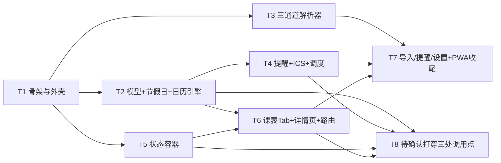

# 北邮课程表 · 任务分解（TASKS）

> 配套：`docs/ARCHITECTURE.md`（设计与契约以该文档为准）
> 排序原则：**先纯逻辑后 UI**（QA 可在 T4 结束时就对纯逻辑写测试），共 **8 个任务 / 25 个文件**（T8 为增量收口任务，不新增文件）。
> 执行纪律：T5 之前不写任何 DOM 代码；T2/T3/T4 三组可并行，谁先完谁先测。
>
> ⚠ **接口已按 team-lead 最终口径确定（2026-10 第 2 轮）**：`resolveDay(state,date) → Day`（带 `status/complete/notice`）、`getReminders(...) → ReminderPlan`（带 `pendingDates/warnings`）、`buildIcs(plan) → {text,warnings}`。旧的"`resolveDay` 返回数组"与 `collectReminderIssues` 均**作废**，详见 §5（T8）签名 diff。

---

## 1. 依赖总览

| 任务 | 名称 | 依赖 | 可并行 | 交付文件数 |
|---|---|---|---|---|
| T1 | 项目骨架与静态外壳 | — | — | 7 |
| T2 | 数据模型 + 节假日库 + 日历引擎（核心） | T1 | 与 T3 并行 | 4 |
| T3 | 三通道解析器 | T1 | 与 T2 并行 | 4 |
| T4 | 提醒点生成 + ICS 导出 + 调度器 | T2 | 与 T5 并行 | 3 |
| T5 | 状态容器（store） | T1 | 与 T4 并行 | 1 |
| T6 | 课表 Tab + 课程详情/调课页 + 路由 | T2, T5 | — | 3 |
| T7 | 导入 / 提醒 / 设置三 Tab + PWA 收尾 | T3, T4, T5, T6 | — | 3 |
| **T8** | **补班日"待确认"打穿三处调用点（增量收口）** | T2, T4, T5, T6 | 内部可 3 路并行 | 0（改既有文件） |



**并行分组**
- 第一波：`T1`（单人串行，必须最先完成，其他人 blocked）
- 第二波（3 人并行）：`T2` ‖ `T3` ‖ `T5`
- 第三波（2 人并行）：`T4`（依赖 T2）‖ 继续 `T3`/`T5` 收尾
- 第四波：`T6`（依赖 T2+T5）
- 第五波：`T7`（依赖 T3+T4+T6）

---

## 2. 任务明细

### T1 · 项目骨架与静态外壳 〔P0〕

**产出文件**
| 文件 | 内容要求 |
|---|---|
| `index.html` | `<meta name="viewport" content="width=device-width,initial-scale=1,viewport-fit=cover">`、`<link rel="manifest">`、`<meta name="theme-color">`、`<main id="view">`、`#tabbar` 四项、`#snackbar-host` `#sheet-host` `#dialog-host`、唯一 `<script type="module" src="./src/main.js">`。**0 个 http(s) 外链**（字体/图标/CSS 全本地） |
| `package.json` | 仅 `{"name":"bupt-schedule","private":true,"version":"1.0.0","type":"module","scripts":{"test":"node --test tests/*.test.mjs","start":"npx --yes serve . -l 5173"}}`，**无 dependencies** |
| `manifest.webmanifest` | `name/short_name:"北邮课程表"`、`start_url:"."`、`display:"standalone"`、`orientation:"portrait"`、`background_color:"#F5F7FA"`、`theme_color:"#0B6BCB"`、`icons:[192 any maskable, 512 any maskable]` |
| `sw.js` | `CACHE='bupt-v1'`；`install` 预缓存 12 条静态清单（html/css/js/icons/manifest）；`activate` 删旧 cache + `clients.claim()`；`fetch` 仅同源 GET → cache-first，`request.mode==='navigate'` 失败回落 `./index.html`；`notificationclick` → `clients.matchAll` 聚焦或 `clients.openWindow(data.url)` |
| `assets/css/app.css` | CSS 变量（`--brand:#0B6BCB; --brand-2:#12B76A; --bg:#F5F7FA; --surface:#fff; --text:#1A1A1A; --muted:#8A8F99; --line:#E6E9EF; --radius:16px; --tap:44px`）；底部 tabbar（`safe-area-inset-bottom`）；课表网格（`grid-template-columns:44px repeat(7,1fr)`）；`.class-block`；`.banner-warn/.banner-holiday/.banner-makeup`；`.snackbar`；`.sheet`（`transform` 上滑）；`.segmented`；`.empty`。**ColorOS 浅色风格、圆角 16px、触控 ≥44px** |
| `assets/icons/icon-192.png` `icon-512.png` | 纯色底 + 白色"课"字/日历图形；可先用脚本生成或提交占位 PNG（必须真实存在，否则 manifest 报错） |
| `src/model.js` | `SCHEMA_VERSION=1`、枚举、`uid()`、时间工具 `pad/todayStr/epochToDateStr/wallToEpoch/dayOfWeekOf/diffDays/addDays/weekNoOf`、周次工具 `expandWeeks/parseWeeksText/weeksToText`、`DEFAULT_PERIODS`（北邮 11 节参考值）、`emptyState()`、`validateState()`、`PALETTE`(10 色) |

**依赖**：无
**验收检查点**
1. `npx serve .` 打开无 404、无 Console 报错；DevTools Network 里**所有请求同源**（离线合规）。
2. `node -e "import('./src/model.js').then(m=>{console.log(m.expandWeeks({start:5,end:9,type:'all',extra:[1,3]}))})"` 输出 `[1,3,5,6,7,8,9]`。
3. `node -e "import('./src/model.js').then(m=>console.log(m.dayOfWeekOf('2026-03-05')))"` 输出 `4`（周四）。
4. `node -e "import('./src/model.js').then(m=>console.log(m.wallToEpoch('2026-03-05','08:00'), new Date(m.wallToEpoch('2026-03-05','08:00')).toISOString()))"` 输出 ISO `2026-03-05T00:00:00.000Z`（即 UTC+8 的 08:00）。
5. Lighthouse PWA 项：manifest 可解析、SW 可注册（可安装性通过）。

---

### T2 · 数据模型校验 + 节假日库 + 日历引擎（核心真相层）〔P0〕

**产出文件**
| 文件 | 内容要求 |
|---|---|
| `src/holidays.js` | `BUILTIN_2026`：**33 个放假日 + 6 个补班日**，数据源为国务院办公厅《关于 2026 年部分节假日安排的通知》（2025-11-04），已核实（见下表）；**6 个补班日 `followDayOfWeek` 一律 `null`**（禁止任何启发式配对）；每条带 `source:'builtin2026'` + `note` + `dataRevision`；`buildHolidayIndex(userHolidays)`（`Map<date, Holiday>`，用户同日覆盖内置）；`getHoliday(date,index)`；`listMakeupDays()`；`effectiveDayOfWeek(holiday, realDow, mode) → {dow:number\|null, kind:'follow'\|'skip'\|'unconfirmed'}`（只做三态翻译，status 由 `classifyDay` 组装） |
| `src/calendar.js` | **仅此文件允许做日期/周次/节假日判断**。实现 `classifyDay(state,date)`（★唯一分类点，出 `status` 7 值枚举 + `skipAll` + `effectiveDow`）、`resolveClasses(state,date)`（内部投影成 `ResolvedClass[]`，**禁止外部调用**）、`resolveDay(state,date) → Day`（出 `status/complete/notice/classes`，**UI 唯一入口**）、`resolveRange → Day[]`、`resolveCourseDates`（详情页用）、`getReminders → ReminderPlan`、`detectConflicts`。严格按 ARCHITECTURE §C.1 状态表 |
| `tests/calendar.test.mjs` | `node:test` 用例 ≥31 条，见下方"必须覆盖的用例"（含 30 判定优先级反例、31 NaN 防线） |
| `tests/holidays.test.mjs` | 内置数据完整性（无重复日期、日期格式合法、放假日合计 33、补班日合计 6、**`2026-01-04` 的 `followDayOfWeek===5` 且 `inferred===true`、其余 5 条补班日 `null`**）、关键日期星期断言（见下表） |

**已核实的 `BUILTIN_2026` 数据（照此录入，不要改）**

放假日 `type:'holiday'`（33 天）：
| 节日 | 日期区间 | 天 |
|---|---|---|
| 元旦 | `01-01`(四) `01-02`(五) `01-03`(六) | 3 |
| 春节 | `02-15`(日) ~ `02-23`(一) | 9 |
| 清明节 | `04-04`(六) ~ `04-06`(一) | 3 |
| 劳动节 | `05-01`(五) ~ `05-05`(二) | 5 |
| 端午节 | `06-19`(五) ~ `06-21`(日) | 3 |
| 中秋节 | `09-25`(五) ~ `09-27`(日) | 3 |
| 国庆节 | `10-01`(四) ~ `10-07`(三) | 7 |

调休上班日 `type:'makeupWorkday'`（6 天；**只有 `01-04` 是推定值 `followDayOfWeek:5`，其余 5 天为 `null`**）：
| 日期 | 星期 | 关联 | `followDayOfWeek` |
|---|---|---|---|
| `2026-01-04` | 日 | 元旦 | **`5`**（`inferred:true`，见下） |
| `2026-02-14` | 六 | 春节 | `null` |
| `2026-02-28` | 六 | 春节 | `null` |
| `2026-05-09` | 六 | 劳动节 | `null` |
| `2026-09-20` | **日** | 国庆 | `null` |
| `2026-10-10` | 六 | 国庆 | `null` |

> 数据源：国务院办公厅《关于 2026 年部分节假日安排的通知》（2025-11-04）。33 天与 6 天的**星期分布已用 `dayOfWeekOf` 纯算术逐条复算通过**，与通知原文一致；春节 9 天（不是 7 天）、清明/端午/中秋无调休上班日。注意 `2026-09-20` 与 `2026-01-04` 是**周日补班**，两条都要覆盖。
>
> **为什么只有 `01-04` 能推定**：元旦期间 01-01 是法定假日本身（不产生"被借用的工作日"），真正被借用的只有 `01-02`（周五）一天，而补班日也只有一个 `01-04` → 1:1 唯一解 → 补周五课，故写 `5` 并标 `inferred:true`（UI 显示"推定，请核对"）。春节（借用 02-16/02-20/02-23 三天 vs 补班 2 天）、劳动节、国庆（借用数 > 补班数）映射不唯一，**必须留 `null`**，不许猜。

**必须覆盖的单测用例（QA 会按此验收）**
1. `weekNoOf('2026-02-23','2026-02-23') === 1`（第 1 周周一）；`+7 天 === 2`。
2. 学期前 `weekNoOf('2026-02-16',...) === 0` → `resolveDay(...).classes` 为 `[]`、`status==='out_of_semester'`、`notice==='本学期尚未开始'`。
3. 单周 `{start:1,end:16,type:'odd'}`：第 3 周命中、第 4 周不命中。
4. 离散周次 `{start:5,end:9,type:'all',extra:[1,3]}`：第 1/3/5/9 周命中，第 2 周不命中。
5. 国庆 `2026-10-01` → `status==='holiday_silent'`、`classes.length===0`、`complete===true`；而 `skipOnHoliday=false` 时同一日期 → `status==='normal'` 且正常排课。
6. **补班日未确认（核心分支）**：state 用 `semesterStartMonday='2026-09-07'`、`totalWeeks=20`（`2026-10-10` 是**第 5 周**）；`2026-10-10`（周六，`followDayOfWeek===null`）→ `status==='makeup_unconfirmed'`、`complete===false`、`classes` 为空、`notice` 含"请确认"，且 **`effectiveDayOfWeek === null`**（不得用真实星期 6 兜底，否则 UI 会把补班日渲染成"周六课表"）。
7. **周日补班未确认**：同一份 state（`2026-09-07` 起点，`2026-09-20` 是**第 2 周**）；`2026-09-20`（周日）同上——覆盖"补班落在周日"分支。
8. **推定值生效**：⚠️ **必须换一份 state**——`2026-01-04` 属于上一学期，用 `semesterStartMonday='2025-09-01'`、`totalWeeks=20`（它是**第 18 周**）。断言 `status==='makeup_follow'`、`effectiveDayOfWeek===5`、返回**周五**课程。<br>反例防呆：若沿用 `'2026-09-07'` 起点，`01-04` 是第 **-7** 周 → 先落 `out_of_semester`，用例会以"状态不对"失败而根因是配置错。
9. 确认后：把 `2026-09-20` 的 `followDayOfWeek` 改为 `4` → `status==='makeup_follow'`、返回**周四**课程。
10. 明确不上课：`followDayOfWeek='none'` → `status==='makeup_skipped'`、`classes.length===0`、`complete===true`、**允许**显示"今日无课"。
10b. **批量确认**：`SET_MAKEUP_FOLLOW_BULK{none:true}` → 全部 `null` 补班日逐日变 `'none'`（`status==='makeup_skipped'`），生效后 `plan.pendingDates` 为空；`Holiday` 数组里每个日期各自有一条记录、**不存在**任何全局静默字段。
11. **`mode='skip'` 不豁免提示义务**：`followDayOfWeek===null` + `makeupWorkdayMode==='skip'` → 仍为 `status==='makeup_unconfirmed'`（**不是** `makeup_skipped`）。
12. `followDayOfWeek===5` + `mode==='skip'` → `status==='makeup_skipped'`、`effectiveDayOfWeek===5`（notice 里带"本应按周五"）。
13. `skipOnHoliday=false` 时国庆日 → `status==='normal'` 且按真实星期出课。
14. `cancel` 带 `targetSessionId` → 该课次消失，其他课不受影响。
15. `cancel` 只带 `courseId` → 该课程当日全部课次消失。
16. `roomChange` → `location` 变为新值、`original.location` 为旧值、`origin==='adjustment'`。
17. `reschedule` 只给 `startPeriod/endPeriod` → 时间按新节次解析。
18. `reschedule` 给 `startTime/endTime` → **自定义时间优先于节次**。
19. `makeup` 在无周期课的日子 → 新增 1 条 `origin==='adjustment'` 课次。
20. 同节次两门不同课 → 二者 `conflict===true` 且 `conflictWith` 互指。
21. **追加 `adjustment` 前后 `state.sessions` 深度相等**（证明只读不被污染）；`SET_MAKEUP_FOLLOW` 前后同样不变。
22. 跨零点课（`Period.end < Period.start`）→ `crossMidnight===true`，仍归属开始日。
23. `settings.semesterStartMonday === null` → `status==='unconfigured'`、`complete===false`，`resolveDay(...).classes` 为 `[]` 且不抛错。
24. `getReminders` **返回计划对象**：9/20–10/12 区间 → `plan.pendingDates` 含 `2026-09-20` 与 `2026-10-10`（或按 fixture 设定），`plan.warnings.length>=1`，`plan.skipped` 里有 `UNCONFIRMED_MAKEUP`；用户确认后该日期从 `pendingDates` 消失。
25. `plan.points` 提前量：课 08:00 + 全局 15 → `triggerAt` 的上海墙钟为 `07:45`。
26. 课程级 rule `advanceMinutes:30` 覆盖全局 15；`enabled:false` → 该课 0 点、其他课不受影响。
27. `makeup_unconfirmed` 日期 → `plan.points` 里 0 条（**即使该日存在 `makeup` adjustment**），且日期进 `pendingDates`。
28. 法定假期日 → 0 点且 `skipped` 含 `HOLIDAY`；同日期有显式 `makeup` adjustment（`forcedOnHoliday`）→ 有 1 点。
29. `cancel` 后的课次 → 0 点且 `skipped` 含 `CANCELLED`；`advanceMinutes:1440` → `triggerAt` 落前一天且不报错。
30. **判定优先级反例（学期外 > 补班三态）**：同一份 state 里把 `semesterStartMonday` 改成 `'2026-02-23'`（`2026-10-10` 变成第 33 周、超出 20 周）→ `resolveDay(state,'2026-10-10').status === 'out_of_semester'`（**不是** `makeup_unconfirmed`），且该日不进 `plan.pendingDates`。这条防的是"把学期后的补班日当未确认、整个寒暑假持续弹确认卡"。
31. **`totalWeeks` 非法的 NaN 防线**：把 `settings.totalWeeks` 设为 `undefined`（模拟备份恢复/手改 localStorage）→ `resolveDay` 必须返回 `status==='unconfigured'`、`complete===false`；**不得**因为 `weekNo > undefined` 得 `false` 而越过学期边界、把学期外日期算成 `normal`。

**依赖**：T1
**验收检查点**：`node --test tests/calendar.test.mjs tests/holidays.test.mjs` 全绿；`grep -nE "document|window|localStorage|navigator" src/calendar.js src/holidays.js` 零命中。

---

### T3 · 三通道解析器（企业微信 / 教务系统 / 通用文本 / JSON）〔P0〕

**产出文件**
| 文件 | 内容要求 |
|---|---|
| `src/parsers/html.js` | `parseHtmlLite(html)`（自研压平器：正则抽 `tr/td/div/br`，**必须处理 `rowspan/colspan` 占位**，输出 `{tables, cards, lines}`）；`parseJwgl(html)`（表头→星期、首列→节次、单元格按 `<br>` 拆行 + 类型标签法 + 多课切分）；`parseWecom(html)`（S1 内联 JSON → S2 table → S3 card → S4 text 四级降级）；共用 `tagLine()` / `splitMultiCourse()` |
| `src/parsers/index.js` | `parse(input,opts)` 统一入口、`detectSource(html)`、`parseText(text)`（F1/F2/F3 三种写法）、`normalize(parsed)`（同名课程合并成 `Course`、`endPeriod<startPeriod` 拦截、周次越界裁剪 + warning、`sourceRef` 补全）、`guessKind(input)` |
| `src/parsers/json.js` | `parseJson(raw)`：自身备份格式（`{schemaVersion,settings,courses,sessions,adjustments,holidays}`）直通；第三方抓包 JSON 字段模糊映射（`kcmc→name` 等）；`schemaVersion` 高版本 → 拒绝并给明确原因；低版本 → `migrate` 尝试 |
| `tests/parsers.test.mjs` | 用**内联 HTML 字符串 fixture**（不读外部文件，避免路径依赖）覆盖下表 |

**必须覆盖的用例**
1. `parseWeeksText` 8 种写法（`1-16周`、`第1-16周`、`1~16周`、`1-16周(单)`、`1-16周（双）`、`单周`、`1,3,5-9周`、`1-8,10-16周`、`3-15周(单),17周`）→ 断言 `WeekSpec` 精确值。
2. 教务网格 fixture（3 行 × 8 列，含 `rowspan=2` 的连堂课）→ 解析出正确 `dayOfWeek`（错位则失败）。
3. 单元格内两门课 `A\n王老师\n1-16周\n教三-101\nB\n李老师\n1-8周\n教四-201` → 拆成 2 条 session。
4. 企微卡片 fixture → `meta.strategy==='wecom:card'`，字段齐全。
5. 企微内联 JSON fixture → `meta.strategy==='wecom:json'`。
6. `detectSource` 三种页面各返回 `jwgl`/`wecom`/`unknown`。
7. 文本 F1 `周一 1-2节 高等数学 教三-101 王老师 1-16周` → 完整对象。
8. 文本 F3 `周一 08:00-09:35 高等数学 教三-101 1-16周` → 反查节次成功（`Period` 预设 08:00 起）。
9. 缺字段行 `周一 体育` → 进 `unrecognized`，`reason==='MISSING_PERIOD'`，且 `sessions` 不含它。
10. 空输入 / 无表格 HTML → `unrecognized[0].reason==='NO_COURSE_FOUND'`，不抛错（防白屏 E14）。
11. JSON `schemaVersion:99` → 拒绝并返回可读原因。
12. 同一课程名出现两次（不同节次）→ 只生成 1 个 `Course`、2 个 `CourseSession`。

**依赖**：T1
**验收检查点**：`node --test tests/parsers.test.mjs` 全绿；`grep -n "DOMParser" src/parsers/` 零命中（保证 Node 可测）。

---

### T4 · 提醒点生成 + ICS 导出 + 前台调度器 〔P0〕

**产出文件**
| 文件 | 内容要求 |
|---|---|
| `src/ics.js` | `buildIcs(plan, {calendarName, sequence}) → {text, warnings, eventCount}`：完整 `VCALENDAR` + `VTIMEZONE(Asia/Shanghai, STANDARD +0800)` + 每课次 `VEVENT`（稳定 UID `${courseId}-${YYYYMMDD}-P{start}-{end}@bupt_schedule`、`DTSTAMP` UTC 带 Z、`DTSTART/DTEND;TZID=Asia/Shanghai`、`SEQUENCE`、`CATEGORIES:bupt_schedule`）+ `VALARM(TRIGGER:-PT{n}M)`；`foldLine()` 按 **UTF-8 字节 75** 折叠且不切多字节字符；`escapeText()` 转义 `\ , ; \n`；全 CRLF。**`warnings` 由 `plan.pendingDates` 生成，只回给 UI，不写进文件正文** |
| `src/reminder.js` | **只做调度，不做计算**：消费 `calendar.js` 的 `getReminders`（返回 `ReminderPlan`，只用 `plan.points` 排程，`plan.warnings` 转发给 UI）。`diffPlan()`、`startScheduler/stopScheduler/replan/catchUp`（6h 窗口 + 60s TICK + `visibilitychange`/`focus` 重排 + 跨零点检测）、`requestPermission()`、`fireNotification()`（优先 `registration.showNotification`，降级 `new Notification`）。DOM 接触仅 `document.visibilityState` 与 `Notification`，通过注入 `ctx` 取用 |
| `tests/ics.test.mjs` | **仅 ICS 格式断言**（`getReminders` 的行为断言归 T2 的 `tests/calendar.test.mjs`） |

**必须覆盖的用例**
1. 输出以 `BEGIN:VCALENDAR\r\n` 开头、`END:VCALENDAR\r\n` 结尾，全串仅 `\r\n`（无裸 `\n`）。
2. 含 `BEGIN:VTIMEZONE` 且 `TZID:Asia/Shanghai`。
3. **不含** `/DTSTART:[0-9]{8}T[0-9]{6}Z/`（无裸 UTC DTSTART）。
4. `DTSTART;TZID=Asia/Shanghai:20260305T080000` 精确出现。
5. 每 VEVENT 含 1 个 `BEGIN:VALARM`，`TRIGGER:-PT15M`（提前量 30 时 `-PT30M`，0 时 `-PT0S`）。
6. 同一 state 连续两次 `buildIcs` → 所有 `UID` 完全一致（可复现）。
7. 长课程名（50 汉字）→ 每行字节数 ≤75 且中文未被截断（`Buffer.byteLength` 校验，逐行 join 后能还原原文）。
8. **待确认补班日不产出事件**：9/20–10/12 区间、`followDayOfWeek=null` → `result.eventCount` == `resolveRange` 中 `complete===true` 的课次数，且 `result.text` **不含** `20260920T` / `20261010T`；`result.warnings` 至少 1 条且提到"待确认"。
9. `result.warnings` 里的文本**不出现**在 `result.text` 中（告警只走 UI，不进 ICS 正文）。

**依赖**：T2
**验收检查点**：`node --test tests/ics.test.mjs` 全绿；把 `buildIcs` 输出存为 `.ics` 用系统日历/在线校验器导入，时间不偏移；在 9 月 20 日未确认的情况下导出，文件里没有 9/20 的事件。

---

### T5 · 状态容器（store）〔P0〕

**产出文件**
| 文件 | 内容要求 |
|---|---|
| `src/store.js` | `createStore()`：`getState()`、`subscribe(fn)→unsubscribe`、`dispatch(action)→{ok,errors}`、`persist()`（debounce 200ms、`try/catch` → `storageBroken`）、`load()`+`migrate()`、`importHistory`（保留最近 3 份 snapshot）、全部 action 见 ARCHITECTURE §E.4；`dispatch` 内**只做字段校验**（节次时间递增、`endPeriod>=startPeriod`、`advanceMinutes 0–1440`、`SET_MAKEUP_FOLLOW` 的 `follow` ∈ `1..7`/`'none'` 且目标日期必须已存在），**不做日期/周次判断**；不得 import `calendar.js`。`SET_MAKEUP_FOLLOW` 必须同时刷新该 `Holiday` 的 `updatedAt`（导出失效判定依赖它） |

**依赖**：T1
**验收检查点**
1. 在浏览器 Console：`store.dispatch({type:'SET_SEMESTER',semesterStartMonday:'2026-02-23',totalWeeks:20})` → `localStorage['bupt_schedule_v1']` 内容立即更新（200ms 内）。
2. 非法 dispatch（`SET_PERIOD` 使第 2 节 start 早于第 1 节 end）→ 返回 `{ok:false,errors:[...]}` 且 **不写入**。
3. 隐私模式（或手动 `localStorage.setItem = ()=>{throw ...}`）→ `state.storageBroken===true`，UI 顶部应能显示横幅（T7 接）。
4. `IMPORT_COMMIT` 后 `importHistory.length===1`；再导入 4 次 → 长度仍为 3（滚动淘汰）。
5. `grep -n "calendar" src/store.js` 零命中（依赖方向正确）。

---

### T6 · 课表 Tab + 课程详情/调课页 + 路由与启动〔P0〕

**产出文件**
| 文件 | 内容要求 |
|---|---|
| `src/ui/components.js` | `ICONS`（内联 SVG：课表/导入/铃铛/齿轮/箭头/加号/垃圾桶/撤销）、`snackbar(msg,{undo})`、`sheet(title,bodyHtml,onSubmit)`、`confirmDialog()`、`segmented()`、`emptyState()`、`escapeHtml()`、`banner(type,text,action)` |
| `src/ui/timetable.js` | `renderTimetable(container,state,uiState)`（周/日视图切换、周次切换器、今日概览+下一节课倒计时、**横幅文案统一取 `resolveDay(...).notice`**、**`makeup_unconfirmed` 确认卡 + 8 选 1 单选（周一…周日/不上课）+「全部未确认日都不上课」批量按钮**、现在进度线、课程块含"已调整"角标与冲突角标、空态）；`renderDetail(container,state,courseId,date)`（信息卡、四个调整操作、调整表单 sheet、5s 撤销 Snackbar、该课程发生日期列表、调整记录列表与删除） |
| `src/main.js` | 初始化 store → 注册 SW → hash 路由表（含 `#/detail/:courseId/:date` 参数解析）→ 全局事件委托（`data-action` 全表，见 ARCHITECTURE §E.3）→ 跨零点 `setInterval(60s)` → 首启引导（未配置学期 → 提示跳设置）→ 挂载 `startScheduler` |

**依赖**：T2, T5
**验收检查点**
1. 空数据首屏 → 显示空态 + "去导入课表"按钮，点击跳 `#/import`。
2. 手动写入示例数据后 → 周视图渲染 7 列 × 11 行网格，连堂课合并为跨行块，当前时刻有进度线，今天列高亮。
3. 周次左/右切换 → URL hash 不变但视图更新；"回到本周"可用。
4. 点课程块 → `#/detail/c1/2026-03-05` 显示"第1-2节 08:00-09:35 教三-201 第2周"。
5. 详情页点"改教室"→ 提交 `教四-105` → 返回课表：块上出现"已调整"，详情显示 `教三-201 → 教四-105`，Snackbar 5 秒内点撤销 → 完全还原。
6. `grep -nE "getDay\(|getUTCDay\(|% 2|weekNoOf" src/ui/` **零命中**（UI 不得自算日期，只能调 `resolveDay`）。
7. **待确认卡片**：把系统日期切到 `2026-09-20`（或临时改 `todayStr`）→ 主区域出现**确认占位卡**（**不是**"今日无课"），8 个单选项可用；点"周四"→ 卡片消失、变成"调休补班 · 按周四课表"并渲染当天课块。
8. **`complete` 纪律**：`status==='makeup_unconfirmed'` 时页面**不出现**"今日无课"字样（`grep` 代码：每处 `classes.length === 0` 前必须有 `day.complete` 判断）。
9. **推定值可见**：切到 `2026-01-04` → 横幅"调休补班 · 按周五课表"，并显示"推定值，请核对"角标；点角标可直达设置页改值。
9. 断网刷新 → 页面仍完整渲染（SW 缓存生效）。

---

### T7 · 导入 / 提醒 / 设置三 Tab + ColorOS 指引 + PWA 收尾〔P0〕

**产出文件**
| 文件 | 内容要求 |
|---|---|
| `src/ui/import.js` | 四通道 Segment（文本 / HTML / JSON / 账号直连灰显）；文本域 + `.html/.json` 文件选择（`FileReader`）；HTML 通道的来源下拉（自动判别结果回显"来源识别为：企业微信"）；解析预览表（**单元格可编辑**：课程名/星期/节次/地点/周次）；未识别行清单（高亮原文 + 缺失字段 + 忽略/补录）；警告条；确认/取消；导入历史回滚；"格式示例"折叠面板 + "一键填充示例数据"；账号直连说明弹层（**无任何账号密码输入框**） |
| `src/ui/reminderView.js` | 权限状态卡（已授予/已拒绝/未询问 + 申请按钮 + 被拒时的 ColorOS 开启路径图文）；通道降级横幅；**待确认补班日横幅（`plan.pendingDates` / `plan.warnings`，可点跳课表确认）**；全局提前量 chips（0/5/10/15/20/30/45/60 + 自定义）；课程级覆盖列表（增删）；**`.ics` 导出**（范围 all/next4weeks + **导出前 `plan.warnings` 非空则弹窗"N 个调休上班日未确认，本文件不含这些日期"→ 去确认 / 仍然导出** + 用 `result.text` 下载 + 展示 `result.warnings` + 已导出过则提示"先删除旧的北邮课程表事件"）；ColorOS 导入五步图文；今日提醒时间轴（`getReminders(today,today).points` 逐条列出 + 已触发打勾）；后台限制说明折叠面板 |
| `src/ui/settings.js` | 学期配置（日期 input + 周数 + 单双周开关，带"已从导入数据识别，请核对"提示）；节次时间表（可编辑表格 + 时间递增校验 + 增删节 + 恢复默认 + "参考值，请按本校区作息核对修改"提示）；节假日管理（内置 33 个放假日列表 + **6 个调休上班日逐一"按周几上课"选择器（未选=待确认，另有"不上课"选项）** + 自定义增删 + `skipOnHoliday` 开关 + `makeupWorkdayMode` 切换 + "数据可能已过时"提示条）；数据管理（导出备份 / 恢复[合并·覆盖] / 清空[二次确认]）；关于（版本 / 数据不上传声明 / 限制说明）；`storageBroken` 横幅 |

**依赖**：T3, T4, T5, T6
**验收检查点**
1. 文本通道粘贴 F1 示例 3 行 → 预览出 3 条，确认后课表 Tab 出现课程。
2. HTML 通道粘贴教务 fixture → 显示"来源识别为：教务系统"，未识别行清单可见。
3. 企微 fixture → 显示"来源识别为：企业微信"。
4. JSON 通道粘贴备份文件 → 摘要（课程数/调整数/学期起始日）+ 二次确认 → 恢复成功。
5. 提醒 Tab：点"申请通知权限"→ 浏览器弹权限框；拒绝后顶部出现降级横幅且 `.ics` 按钮置顶。
6. 点"导出日历"→ 下载 `bupt-schedule.ics`；文本检查含 `VTIMEZONE`/`TZID=Asia/Shanghai`/无裸 UTC；`settings.icsSequence` +1。
7. 今日时间轴条数与 `getReminders(today,today).points.length` 一致（不允许另算）；`plan.pendingDates` 非空时时间轴顶部出现"今日有 N 个待确认上课日"。
8. 设置页把第 2 节 start 改成 07:50（早于第 1 节 end 08:45）→ 阻止保存并提示。
9. 设置页恢复默认节次 → 全部 `isCustom:false`。
10. 节假日页开关 `skipOnHoliday` 关闭 → 课表 Tab 当天不再是"无课"。
11. **补班确认闭环**：设置页 6 个补班日初始显示"待确认"→ 给 `09-20` 选"周四"→ 提醒 Tab 横幅条数 -1 → 课表 Tab 9/20 出现周四的课。
12. **导出告警**：`09-20` 未确认时点导出 → 弹出"N 个调休上班日未确认"弹窗；点"仍然导出" → 文件里搜不到 `20260920T`；点"去确认" → 跳课表/设置对应位置。
13. `grep -rn "http://\|https://\|//cdn\|@import url" index.html assets/ src/` **零命中**（离线合规）。

---

## 3. 全局质量门（QA 会逐条跑）

> **QA 断言写法（避免按旧函数名写错）**：对外唯一日级入口是 `resolveDay(state, date)`，返回对象。**不存在 `resolveDaySummary`**（该名在三层合并时已被吸收）。断言请直接引用对象字段，不要用 `classes.length` 间接推断：
> ```js
> const day = resolveDay(state, '2026-10-10');
> assert.equal(day.status, 'makeup_unconfirmed');
> assert.equal(day.complete, false);        // ★ 直接引用，不做推断
> ```

> **门禁总则（2026-10 因一次误报事故确立）**：**门禁只允许"运行时断言"——必须 import 被测模块并校验其导出对象；禁止用 `grep`/`sed` 匹配源码结构（缩进、`Object.freeze({...})`、换行方式一变就瞎）来推断运行时属性。**
> 唯一例外是 **G17**：它本来就是文本层检查（查代码里有没有裸判 `classes.length`），不涉及运行时对象。其余全部（G14 / G16 等）一律运行时。
> 判断标准：**这条门禁会不会因为"代码写法变了但行为没变"而变红或变绿？** 会 → 它测的是源码形状，不是契约，必须改写。

| # | 门禁 | 命令/方法 |
|---|---|---|
| G1 | 全量单测 | `node --test tests/*.test.mjs` 全绿 |
| G2 | 纯逻辑无 DOM | `grep -nE "document|window|localStorage|navigator" src/model.js src/holidays.js src/calendar.js src/ics.js src/parsers/index.js src/parsers/html.js src/parsers/json.js` → 仅允许注释命中 |
| G3 | UI 不自算日期 | `grep -nE "getDay\(|getUTCDay\(|% ?2|weekNoOf|new Date\(" src/ui/` 零命中 |
| G4 | 零外链 | `grep -rnE "https?://" index.html assets/css/app.css src/` 零命中（`@bupt_schedule` 之类文本白名单除外） |
| G5 | ICS 合规 | 导出文件无 `/DTSTART:\d{8}T\d{6}Z/`、含 `BEGIN:VTIMEZONE`、行宽 ≤75 字节 |
| G6 | sessions 只读 | 单测断言：任何 `ADD_ADJUSTMENT` 前后 `JSON.stringify(state.sessions)` 不变 |
| G7 | 离线可用 | `serve` 起服务 → 访问一次 → DevTools 切 Offline → 刷新，页面正常 |
| G8 | 零依赖 | `package.json` 无 `dependencies`/`devDependencies` 字段或为空 |
| G9 | 真相函数不被绕过 | `grep -rn "resolveClasses(\|classifyDay(" src/ \| grep -v "src/calendar.js"` → 不存在裸调用（外部只能用 `resolveDay`） |
| G10 | `complete` 纪律 | 每处 `classes.length === 0` 之前必须有 `day.complete`（或 `status`）判据；`makeup_unconfirmed` 状态下页面**不得**出现"今日无课/休息"字样（**禁止输出"无课/休息"结论**）。**此门禁不过 = 不算交付**（P0-17 的成败点，team-lead 已明确） |
| G11 | 补班数据未被猜测 | 断言 `BUILTIN_2026`：放假日 33 条、补班日 6 条；仅 `2026-01-04` 有 `followDayOfWeek:5`（且 `inferred:true`），其余 5 条为 `null` |
| G12 | 计划对象未被当数组用 | `grep -rn "const points = getReminders" src/` 零命中（必须解构 `{points, pendingDates, warnings}`） |
| G13 | 导出告警未被吞 | `buildIcs` 调用点必须读 `result.text` 与 `result.warnings`；文件正文内不含告警文案 |
| G14 | NOTICE 键集合与值类型（**运行时**） | 见下方「G14 参考脚本」：导入后断言 `Object.keys(NOTICE)` 与冻结 7 值**集合相等**，且每个值 `typeof === 'function'`。漏键 ⇒ `NOTICE[status]` 为 `undefined` ⇒ `notice` 调用 TypeError 崩页；值非函数同样崩。**禁止用 grep/sed 推断源码结构**（历史事故：`sed + grep '^  key:'` 对 `Object.freeze({...})` 写法误报"7 键全缺失"，而运行时 7/7 全绿 —— 一个会误报的门禁比没有门禁更糟，它训练人忽略红灯） |
| G15 | 未确认态 fail-closed | `day.status==='makeup_unconfirmed'` 时 `effectiveDayOfWeek === null` 且 `complete === false`；**不得**用真实星期兜底（否则 UI 会把补班日渲染成"周六课表"） |
| G16 | **`Day` 运行时形状断言** | 一次钉死"未知 vs 确定没课"三个样本：`2026-10-10`（未确认）与 `2026-09-20`（**周日**补班，未确认）→ `status==='makeup_unconfirmed'`、`complete===false`、`effectiveDayOfWeek===null`、`classes` 为 `[]`；`2026-10-01` → `status==='holiday_silent'`、`complete===true`、`classes` 为 `[]`（**允许** UI 下"无课"结论）。同时断言 9 字段齐全（`date/weekNo/status/complete/notice/holidayName/followDayOfWeek/effectiveDayOfWeek/classes`）、`status` ∈ 冻结 7 值、`Array.isArray(day.classes)`、`typeof day.complete==='boolean'`。<br>**这条门禁必须能对旧契约实跑吐 `BAD`**（当前实跑：9 字段全缺 → `BAD`），T8 后吐 `OK`；**吐不出 `BAD` 的断言不算门禁**（空转脚本比没有脚本更危险） |
| G17 | **UI 层 `classes.length` 裸判反向门禁** | `grep -rn "classes\.length *=== *0\|\.classes\.length\b" src/ --include=*.js \| grep -v calendar.js`，**每处命中同行或相邻行必须有 `complete`**，裸判即不合规。注意**不要求零命中**——UI 合法地需要判"今天没课"，正确写法是 `if (day.complete && day.classes.length === 0)`。本门禁抓的是改名后最阴的残留：`if (!classes.length)` 对 `undefined` 取 `.length`，grep 干净但运行时抛错 |

| G18 | **文案可读性（运行时，7 状态全覆盖）** | 见下方「G18 参考脚本」：用**真实 state** 跑出 7 种 status 的 `Day`（不许手写假对象），先断言 `status` 等于预期（否则样本没走到目标分支、断言会平凡通过），再断言 `notice`：`string\|null`、不含 `undefined`/`null`/`NaN`/`[object`/连续空白；`normal` **严格** `null`；`makeup_unconfirmed` 必须含"日期+（周X）"，`makeup_follow` 必须含"周X"。<br>**补的是 G14/G16 的盲区**：字段名漂移（`effectiveDow` vs `effectiveDayOfWeek`）不会让键集/形状断言变红，只会让用户看到"按周undefined课表"。<br>**原则：断言"该有的在"，不只断言"不该有的不在"** —— 文案漏拼日期时字符串同样干净，但信息已缺失 |
> **验收顺序（硬约束）**：**T8 验收通过是 UI 验收的前置条件**。PRD 是目标态、`src/` 可能仍是旧态；QA 若提前按 PRD 点 UI，会把"尚未落地"误判成"实现缺失"，白耗一轮排查。

**G14 参考脚本**（存成 `.gate-notice.mjs` 后 `node .gate-notice.mjs`）。退出码与 G16 同规范：**0 PASS / 1 键集或值类型不符 / 2 门禁自身故障（模块加载不进来）**：

```js
const ST = ['normal','holiday_silent','makeup_unconfirmed','makeup_skipped','makeup_follow','out_of_semester','unconfigured'];

let C;
try {
  C = await import('./src/calendar.js');
} catch (e) {
  console.log('GATE14: BROKEN');
  console.log('  load-failed: ' + (e && e.message));
  process.exit(2);
}

const N = C.NOTICE;
if (!N || typeof N !== 'object') {
  console.log('GATE14: FAIL');
  console.log('  NOTICE-not-exported（契约要求导出 NOTICE，便于门禁运行时校验）');
  process.exit(1);
}

const got = Object.keys(N).sort();
const want = [...ST].sort();
const missKeys = want.filter(k => !got.includes(k));      // 漏键 → 运行时 TypeError 崩页
const extraKeys = got.filter(k => !want.includes(k));     // 多键 → 冻结集合被破坏
const notFn = got.filter(k => typeof N[k] !== 'function'); // 键对值废 → 同样崩

const bad = missKeys.length + extraKeys.length + notFn.length;
console.log(bad ? 'GATE14: FAIL' : 'GATE14: PASS');
console.log(bad
  ? '  missing=' + JSON.stringify(missKeys) + ' ; extra=' + JSON.stringify(extraKeys) + ' ; notFunction=' + JSON.stringify(notFn)
  : '  ' + got.length + ' keys, all functions');
process.exitCode = bad ? 1 : 0;
```

**四种情形都跑过**：正常 → `PASS`/0；桩缺一个键 → `FAIL`/1 且 `missing` 精确指出；桩把某值写成 `undefined` → `FAIL`/1 且 `notFunction` 指出（键集 diff 查不到这一种）；模块路径错 → `BROKEN`/2。

**G18 参考脚本**（存成 `.gate-copy.mjs` 后 `node .gate-copy.mjs`），退出码同规范：**0 PASS / 1 文案或状态不符 / 2 门禁自身故障**。

> 设计要点：**样本必须用真实 `state` 跑出来，不许手写假 `Day` 对象**。手写的对象字段名是人填的，会掩盖"实现里字段名不对"的问题——那就白测了。
> 还要先断言 `day.status` 等于预期：否则样本没走到目标分支，`notice` 断言会**平凡通过**（测了个寂寞）。

```js
let C, M;
try {
  [C, M] = await Promise.all([import('./src/calendar.js'), import('./src/model.js')]);
} catch (e) {
  console.log('GATE18: BROKEN');
  console.log('  load-failed: ' + (e && e.message));
  process.exit(2);
}

// 用真实 state 构造 7 种 status 的样本（补班日靠注入 user holiday，不手写 Day）
const base = (over = {}) => {
  const st = M.emptyState();
  st.settings.semesterStartMonday = over.start === undefined ? '2026-09-07' : over.start;
  st.settings.totalWeeks = 20;
  st.settings.makeupWorkdayMode = over.mode || 'followWeekday';
  st.holidays = over.holidays || [];
  return st;
};
const makeup = (date, follow) => ({ date, name: '测试调休上班', type: 'makeupWorkday',
                                    followDayOfWeek: follow, source: 'manual' });

const cases = [
  ['normal',             base(),                                        '2026-09-08'],
  ['holiday_silent',     base(),                                        '2026-10-01'],
  ['makeup_unconfirmed', base(),                                        '2026-10-10'],
  ['makeup_follow',      base({ holidays: [makeup('2026-09-13', 5)] }), '2026-09-13'],
  ['makeup_skipped',     base({ holidays: [makeup('2026-09-19', 'none')] }), '2026-09-19'],
  ['makeup_skipped',     base({ mode: 'skip', holidays: [makeup('2026-09-26', 5)] }), '2026-09-26'],
  ['out_of_semester',    base(),                                        '2027-03-01'],
  ['unconfigured',       base({ start: null }),                         '2026-09-08']
];

const DROSS = /undefined|null|NaN|\[object/;   // 脏值
const bad = [];
for (const [wantStatus, st, date] of cases) {
  const day = C.resolveDay(st, date);
  const tag = wantStatus + '@' + date;
  if (day.status !== wantStatus) { bad.push(tag + ' → status=' + day.status + '（样本没走到目标分支，断言会平凡通过）'); continue; }

  const n = day.notice;
  if (wantStatus === 'normal') {
    if (n !== null) bad.push(tag + ' → notice 应为严格 null，得到 ' + JSON.stringify(n));
    continue;
  }
  if (typeof n !== 'string') { bad.push(tag + ' → notice 不是 string 也不是 null：' + typeof n); continue; }
  if (DROSS.test(n))          bad.push(tag + ' → 文案含脏值：' + n);
  if (/\s{2,}/.test(n))       bad.push(tag + ' → 文案含连续空白：' + JSON.stringify(n));

  // ★ 断言"该有的在"，不只断言"不该有的不在"
  if (wantStatus === 'makeup_unconfirmed' && !(/\d{1,2}/.test(n) && /（周[一二三四五六日]）/.test(n)))
    bad.push(tag + ' → 文案缺少"日期+星期"，可能是忘了把 date 传进 NOTICE：' + n);
  if (wantStatus === 'makeup_follow' && !/周[一二三四五六日]/.test(n))
    bad.push(tag + ' → 文案缺少"周X"，effectiveDayOfWeek 可能没传到：' + n);
  if (wantStatus === 'makeup_skipped' && !/调休上班日/.test(n))
    bad.push(tag + ' → 文案缺少主语：' + n);
}

console.log(bad.length ? 'GATE18: FAIL' : 'GATE18: PASS');
console.log(bad.length ? '  ' + bad.join('\n  ') : '  ' + cases.length + ' 样本，文案与状态全部符合');
process.exitCode = bad.length ? 1 : 0;
```

**覆盖的 status**：`normal` / `holiday_silent` / `makeup_unconfirmed` / `makeup_follow` / `makeup_skipped`（两种来源各一）/ `out_of_semester` / `unconfigured` —— 7 种全覆盖，均已实跑。

**G16 参考脚本**（存成 `.gate-shape.mjs` 后 `node .gate-shape.mjs`）。**四情形已实跑**：符合契约 → `GATE16: PASS`(exit 0)；缺字段 → `FAIL`(exit 1)；`resolveDay` 抛错 → `FAIL`(exit 1) + 抛错位置；模块加载不进来 → `BROKEN`(exit 2)。既证明它会失败，也证明它不会误报：

```js
const need = ['date','weekNo','status','complete','notice','holidayName','followDayOfWeek','effectiveDayOfWeek','classes'];
const ST = ['normal','holiday_silent','makeup_unconfirmed','makeup_skipped','makeup_follow','out_of_semester','unconfigured'];

// ★ 退出码三态：0 = PASS / 1 = 契约不符（含 resolveDay 抛错）/ 2 = 门禁自身故障（模块根本加载不进来）
//   2 严格只用于"连模块都没进来"：那种情况门禁失去了被测对象，它的红不代表契约有问题。
//   resolveDay 抛错属于"被测实现违约"，必须记 1，否则会被误判成"门禁坏了"而放过真实缺陷。
let C, M;
try {
  [C, M] = await Promise.all([import('./src/calendar.js'), import('./src/model.js')]);
} catch (e) {
  console.log('GATE16: BROKEN');
  console.log('  load-failed: ' + (e && e.message));
  process.exit(2);
}

const st = M.emptyState();
// ★ 必须用秋季学期起点：10-01 / 10-10 / 09-20 在 2026 秋季学期内（第 4 / 5 / 2 周）；
//   若用 '2026-02-23' 起 20 周，这三个日期是第 32 / 33 / 30 周 → 全落 out_of_semester，门禁测的是错误分支。
// ★ 判定顺序（见 §C.1）：unconfigured(1) → out_of_semester(2) → holiday_silent(3) → 补班三态(4) → normal(5)。
//   即 out_of_semester 优先于补班三态：学期结束后的补班日不得弹确认卡。本脚本只测学期内样本，
//   该优先级由 T2 用例 30 另测（'2026-02-23' 起点下 2026-10-10 应为 out_of_semester）。
st.settings.semesterStartMonday = '2026-09-07';
st.settings.totalWeeks = 20;

let d1020, d0920, d1001;
try {
  d1020 = C.resolveDay(st, '2026-10-10');   // 周六补班，未确认，第 5 周
  d0920 = C.resolveDay(st, '2026-09-20');   // 周日补班，未确认，第 2 周
  d1001 = C.resolveDay(st, '2026-10-01');   // 国庆，静默，第 4 周
} catch (e) {
  console.log('GATE16: FAIL');
  console.log('  threw=' + (e && e.message) + ' @ ' + String((e && e.stack) || '').split('\n')[1].trim());
  process.exit(1);
}

const miss = need.filter(k => !(k in Object(d1020)));
const unconfirmed = (d) => d.status === 'makeup_unconfirmed' && d.complete === false
                        && d.effectiveDayOfWeek === null && Array.isArray(d.classes) && d.classes.length === 0;
const checks = {
  '9 字段齐全': miss.length === 0,
  'status ∈ 冻结 7 值': ST.includes(d1020.status),
  'classes 是数组': Array.isArray(d1020.classes),
  'complete 是布尔': typeof d1020.complete === 'boolean',
  '2026-10-10 未确认': unconfirmed(d1020),
  '2026-09-20 未确认（周日补班）': unconfirmed(d0920),
  '2026-10-01 静默假期且可下"无课"结论': d1001.status === 'holiday_silent'
      && d1001.complete === true && Array.isArray(d1001.classes) && d1001.classes.length === 0
};
const bad = Object.entries(checks).filter(([, ok]) => !ok).map(([k]) => k);

// 第一行机器可读（供脚本/CI 解析），第二行人类可读明细
console.log(bad.length ? 'GATE16: FAIL' : 'GATE16: PASS');
console.log(bad.length
  ? '  failed=' + bad.join(' | ') + ' ; missing=' + JSON.stringify(miss) + ' ; got.status=' + d1020.status
  : '  ' + Object.keys(checks).length + ' checks passed');
process.exitCode = bad.length ? 1 : 0;

```


---

## 4. 工程师最容易实现错的 3 个点（务必自查）

1. **时区：`new Date('2026-03-05T08:00')` 会按设备时区解析。**
   手机若不是 `Asia/Shanghai`（或系统开了"自动时区"漂移），课表整体偏移。所有"日期+时刻 → 时间戳"必须只走 `model.js` 的 `wallToEpoch(dateStr,hhmm)`（`Date.UTC(...) - 8h`）；`.ics` 里 `DTSTAMP` 用 UTC 带 `Z`、`DTSTART/DTEND` 用 `TZID=Asia/Shanghai` 不带 `Z`，两者**写反就是整体偏 8 小时**且真机上很难立刻发现。

2. **`dayOfWeek` 的 1-based / 0-based 混用，以及 `effectiveDayOfWeek` 用错位置。**
   内部一律 **周一=1 … 周日=7**（`dayOfWeekOf` 已把 `getUTCDay()` 的 0 翻成 7）。调休补班的 `followDayOfWeek` **只能**用于过滤 `CourseSession.dayOfWeek`，**绝不能**参与 `weekNo` 计算（`weekNo` 永远基于 `dateStr` 与 `semesterStartMonday` 的整数天差：`Math.floor(diffDays(start,date)/7)+1`，`diffDays` 必须 `Math.round`）。把 `effectiveDow` 也喂给 `weekNoOf` 是典型翻车点。

3. **`CourseSession` 只读 + `Adjustment` 只在 `resolveClasses` 里投影。**
   最容易犯的两种写法：①"停课"直接 `state.sessions.splice(...)` 或删 `adjustment` 同时改 session；②把 `roomChange` 直接写回 `session.location`。后果：撤销无法还原、同一课程其他周次被污染、跨周次串味。正确姿势：`dispatch` 只 append/remove `adjustments` 数组，`resolveClasses` 每次从 `sessions` 现算投影，`original` 字段只用于 UI 对照。

> 附加提醒（非前三但同样常见）：`parseHtmlLite` 处理 `rowspan/colspan` 时不做占位记账 → 从第 3 行起整列左移，解析出的星期全错但**不报错**，属于"静默错误"，必须靠 T3 用例 2 的 fixture 拦住。

> **第 4 个坑（本轮新增契约，杀伤力最大）：把 `makeup_unconfirmed` 当成"无课"。**
> 补班日 `followDayOfWeek === null` 时，`resolveClasses` 返回空数组——**这个空数组不表示"没课"，表示"不知道有没有课"**。如果 UI 写成 `if (classes.length === 0) 显示"今日无课"`，学生国庆后的补班日就会被 App 明确告知"今天没课"，然后缺课，而且他不会怀疑是 App 错了。
> 三条硬性写法：① UI 只能按 `resolveDay(...).status` 分支，且必须先判 `.complete`；② 横幅文案只能取 `.notice`，不许各页面自己拼；③ 提醒与 `.ics` 必须消费 `plan.pendingDates` / `plan.warnings`，把"N 个待确认日"显式告警出来——**沉默地少导出一天，比报错更危险**。

---

## 5. T8 · 补班日"待确认"打穿三处调用点（增量任务）〔P0〕

> 目的：把 `resolveDay().status` / `getReminders().pendingDates` / `buildIcs().warnings` 三条链路真正打通，确保 `followDayOfWeek = null` 的补班日**在任何界面都不会被渲染成"今日无课"**。核心逻辑在 T2/T4 已具备，T8 是"接线 + 收口 + 回归"任务。

**触发场景（必须能复现）**：`2026-10-10`（周六，`followDayOfWeek:null`）与 `2026-09-20`（周日，`null`）；`2026-01-04`（`5`，推定）作为对照。

### 5.1 函数签名 diff

> 类型名**全库统一为 `Day`**（文档、类图、JSDoc、`@returns`、类型别名一律同此名）。历史上曾用「`Resolved-` + `Day`」的同义名，已废弃，**grep 该组合必须零命中**——同义名会让下一个人以为是两个类型。`Day.classes` 仍是 `ResolvedClass[]`。

| 函数 | 旧（作废） | 新（实现此版） |
|---|---|---|
| `classifyDay(state,date)` | 无 | `→ { weekNo, realDow, effectiveDow, status, skipAll, holidayName, followDayOfWeek }` |
| `resolveClasses(state,date)` | `resolveDay(state,date) → ResolvedClass[]` | `→ ResolvedClass[]`（**内部投影**，外部禁止调，G9） |
| **`resolveDay(state,date)`** | `→ ResolvedClass[]` | **`→ Day { date, weekNo, status, complete, notice, holidayName, followDayOfWeek, effectiveDayOfWeek, classes }`** |
| `resolveRange(state,from,to)` | `→ ResolvedClass[]` | `→ Day[]`（周视图要按日取 `status`） |
| **`getReminders(state,from,to)`** | `→ ReminderPoint[]` | **`→ ReminderPlan { points, pendingDates, skipped[], warnings[] }`** |
| `collectReminderIssues(...)` | 独立导出函数 | **删除**（职责并入 `plan.pendingDates` / `plan.skipped` / `plan.warnings`） |
| **`buildIcs(points,opts)`** | `→ string` | **`buildIcs(plan,{calendarName,sequence}) → { text, warnings, eventCount }`** |
| `effectiveDayOfWeek(hol,realDow,mode)` | `→ {dow,kind:'follow'\|'skip'\|'unconfirmed'}` | 增加 `kind:'skipWithHint'`（`1..7` + `mode='skip'`，用于 `notice` 提示"本应按周X"） |

### 5.2 调用点适配清单

| # | 位置 | 改法 | 不改的后果 |
|---|---|---|---|
| A1 | `ui/timetable.js` 今日/周视图 | `const day = resolveDay(state, d)` → 按 `day.status` 分支；`day.complete` 判完才允许"今日无课"；文案取 `day.notice` | 补班日显示"今日无课" → 学生缺课（本任务的核心缺陷） |
| A2 | `ui/timetable.js` 确认卡 | 新增 `status==='makeup_unconfirmed'` 分支：主区域占位卡 + 8 选 1（`data-action="makeup-follow"`），写回 `SET_MAKEUP_FOLLOW` | 提示条无处落地，P0-17 等于没做 |
| A3 | `ui/timetable.js` 周视图 | `resolveRange` 返回 `Day[]`，周顶部汇总"本周 N 个待确认" | 只看今天会漏掉本周四的补班日 |
| A4 | `ui/reminderView.js` 时间轴 | `const {points, pendingDates} = getReminders(today,today)`；`pendingDates.length` → 顶部横幅 | 时间轴空白，用户以为没课 |
| A5 | `ui/reminderView.js` 导出 | `const plan = getReminders(from,to)`；`plan.warnings.length` → 弹窗（去确认 / 仍然导出）；`result.text` 下载、`result.warnings` 展示 | 静默导出缺一天 |
| A6 | `reminder.js` 调度器 | `const plan = getReminders(...); plan.points` 排程；`pendingDates` 透传 UI | 排程把对象当数组用 → 运行时崩 |
| A7 | `store.js` | 新增 `SET_MAKEUP_FOLLOW{date,follow}`（`1..7`/`'none'`），刷新 `Holiday.updatedAt` | `.ics` 已过期判定失效 |
| A8 | `ui/settings.js` | 6 行补班日选择器（未选=待确认）；`01-04` 显示"推定，请核对" | 用户无法修正推定值 |

### 5.3 验收标准（逐条可执行）

1. **课表页**：把 `todayStr` 指向 `2026-10-10` → 出现**确认占位卡**（8 选 1），页面任意位置**不出现**"今日无课"字样。
2. **确认闭环**：卡片选"周四" → `dispatch(SET_MAKEUP_FOLLOW)` → 卡片消失、横幅变为"调休补班 · 按周四课表"、当天渲染周四课块；刷新页面后保持。
3. **`.ics` 排除 + 告警**：`2026-09-20`、`2026-10-10` 未确认时导出（范围 all）→ 先弹"N 个调休上班日待确认，本文件不含这些日期"；点"仍然导出"后，`result.text` 里 `grep 20260920T` 与 `grep 20261010T` **均为 0 命中**，`result.warnings.length ≥ 1`。
4. **提醒不静默**：`getReminders('2026-09-19','2026-10-12')` → `pendingDates` 含这两个日期、`warnings` 非空、`points` 中不含这两天的任何点；确认其中一个后该日期从 `pendingDates` 消失。
5. **推定值**：`2026-01-04`（state 用 `semesterStartMonday='2025-09-01'`，第 18 周）→ `status==='makeup_follow'`、`effectiveDayOfWeek===5`、页面显示"按周五课表"+"推定，请核对"。
6. **`'none'` 不受影响**：把某补班日设为 `'none'` → `status==='makeup_skipped'`、`complete===true`、页面**允许**显示"今日无课"、不进 `pendingDates`。
7. **门禁通过**：G9（无裸调 `resolveClasses`/`classifyDay`）、G10（`complete` 判据齐全）、G11（`01-04=5` 且 `inferred`，其余 5 条 `null`）、G12（无 `const points = getReminders`）、G13（导出告警未被吞）、G14（`NOTICE` 键集合与 7 值 diff 为空）、G15（未确认态 `effectiveDayOfWeek===null` 且 `complete===false`）。
8. **回归**：`node --test tests/*.test.mjs` 全绿（T2 ≥29 条、T4 ≥9 条）。

**依赖**：T2, T4, T6（`ui/timetable.js`）、T5（store action）
**可并行**：A1/A2/A3（课表侧）、A4/A5（提醒侧）、A8（设置侧）可三人并行，A6/A7 是前置。
**优先级**：P0（缺课风险）
